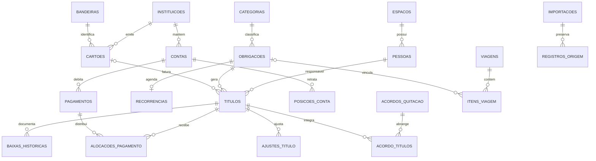

# Arquitetura do Sistema de Controle Financeiro

**Fonte:** `NovaPlanilhaDividas2.xlsx` · **Data da análise:** 09/11/2026 · **Idioma:** Português do Brasil.

## 1. Objetivo, método e limites

Modernizar o controle familiar de obrigações, parcelamentos, pagamentos, contas bancárias, cartões e despesas recorrentes com React, ASP.NET Core Web API, EF Core e PostgreSQL. A solução proposta é um monólito modular com Clean Architecture: implantação simples, transações consistentes e possibilidade de separar módulos quando houver demanda comprovada.

A análise leu o conteúdo OOXML do Excel em modo somente leitura: todas as 14 abas, inclusive ocultas, células preenchidas, cabeçalhos, fórmulas, resultados armazenados, formatos numéricos, mesclagens e amostras dos comentários. Não houve execução do Excel nem recálculo das fórmulas. Resultados em cache podem estar desatualizados, sobretudo os dependentes de `TODAY()`. Dimensão de aba não equivale à quantidade de registros: inclui formatação, cabeçalhos e resumos.

SHA-256 da origem: `7d386946d6753f4bd8ddc0b823800722e6f46f6db40e77ceeacf9b008b20d500`.

Este documento distingue **evidências observadas** de **decisões propostas**. Não implementa o sistema, não importa os dados e não altera a planilha. Autenticação, histórico de movimentos, estornos e receitas são extensões arquiteturais; a planilha não contém um livro-caixa completo nem informações suficientes para reconstruí-lo.

## 2. Inventário da planilha

| Aba exata | Visibilidade | Dimensão | Células com valor/fórmula | Fórmulas | Papel |
|---|---|---|---:|---:|---|
| 2024 | Oculta | A1:AY142 | 4.976 | 1.368 | Controle mensal histórico |
| 2025 | Oculta | A1:AY153 | 5.373 | 1.519 | Controle mensal histórico |
| 2026 | Visível | A1:AY161 | 5.672 | 1.632 | Controle mensal atual |
| 2027 | Visível | A1:AY160 | 5.530 | 1.620 | Controle mensal futuro; confirmar se é previsão ou cópia |
| Controle Pagamentos - 2026 | Visível | A1:CB36 | 1.652 | 691 | Detalhamento mensal de parcelas |
| CP - 2026 - Antecipação de Parc | Visível | A1:CD43 | 1.746 | 775 | Variante com quitação antecipada |
| CP - 2026 - BKP | Oculta | A1:CB52 | 2.322 | 987 | Backup; não somar ao controle principal |
| Controle Pagamentos - 2025 | Oculta | A1:CB48 | 2.025 | 795 | Parcelas históricas |
| Controle Pagamentos - 2024 | Oculta | A1:CB45 | 2.834 | 1.089 | Parcelas históricas |
| Contas Bancarias | Visível | A1:K25 | 213 | 25 | Cadastro e posição de saldos |
| Cartoes de Credito | Visível | A1:J33 | 307 | 5 | Cadastro e limites de cartões |
| Streaming e Serviços | Visível | A1:F48 | 225 | 36 | Despesas recorrentes |
| Dividas de Casa | Visível | A1:F36 | 82 | 33 | Despesas domésticas recorrentes |
| Passeio - Chile | Oculta | A1:K23 | 101 | 29 | Orçamento de viagem e valores em moedas diferentes |

Não foram encontrados objetos de tabela estruturada nem gráficos no pacote. As abas não possuem regras OOXML de validação de dados. Foram encontrados quatro arquivos de comentários, com 49, 39, 49 e 49 comentários, totalizando 186; amostras incluem anotações antigas sobre compras. Esses textos são contexto, não lançamentos financeiros automaticamente válidos. Não foram encontradas células de tipo erro armazenado; isso não comprova a correção das fórmulas.

## 3. Estrutura e regras observadas

### 3.1. Abas anuais 2024–2027

A linha 3 informa meses, a linha 4 contém o cabeçalho inicial e há cabeçalhos repetidos entre seções. As colunas A–C são descrição da dívida, dia de vencimento e limite de crédito. D–AY repetem quatro campos por mês. Seções representam grupos como dívidas familiares, telefonia, financiamentos, contas pessoais, gastos domésticos, faturas de cartões e serviços. Os nomes de responsáveis aparecem na coluna chamada “Pagamento”. Linhas de subtotal por pessoa e totais finais não são dívidas.

**Divergência semântica:** `2026!E7 = IF(G7="P",0,D7)`. Apesar do título “Valor Pago”, E7 representa pendência nessa fórmula. Há seções intituladas “Qto. Pagarei”, que podem ter interpretação de planejamento. Não mapear o nome do cabeçalho isoladamente: classificar cada célula conforme fórmula, status e contexto. A interpretação de `P` como pago é fortemente sugerida pelo comportamento da fórmula, mas deve constar da homologação de migração. Status vazio não comprova atraso ou pagamento.

### 3.2. Controles de parcelas

A–D: descrição, “Data Compra”, quantidade de parcelas e vencimento. Depois há doze blocos mensais de seis campos: número da parcela, valor, faltante, pago, responsável e status. Em `Controle Pagamentos - 2026!G5`, `IF(J5="Pago",0,F5)` calcula faltante; H5 usa `IF(J5="Pago",F5,0)` para pago. Essa regra original é binária e não registra pagamentos parciais, juros, descontos ou data efetiva do pagamento.

“Data Compra” é heterogênea: B5 da aba de 2026 contém `10`, enquanto B30 da aba de antecipação contém serial de data com formato de data. Não converter todo número dessa coluna em data Excel: `10` não comprova uma compra em janeiro de 1900. Quantidade 12 em obrigações domésticas pode representar os meses exibidos, não o prazo integral de um financiamento.

Na aba de antecipação, abril tem oito campos: W–AD, incluindo **AA = Valor Quitação** e **AB = Quitação Pago**. Maio passa a AE–AJ; um leitor com deslocamento fixo de seis colunas falharia. Totais ficam em CB–CD. A existência dessa aba não comprova que as antecipações foram efetivadas; é uma fonte concorrente a reconciliar.

### 3.3. Limites, recorrência e viagem

Em contas, K calcula `J-I`, ou limite de cheque especial menos saldo negativo informado. Saldo, poupança e saldo negativo são campos independentes na origem: não deduzir automaticamente o sinal de um a partir do outro. Limite de crédito não é caixa disponível próprio.

Serviços e casa compartilham cabeçalhos; “Tipo de Pagamento” contém Mensal, Anual ou Trimestral e representa **periodicidade**, não meio de pagamento. A fórmula de renovação `IF(E4 > 0, DATE(YEAR(TODAY()), MONTH(TODAY()), E4), "")` gera data do mês corrente. Não calcula corretamente, por si só, o próximo ciclo anual ou trimestral, nem garante uma data futura.

Viagem mistura BRL, peso chileno e dólar sem convenção explícita da cotação. Em `Passeio - Chile!G3`, a fórmula é `E3+F3`, apesar do título de conversão para pesos: soma não comprova conversão cambial válida. K5 tem saldo negativo armazenado de -6; tratar como divergência/crédito a investigar, sem apagar o excedente.

### 3.4. Inconsistências e decisões de tratamento

| Evidência | Consequência | Tratamento proposto |
|---|---|---|
| `Cartoes de Credito!E33:I33` somam linhas 3–29, mas existem cartões nas linhas 30–31 | Totais não abrangem todos os cadastros | Recalcular sobre cadastros aprovados; apresentar diferença de reconciliação |
| `Controle Pagamentos - 2026!BZ36:CB36` excluem explicitamente linhas 5–7 | Total tem escopo diferente do total de todas as obrigações | Tornar filtros de categoria explícitos; não reproduzir exclusão por posição |
| Linha 30 do controle de 2026 usa intervalos distintos nos subtotais F30 e H30 | Pago e previsto podem ter escopos diferentes | Recalcular por entidades e registrar divergências |
| Abas anual, parcelas, casa e serviços podem descrever a mesma obrigação | Risco de duplicação | Vincular cadastro, recorrência e título; não somar fontes sem reconciliação |
| Safra/Banco Safra e descrições semelhantes de cartões | Identidade ambígua | Sugerir unificação; exigir revisão antes de mesclar |
| Zeros, células vazias e “-” coexistem | Ausência não é zero | Preservar valor bruto e significado; pendências ficam em staging |
| Comentários antigos reaparecem em abas recentes | Não comprovam transação do ano | Preservar anotação com origem e não gerar dívida automaticamente |

## 4. Dicionário de mapeamento da origem

### 4.1. Abas anuais: todas as colunas

| Origem | Tipo observado/semântico | Destino |
|---|---|---|
| A — Dívida | Texto, também seção/cabeçalho | `obrigacoes.descricao`; seções → `categorias` |
| B — Data - Venc. | Número de dia, vazio | `obrigacoes.dia_vencimento`; materializar `titulos.vencimento` por mês/ano |
| C — Limite de Crédito | Monetário, zero ou “-” | `cartoes.limite` somente com vínculo confirmado; senão staging para revisão |
| Valor Total de cada mês | Número monetário | `titulos.valor_original`, competência obtida da aba e mês |
| Valor Pago / Qto. Pagarei | Número ou fórmula | Fórmula de pendente → valor calculado de conferência; valor planejado manual → `planejamentos.valor`; pagamento comprovado → baixa histórica |
| Pagamento | Nome de pessoa | `pessoas` e `titulos.responsavel_id`; não é data nem forma de pagamento |
| Status | Texto “P” ou vazio, entre outros a validar | `baixas_historicas.status_origem`; situação operacional derivada após aprovação |
| Subtotais, totais e Gasto Fixo/Variável | Fórmulas/textos de agrupamento | Relatórios e classificação `categorias.natureza`; não importar como obrigação |

| Mês | Total | Campo pago/planejado/pendente | Responsável | Status |
|---|---|---|---|---|
| Janeiro | D | E | F | G |
| Fevereiro | H | I | J | K |
| Março | L | M | N | O |
| Abril | P | Q | R | S |
| Maio | T | U | V | W |
| Junho | X | Y | Z | AA |
| Julho | AB | AC | AD | AE |
| Agosto | AF | AG | AH | AI |
| Setembro | AJ | AK | AL | AM |
| Outubro | AN | AO | AP | AQ |
| Novembro | AR | AS | AT | AU |
| Dezembro | AV | AW | AX | AY |

### 4.2. Parcelamentos: todas as colunas de negócio

| Campo | Tipo alvo | Destino/regra |
|---|---|---|
| A — Dívida | Texto | `obrigacoes.descricao`, credor/cartão apenas por vínculo revisado |
| B — Data Compra | `date` ou desconhecido | `obrigacoes.data_compra` quando data inequívoca; dia isolado fica no registro bruto |
| C — Qtde Parcelas | Inteiro | `obrigacoes.quantidade_parcelas` se prazo confirmado; não inferir saldo total do contrato |
| D — Data - Venc. | Inteiro 1–31 | `obrigacoes.dia_vencimento` |
| Parcela | Inteiro | `titulos.numero_parcela`; não renumerar a cada ano |
| Valor | `numeric(19,2)` | `titulos.valor_original` |
| Valor Faltante | Monetário calculado | Conferência com saldo derivado; não segunda dívida |
| Valor Pago | Monetário calculado/manual | Conferência ou `baixas_historicas.valor`, após homologação |
| Pagamento | Texto | `titulos.responsavel_id` |
| Status | Texto | Evidência de baixa; “Pago” sugere quitação integral |
| Valor Quitação | Monetário | `acordos_quitacao.valor_proposto` |
| Quitação Pago | Monetário/fórmula | Evidência histórica de pagamento do acordo; não somar com parcelas já baixadas |
| Totais Valor/Faltante/Pago | Fórmulas | Consultas agregadas e reconciliação |

Blocos das abas padrão: janeiro **E:J**, fevereiro **K:P**, março **Q:V**, abril **W:AB**, maio **AC:AH**, junho **AI:AN**, julho **AO:AT**, agosto **AU:AZ**, setembro **BA:BF**, outubro **BG:BL**, novembro **BM:BR**, dezembro **BS:BX**. Dentro de cada bloco, a ordem é a da tabela acima. BY é separação; BZ/CA/CB são os totais.

Na antecipação: janeiro **E:J**, fevereiro **K:P**, março **Q:V**, abril **W:AD** (W parcela, X valor, Y faltante, Z pago, AA quitação, AB quitação paga, AC responsável, AD status), maio **AE:AJ**, junho **AK:AP**, julho **AQ:AV**, agosto **AW:BB**, setembro **BC:BH**, outubro **BI:BN**, novembro **BO:BT**, dezembro **BU:BZ**. CA é separação; CB/CC/CD são totais. O parser deve reconhecer os cabeçalhos reais.

### 4.3. Contas bancárias

| Coluna / título | Tipo PostgreSQL / C# | Destino |
|---|---|---|
| A Nome Banco | `varchar(120)` / string | `instituicoes.nome` |
| B Banco | `varchar(20)` / string | `instituicoes.codigo`; preservar zeros e códigos ausentes |
| C Tipo Conta | `varchar(30)` / string | `contas.tipo` |
| D Agência | `varchar(30)` / string | `contas.agencia`; preservar hífen/dígito |
| E Conta | `varchar(60)` / string | `contas.numero`; aceita identificadores alfanuméricos |
| F Digito | `varchar(10)` / string | `contas.digito`, opcional |
| G Saldo | `numeric(19,2)` / decimal | `posicoes_conta.saldo` |
| H Saldo Poupança | `numeric(19,2)` / decimal | `posicoes_conta.saldo_poupanca`; separar em outra conta só após confirmação |
| I Saldo Negativo | `numeric(19,2)` / decimal | `posicoes_conta.cheque_utilizado` |
| J Limite Cheque Especial | `numeric(19,2)` / decimal | `contas.limite_cheque_especial` |
| K Limite Cheque Especial Disponível | Calculado | `limite_cheque_especial - cheque_utilizado`, sem persistência redundante |

Linhas 4–23 são candidatas a cadastro, incluindo registros incompletos; linha 25 é total. Saldos importados não têm data de posição comprovada: registrar data informada pelo usuário ou manter posição histórica sem data efetiva conhecida, fora do saldo atual até revisão.

### 4.4. Cartões de crédito

| Coluna / título | Tipo alvo | Destino |
|---|---|---|
| A Id | Inteiro legado | `vinculos_origem.chave_legada`; PK nova é UUID |
| B Credenciadora | Texto | `instituicoes.nome`, usada como instituição emissora conforme revisão |
| C Nome do Cartão | Texto | `cartoes.nome` |
| D Administradora | Texto (Visa/MasterCard observados) | `bandeiras.nome`; preservar título original na origem |
| E Limite | Monetário | `cartoes.limite` |
| F Limite Saque | Monetário | `cartoes.limite_saque` |
| G Limite Saque Exterior | Monetário | `cartoes.limite_saque_exterior` |
| H Pix no Crédito | Monetário | `cartoes.limite_pix_credito`, não booleano |
| I Pagamento de Boletos | Monetário | `cartoes.limite_boletos`, não valor de uma despesa |
| J Vencimento | Inteiro 1–31 | `cartoes.dia_vencimento` |

29 cadastros candidatos nas linhas 3–31. Limites de modalidades podem ser compartilhados: não somá-los para obter crédito total. Titular, fechamento e últimos quatro dígitos não estão em colunas próprias; são campos opcionais novos. Não armazenar PAN completo nem CVV.

### 4.5. Serviços e dívidas de casa

| Coluna / título | Tipo alvo | Destino |
|---|---|---|
| A Id | Inteiro legado | `vinculos_origem.chave_legada` |
| B Produto | Texto | `obrigacoes.descricao` |
| C Valor | Monetário por ciclo | `recorrencias.valor_ciclo` |
| D Tipo de Pagamento | Enum textual | `recorrencias.periodicidade`: MENSAL, TRIMESTRAL, ANUAL |
| E Dia de Renovação | Inteiro 1–31 | `recorrencias.dia_renovacao` |
| F Data Renovação | Data serial/fórmula | Conferência; `recorrencias.data_ancora` somente quando data histórica confiável |
| Totais por periodicidade e total | Fórmulas | Agregados, nunca cadastros |

“Streaming e Serviços” usa área de dados até a linha 43 e resumos 44–47; “Dividas de Casa” tem área modelo até 32, com produtos preenchidos nas linhas 3–8, e resumos 33–35. Fórmula isolada em linha vazia não cria assinatura. Categorias iniciais propostas: SERVICOS e CASA; vínculos com títulos anuais exigem revisão.

### 4.6. Passeio - Chile

Os cabeçalhos se repetem nas linhas 2 e 10. Registros candidatos em 3–5 e 11–19; totais em 7 e 21, cuja abrangência precisa ser conferida.

| Coluna / título | Tipo alvo | Destino/regra |
|---|---|---|
| A Produto | Texto | `itens_viagem.descricao` |
| B Valor | Monetário | `itens_viagem.valor_base`, moeda a confirmar |
| C Parcelas | Inteiro ou texto “4X” | `obrigacoes.quantidade_parcelas`, com parsing explícito e revisão |
| D Taxas | Monetário | `itens_viagem.taxas`, moeda compatível com base |
| E Total | Calculado B+D | Total de conferência |
| F Cotação Peso Chileno | `numeric(20,8)` | `cotacoes.valor`, somente após definir par, data e direção |
| G Valor em Peso Chileno | Monetário | Valor original em CLP se confirmado; fórmula observada não é conversão confiável |
| H Valor em Real | Monetário | Valor BRL de conferência, com regra de conversão validada |
| I Valor Já Pago | Monetário acumulado | `baixas_historicas` após vincular obrigação; data pode ser desconhecida |
| J Dolar | Monetário sem unidade comprovada | Staging; promover a valor USD ou cotação apenas após confirmação |
| K Falta Pagar | Calculado | Conferir saldo; manter excedentes como crédito separado |

Comentários de qualquer aba → `anotacoes_origem(aba, celula, autor, texto)`; não extrair valores de texto como pagamentos automaticamente.

## 5. Modelo conceitual e lógico normalizado

### 5.1. Conceitos e relacionamentos

**Obrigação** representa o compromisso ou contrato; **título** representa uma parcela/fatura/ocorrência com competência e vencimento; **pagamento** representa saída efetiva de caixa; **alocação** aplica parte do pagamento a um título. Um pagamento pode liquidar vários títulos e um título pode receber vários pagamentos. **Baixa histórica** registra quitação conhecida sem inventar movimentação bancária ou data de caixa.



Toda entidade financeira pertence a um espaço familiar. O diagrama omite algumas FKs de escopo para legibilidade. A aplicação e o banco devem impedir associações entre espaços diferentes.

### 5.2. Convenções de armazenamento

PK `id uuid`; escopo `espaco_id uuid`; valores `numeric(19,2)` mapeados a `decimal`; cotações `numeric(20,8)`; datas civis `date`/`DateOnly`; instantes de auditoria `timestamptz`/`DateTimeOffset` UTC. Competência é primeiro dia do mês (`date`), independente da data do pagamento. BRL é pressuposto a homologar para abas domésticas; nenhuma soma mistura moedas sem conversão explícita. Identificadores de conta e banco são strings.

Salvo indicação contrária, campos são obrigatórios; `?` indica opcional. Entidades mutáveis têm `criado_em`, `atualizado_em`, `criado_por` e `versao bigint` para concorrência otimista. Exclusão lógica de cadastros por `ativo`; movimentos confirmados são preservados e estornados com motivo.

### 5.3. Dicionário das tabelas propostas

| Tabela | Colunas de negócio e chaves principais |
|---|---|
| `espacos` | `id`, `nome varchar(120)`, `fuso varchar(60)`; padrão America/Sao_Paulo |
| `usuarios` | `id`, `identidade_externa varchar(200) UNIQUE`; autenticação externa, sem senha própria no domínio |
| `membros` | `espaco_id FK`, `usuario_id FK`, `papel varchar(20)`; PK composta, papeis LEITOR/EDITOR/ADMIN |
| `pessoas` | `id`, `espaco_id FK`, `nome varchar(120)`, `ativo bool`; responsável financeiro não precisa ser usuário autenticado |
| `categorias` | `id`, `espaco_id FK`, `nome varchar(100)`, `natureza varchar(15)` FIXA/VARIAVEL/NAO_CLASSIFICADA, `ativo` |
| `instituicoes` | `id`, `espaco_id FK`, `nome varchar(120)`, `codigo varchar(20)?`, `ativo`; não unificar apenas por código |
| `bandeiras` | `id`, `nome varchar(50) UNIQUE` |
| `contas` | `id`, `espaco_id FK`, `instituicao_id FK`, `titular_id FK?`, `tipo varchar(30)?`, `agencia varchar(30)?`, `numero varchar(60)?`, `digito varchar(10)?`, `moeda char(3)`, `limite_cheque_especial numeric(19,2)`, `ativo` |
| `posicoes_conta` | `id`, `espaco_id FK`, `conta_id FK`, `data_posicao date?`, `saldo`, `saldo_poupanca`, `cheque_utilizado` monetários opcionais, `origem varchar(20)`; snapshot, não fluxo |
| `cartoes` | `id`, `espaco_id FK`, `instituicao_id FK`, `bandeira_id FK?`, `titular_id FK?`, `nome varchar(120)`, `dia_vencimento smallint?`, `dia_fechamento smallint?`, cinco limites monetários opcionais: `limite`, `limite_saque`, `limite_saque_exterior`, `limite_pix_credito`, `limite_boletos`; `ativo` |
| `obrigacoes` | `id`, `espaco_id FK`, `categoria_id FK`, `responsavel_padrao_id FK?`, `descricao varchar(300)`, `credor varchar(150)?`, `tipo varchar(20)` AVULSA/PARCELADA/RECORRENTE/FATURA, `data_compra date?`, `dia_vencimento smallint?`, `quantidade_parcelas int?`, `moeda char(3)`, `ativo` |
| `recorrencias` | `id`, `espaco_id FK`, `obrigacao_id FK UNIQUE`, `periodicidade varchar(15)`, `valor_ciclo numeric(19,2)`, `dia_renovacao smallint?`, `data_ancora date?`, `fim date?`, `ativo`; sem âncora confiável, não gerar ciclos automaticamente |
| `titulos` | `id`, `espaco_id FK`, `obrigacao_id FK`, `responsavel_id FK?`, `cartao_id FK?`, `competencia date`, `vencimento date?`, `numero_parcela int?`, `chave_ocorrencia varchar(100)`, `valor_original numeric(19,2)`, `situacao_registro varchar(15)` RASCUNHO/EFETIVO, `cancelado_em timestamptz?`; vencimento ausente somente para histórico incompleto |
| `planejamentos` | `id`, `espaco_id FK`, `titulo_id FK`, `pessoa_id FK`, `valor numeric(19,2)`; UNIQUE(titulo_id,pessoa_id), previsão não reduz saldo |
| `pagamentos` | `id`, `espaco_id FK`, `conta_id FK`, `pagador_id FK`, `data_pagamento date`, `valor numeric(19,2)`, `moeda char(3)`, `meio varchar(30)`, `situacao varchar(20)` RASCUNHO/CONFIRMADO/ESTORNADO, `chave_idempotencia varchar(100)`, `estornado_em timestamptz?`, `motivo_estorno text?`; UNIQUE(espaco_id,chave_idempotencia) |
| `alocacoes_pagamento` | `id`, `espaco_id FK`, `pagamento_id FK`, `titulo_id FK`, `valor numeric(19,2)`; UNIQUE(pagamento_id,titulo_id) |
| `baixas_historicas` | `id`, `espaco_id FK`, `titulo_id FK`, `registro_origem_id FK`, `valor numeric(19,2)`, `data_efetiva date?`, `status_origem varchar(50)`, `aprovado_por FK`, `revogada_em timestamptz?`; sem conta bancária fictícia |
| `ajustes_titulo` | `id`, `espaco_id FK`, `titulo_id FK`, `tipo varchar(20)` JUROS/MULTA/DESCONTO/CREDITO, `valor numeric(19,2)` positivo, `motivo text`, `data date`, `acordo_id FK?`, `revogado_em timestamptz?` |
| `acordos_quitacao` | `id`, `espaco_id FK`, `obrigacao_id FK`, `data_proposta date?`, `validade date?`, `valor_proposto numeric(19,2)`, `situacao varchar(20)` RASCUNHO/CONFIRMADO/CANCELADO, `pagamento_id FK?` |
| `acordo_titulos` | `acordo_id FK`, `titulo_id FK`, `espaco_id FK`, `valor_nominal numeric(19,2)`, `desconto numeric(19,2)`; PK(acordo_id,titulo_id) |
| `viagens` | `id`, `espaco_id FK`, `nome varchar(150)`, `inicio date?`, `fim date?` |
| `itens_viagem` | `id`, `espaco_id FK`, `viagem_id FK`, `obrigacao_id FK?`, `descricao varchar(300)`, `moeda char(3)?`, `valor_base numeric(19,2)?`, `taxas numeric(19,2)?`, `cotacao_id FK?`; itens sem moeda definida não entram em consolidação |
| `cotacoes` | `id`, `espaco_id FK`, `moeda_origem char(3)`, `moeda_destino char(3)`, `data date`, `valor numeric(20,8)`, `fonte varchar(200)`; convenção: destino por 1 unidade de origem |
| `importacoes` | `id`, `espaco_id FK`, `arquivo_nome`, `sha256 char(64)`, `versao_parser`, `situacao`, `recebido_em`, `aprovado_por FK?`; UNIQUE(espaco_id,sha256,versao_parser) |
| `registros_origem` | `id`, `espaco_id FK`, `importacao_id FK`, `aba`, `celula_ou_intervalo`, `valor_bruto jsonb`, `formula text?`, `cache jsonb?`, `classificacao`, `erro text?`; UNIQUE(importacao_id,aba,celula_ou_intervalo) |
| `vinculos_origem` | `id`, `registro_origem_id FK`, `tipo_entidade`, `entidade_id uuid`, `chave_legada text?`, `decisao text`; referência polimórfica validada pelo serviço e auditoria, sem FK genérica fictícia |
| `anotacoes_origem` | `id`, `registro_origem_id FK`, `autor text?`, `texto text`; acesso restrito ao mesmo espaço |
| `auditoria` | `id`, `espaco_id FK`, `usuario_id FK?`, `acao`, `entidade`, `entidade_id`, `instante`, `correlacao_id`, `alteracoes jsonb`; excluir segredos e mascarar contas |

O núcleo transacional está em 3FN: meses são linhas, cadastros são referenciados e saldos derivados não são duplicados. JSONB fica restrito à origem/auditoria. Limites atuais pertencem ao cadastro; caso seja necessário histórico de limites, acrescentar tabela de vigências em vez de reescrever posições antigas.

### 5.4. Integridade, índices e EF Core

- FKs de entidades do mesmo espaço usam `(espaco_id, id)` como chave alternativa e referência composta; não basta filtrar a tela. `bandeiras` é referência global.
- `CHECK`: valores originais, limites e ajustes não negativos; pagamentos/alocações estritamente positivos; dia entre 1 e 31; parcelas positivas; competência no primeiro dia; moeda em catálogo ISO configurado. Zeros importados permanecem distintos de desconhecidos.
- `UNIQUE(obrigacao_id,chave_ocorrencia)` evita gerar duas vezes a mesma ocorrência. Para parcelamentos, índice único parcial `(obrigacao_id,numero_parcela)` onde número não nulo; não usar descrição como chave.
- Índices: `titulos(espaco_id,competencia)`, `(espaco_id,vencimento)` para não cancelados, `(espaco_id,responsavel_id,competencia)`, `pagamentos(espaco_id,data_pagamento)`, alocações por título e posições por conta/data. Indexar FKs consultadas e verificar planos com EXPLAIN.
- `ON DELETE RESTRICT` em obrigações com títulos e pagamentos com alocações. Exclusão física apenas de rascunhos sem dependências. Revogação de baixa histórica exige justificativa.
- EF Core: `IEntityTypeConfiguration<T>`, `HasPrecision(19,2)`, `DateOnly`, enum convertido a string com restrição, migrations versionadas. `versao` é concurrency token incrementado na alteração; conflito retorna 409. Projeções DTO com `AsNoTracking()` e paginação; proibir lazy loading e consultas N+1.
- `DbContext` scoped é unidade de trabalho. Repositórios especializados não expõem `IQueryable` para controllers. Consultas de dashboard têm interface de leitura própria; transações atravessando agregados usam o mesmo contexto.

Exemplo ilustrativo de configuração (a implementação deve completar FKs, escopo e checks):

```csharp
public void Configure(EntityTypeBuilder<Titulo> b)
{
    b.ToTable("titulos");
    b.HasKey(x => x.Id);
    b.Property(x => x.ValorOriginal).HasPrecision(19, 2);
    b.Property(x => x.Competencia).HasColumnType("date");
    b.Property(x => x.Versao).IsConcurrencyToken();
    b.HasAlternateKey(x => new { x.EspacoId, x.Id });
    b.HasIndex(x => new { x.ObrigacaoId, x.ChaveOcorrencia }).IsUnique();
    b.HasIndex(x => new { x.EspacoId, x.Vencimento });
}
```

## 6. Regras de negócio propostas

1. **Saldo de título:** original + juros + multas − descontos − créditos − alocações de pagamentos confirmados e não estornados − baixas históricas não revogadas. Cancelados e rascunhos são excluídos dos indicadores de pendência. Evitar excedente por validação; excedente legado fica em conciliação/crédito, sem ocultação por simples truncamento.
2. **Situação:** CANCELADO quando cancelado; PAGO quando saldo = 0; PARCIAL quando há baixa e saldo > 0; ABERTO quando sem baixa; `atrasado` é atributo adicional se vencimento < data de referência e saldo > 0. Vence hoje não está atrasado. Vencimento desconhecido resulta em atraso indeterminado.
3. **Pagamentos:** soma das alocações = valor do pagamento na confirmação; mesmas moeda e família. Bloquear concorrência nos títulos em ordem estável dentro de transação; recalcular saldo antes de gravar. Idempotência evita duplicação por retry. Estorno integral reverte o efeito uma única vez e mantém histórico.
4. **Histórico incompleto:** baixa aprovada pode reduzir saldo, mesmo sem data efetiva; não entra em fluxo de caixa por período quando a data é desconhecida. Ao substituí-la por pagamento comprovado, revogar baixa e gravar pagamento atomicamente para não liquidar duas vezes.
5. **Antecipação:** simulação não altera títulos. Confirmar acordo aplica desconto explícito e distribui um pagamento entre os títulos selecionados em transação. Ex.: nominal 300, desconto 20 e pagamento 280 liquidam 300. Não manter simultaneamente a quitação e as parcelas como duas saídas.
6. **Recorrência:** usar data âncora e avanço de 1/3/12 meses conforme periodicidade. Para dia 31 em mês menor, proposta é último dia válido, preservando o dia nominal para o próximo ciclo. Geração idempotente por ocorrência, sem reproduzir a fórmula volátil da origem. Não reajustar valores históricos ao editar preço da assinatura.
7. **Cartões/faturas:** no MVP, título de fatura representa obrigação de pagar; compras detalhadas vinculadas à fatura são composição analítica, excluídas da soma de contas a pagar. Não somar compra e fatura. Sem fechamento/uso histórico, não prometer limite disponível calculado com precisão.
8. **Saldos bancários:** snapshots importados não são receitas. Para evolução futura, saldo = posição inicial datada + movimentos posteriores; transferências entre contas têm duas pernas e não contam como despesa. Adicionar módulo de movimentos antes de oferecer fluxo de caixa completo. O MVP oferece saídas registradas e posições bancárias, sem inventar receitas.
9. **Moedas:** conversão = valor_origem × cotação_destino_por_origem; arredondar no resultado monetário com política explícita `MidpointRounding.AwayFromZero`. Distribuir resíduos de centavos na última alocação. Preservar taxa e data utilizadas.
10. **Previsão:** títulos futuros não equivalem a pagamentos. Dados copiados para 2027 devem ser classificados como previsão até revisão; um status copiado não deve criar baixa automática.

## 7. Arquitetura backend

### 7.1. Camadas e dependências

```text
Financeiro.sln
src/
  Financeiro.Domain/          Entidades, invariantes, enums, serviços de domínio
  Financeiro.Application/     DTOs, validadores, casos de uso/services, interfaces
  Financeiro.Infrastructure/  EF Core, Npgsql, repositories, importação, identidade
  Financeiro.Api/             Controllers, composição DI, OpenAPI, middleware
 tests/                      Proposta: testes de domínio, integração e contrato
```

Dependências: Application → Domain; Infrastructure → Application/Domain; Api → Application e Infrastructure na composição. Domain não referencia EF, HTTP ou React. Controllers fazem binding/autorização e delegam; Services coordenam regras/transações; Repositories persistem agregados. Importação é um módulo separado, sem contaminar o domínio com coordenadas Excel.

Módulos: Cadastros, Obrigações, Liquidação, Recorrências, Consultas e Importação. Usar `CancellationToken`, validação de entrada, injeção por construtor, logs estruturados e `ProblemDetails`. Para o volume familiar, PostgreSQL e API são suficientes; fila, Redis e microserviços somente após necessidade medida.

### 7.2. Plataforma e compatibilidade

Alvo solicitado: **.NET 11 / ASP.NET Core 11** (`net11.0`). Na consulta de 09/11/2026, as fontes oficiais indicam estágio release candidate e disponibilidade geral prevista para novembro, com tabela de releases indicando 10/11/2026. Não tratar o SDK estável como já homologado. Fixar SDK em `global.json` quando implementado e selecionar versões compatíveis de EF Core e `Npgsql.EntityFrameworkCore.PostgreSQL`; a versão principal do provider precisa suportar a versão do EF. Não usar um provider antigo ignorando conflitos de dependência. Esta análise não executou restore/build nem comprovou compatibilidade binária do conjunto. [Estado do .NET 11](https://learn.microsoft.com/en-us/dotnet/core/whats-new/dotnet-11/overview), [releases oficiais](https://github.com/dotnet/core/blob/main/releases.md), [compatibilidade de providers EF](https://learn.microsoft.com/en-us/ef/core/providers/), [Npgsql](https://www.npgsql.org/efcore/).

### 7.3. OpenAPI e Swagger UI

Usar geração nativa `Microsoft.AspNetCore.OpenApi` com `AddOpenApi`/`MapOpenApi`, que suporta documentação de controllers, e pacote `Swashbuckle.AspNetCore.SwaggerUI` para interface visual. OpenAPI é o contrato; Swagger UI é o explorador. Fixar OpenAPI 3.0 no exemplo para reduzir dependência do suporte da UI ao padrão 3.2 citado na documentação de .NET 11. Confirmar versões efetivas no projeto. [Geração OpenAPI e integração de UI](https://learn.microsoft.com/en-us/aspnet/core/fundamentals/openapi/aspnetcore-openapi).

Exemplo de composição, não aplicação completa executada:

```csharp
using Microsoft.OpenApi;

var builder = WebApplication.CreateBuilder(args);
builder.Services.AddControllers();
builder.Services.AddProblemDetails();
builder.Services.AddOpenApi("v1", options =>
{
    options.OpenApiVersion = OpenApiSpecVersion.OpenApi3_0;
});
// Registrar Application, Infrastructure, DbContext/UseNpgsql,
// autenticação OIDC/JWT, autorização por espaço e CORS permitido.

var app = builder.Build();
app.UseExceptionHandler();
app.UseHttpsRedirection();
// app.UseCors("Frontend");
// app.UseAuthentication();
// app.UseAuthorization();
app.MapControllers();
if (app.Environment.IsDevelopment())
{
    app.MapOpenApi();
    app.UseSwaggerUI(options =>
    {
        options.RoutePrefix = "swagger";
        options.SwaggerEndpoint("/openapi/v1.json", "Financeiro API v1");
    });
}
app.Run();
```

Documentar parâmetros, paginação, filtros, DTOs de request/response, exemplos sintéticos, tipos monetários, erros e códigos HTTP com metadados de controllers (`ProducesResponseType`, descrições e comentários XML conforme gerador). Na implementação autenticada, adicionar esquema bearer e requisitos às operações via transformer OpenAPI; o botão Authorize sem política de backend não protege a API. Em produção, habilitar documentação apenas sob política administrativa quando necessário. Validar o JSON gerado e a renderização da UI em teste de contrato.

### 7.4. Contrato REST

Prefixo `/api/v1`. Família autorizada extraída do contexto autenticado e validada para cada recurso; não confiar em `espacoId` enviado no corpo.

| Recurso/ação | Métodos e rotas |
|---|---|
| Cadastros | `GET/POST /pessoas`, `/categorias`, `/instituicoes`, `/contas`, `/cartoes`, `/viagens` |
| Registro cadastral | `GET/PUT/DELETE /{recurso}/{id}` para os recursos acima; DELETE inativa quando referenciado |
| Obrigações | `GET/POST /obrigacoes`; `GET/PUT/DELETE /obrigacoes/{id}` |
| Recorrências | `GET/POST /recorrencias`; `GET/PUT/DELETE /recorrencias/{id}`; `POST /recorrencias/{id}/geracoes` com horizonte |
| Títulos | `GET/POST /titulos`; `GET/PUT/DELETE /titulos/{id}`; exclusão só em rascunho, cancelamento auditado para título efetivo |
| Planejamento | `GET/POST /titulos/{id}/planejamentos`; `PUT/DELETE /titulos/{id}/planejamentos/{planejamentoId}` |
| Pagamentos | `GET/POST /pagamentos`; `GET /pagamentos/{id}`; `PUT/DELETE /pagamentos/{id}` somente rascunhos; `POST /pagamentos/{id}/confirmacao` e `/estornos` |
| Posições | `GET/POST /contas/{id}/posicoes`; correção auditada de posição importada, nunca sobrescrita silenciosa |
| Quitação | `POST /obrigacoes/{id}/simulacoes-quitacao`; `POST /acordos-quitacao`; `GET/PUT/DELETE /acordos-quitacao/{id}` em rascunho; `POST /acordos-quitacao/{id}/confirmacao` |
| Viagem | `GET/POST /viagens/{id}/itens`; `GET/PUT/DELETE /viagens/{id}/itens/{itemId}`; CRUD `/cotacoes` e `/cotacoes/{id}` |
| Importação | `POST /importacoes` (upload); `GET /importacoes/{id}` e `/pendencias`; `PUT /importacoes/{id}/decisoes/{registroId}`; `POST /importacoes/{id}/confirmacao` |
| Dashboard | `GET /dashboard/resumo`, `/evolucao-mensal`, `/por-categoria`, `/por-responsavel`, `/vencimentos`, `/posicao-bancaria` |

Bandeiras são catálogo de leitura via `GET /bandeiras`; baixas históricas são geridas pelo fluxo de aprovação da importação, não por CRUD financeiro irrestrito. O “CRUD completo” aplica-se aos cadastros e rascunhos; registros financeiros confirmados exigem cancelamento/estorno para integridade.

Listas: `page` ≥ 1, `pageSize` 1–100, filtros `competenciaInicio`, `competenciaFim`, `vencimentoInicio`, `vencimentoFim`, `categoriaId`, `responsavelId`, `cartaoId`, `situacao`, `atrasado`, ordenação por lista permitida. Retorno `{items,total,page,pageSize}`. O grid e os gráficos compartilham a mesma definição de filtros.

HTTP: 201 + Location em criação; 200 em leitura/edição; 204 em exclusão; 400 em entrada inválida; 401/403 em autenticação/autorização; 404 para recurso não acessível; 409 em concorrência, duplicação ou saldo incompatível; 422 para regra de negócio não satisfeita. Erros seguem ProblemDetails com `traceId` e erros por campo, sem detalhes internos.

Valores monetários são strings decimais no contrato (`"1250.30"`) para evitar arredondamento no JavaScript; schemas OpenAPI devem refletir string com padrão decimal, não number. Backend converte com cultura invariável. Datas ISO `YYYY-MM-DD`; interface formata pt-BR. `versao` no DTO ou ETag/If-Match, padronizado em todas as mutações.

### 7.5. Consultas e indicadores sem dupla contagem

| Indicador | Definição e período |
|---|---|
| Total de obrigações do período | Soma dos títulos válidos por competência, com ajustes; excluir composição analítica de fatura |
| Total liquidado da carteira | Alocações válidas + baixas históricas aprovadas dos títulos filtrados; não é caixa do período |
| Saldo em aberto | Soma dos saldos individuais dos títulos filtrados na data de referência |
| Vencido | Saldo > 0 com vencimento anterior à data de referência |
| Saídas efetivas | Pagamentos confirmados pela data de pagamento, excluindo estornados; não inclui baixas sem data |
| Evolução mensal | Série distinta de competência (obrigações) e caixa (pagamentos), explicitamente rotuladas |
| Recorrência mensal equivalente | Mensal + trimestral/3 + anual/12; indicador de orçamento, distinto de vencimentos efetivos |
| Posição bancária | Última posição conhecida por conta até referência, exibindo data e saldos desconhecidos |
| Limites | Somar apenas limites principais quando independência estiver confirmada; não apresentar como patrimônio |

Agregações devem pré-agrupar alocações, ajustes e baixas por título antes dos JOINs; juntar relações 1:N diretamente multiplicaria valores. Resposta de dashboard inclui filtros efetivos, moeda, data de referência, horário de geração e quantidade de registros com informações desconhecidas. Views SQL são suficientes no início; materialização/cache exige invalidação após confirmação, estorno e importação. Sem histórico datado dos eventos, não prometer saldo retroativo exato.

## 8. Arquitetura frontend React

### 8.1. Organização e estado

Proposta: React + TypeScript + Vite, React Router, MUI para componentes e grid paginado, React Hook Form + Zod para formulários, TanStack Query para dados de servidor e Recharts para gráficos. São escolhas de arquitetura a validar no início da implementação; fixar versões compatíveis em lockfile. O escopo não depende de funcionalidade paga de grid: exportação e filtros podem ser atendidos pelo backend.

```text
src/
  app/            providers, router, autenticação, tema
  features/
    cadastros/    pessoas, categorias, contas, cartões
    obrigacoes/   formulários, títulos, parcelas, recorrências
    pagamentos/  alocações, confirmação e estorno
    dashboard/   filtros, indicadores, gráficos e grid
    importacao/  prévia, pendências e reconciliação
    viagens/     itens, moedas e cotações
  shared/         componentes, cliente HTTP, tipos e formatação
```

TanStack Query mantém cache e estado assíncrono; filtros compartilháveis ficam na URL; estado temporário fica no componente; contexto de autenticação/espaço é global. Evitar copiar respostas do servidor para outro store. Chaves de cache incluem espaço e filtros; ao trocar família, limpar dados anteriores. Após alteração financeira, invalidar título, listas, pagamentos e dashboard pertinentes.

Gerar cliente/tipos a partir do OpenAPI no CI para prevenir divergência entre C# e TypeScript. Guardar valores monetários como strings, usar biblioteca decimal para cálculos de interface e converter a number somente para apresentação gráfica, sem persistir esse valor aproximado.

### 8.2. Tela de cadastro e operação

Rota `/cadastros`, com navegação por Pessoas, Categorias, Contas, Cartões, Obrigações e Recorrências. Cada cadastro possui lista pesquisável, formulário de criação/edição e indicação de inativação. Os formulários mostram somente campos pertinentes ao tipo escolhido.

- **Obrigação:** descrição, categoria, responsável, credor, moeda, tipo, compra opcional, vencimento e parcelas. Mostrar prévia das ocorrências antes de confirmar geração; não confundir quantidade exibida com prazo contratual.
- **Recorrência:** produto, valor por ciclo, periodicidade, data âncora, dia nominal e fim opcional. Mostrar próxima data calculada e efeito de meses curtos.
- **Conta:** instituição, tipo, agência/conta/dígito como texto, moeda e limite; posição em formulário separado com data de referência. Dados bancários mascarados na lista.
- **Cartão:** instituição, nome, bandeira, titular opcional, limites por modalidade e vencimento; fechamento opcional sem preenchimento inventado.
- **Pagamento:** data, pagador, conta, meio e valor, seleção de títulos, distribuição e saldo resultante. Mostrar inconsistência antes de confirmar; envio com chave idempotente.
- **Antecipação:** selecionar parcelas, informar proposta e desconto, visualizar efeito e confirmar transação. Simulação e confirmação têm estados visíveis distintos.
- **Histórico/importação:** exibir origem e dados desconhecidos; usuário não é obrigado a inventar data para conseguir visualizar um registro legado.

Validação em cliente e servidor: campos obrigatórios, dia 1–31, valor decimal com duas casas, parcelas positivas, moeda coerente, soma das alocações e prevenção de pagamento excedente. Bloquear reenvio enquanto requisição está pendente; em 409, recarregar e pedir revisão das diferenças. Erros por campo em pt-BR, preservando o preenchimento. Exclusões e estornos mostram valor, entidade e consequência concreta.

### 8.3. Tela de dashboard

Rota `/dashboard`. Cabeçalho com período/competência, data de referência, responsável, categoria, cartão, situação e moeda. Alternar visão de carteira e saídas por data de pagamento, com rótulos claros.

1. Cards: obrigações do período, liquidado da carteira, saldo pendente, vencido e saídas efetivas.
2. Gráfico de barras/linhas: obrigações por competência e pagamentos por mês de caixa; tooltip explica bases temporais.
3. Gráfico por categoria e responsável: valores absolutos e percentuais com denominador visível; clique aplica filtro ao grid.
4. Agenda de vencimentos: próximos 7/30 dias e atrasados, com alerta de vencimentos desconhecidos.
5. Grid: descrição, categoria, responsável, competência, vencimento, parcela, valor, ajustes, liquidado, saldo, situação, atraso e origem. Paginação/ordenação/filtros no servidor; painel lateral apresenta histórico.
6. Posição bancária separada: saldos e poupança com data de posição; cheque especial em indicador de crédito separado.
7. Recorrências: valor por ciclo, custo mensal equivalente e próximo vencimento; não misturar projeção com dívida efetivada.

Gráficos têm alternativa tabular, cores acessíveis e valores visíveis. Interface responsiva, navegação por teclado, labels e foco adequados. Prever loading, erro com retry, ausência de dados e dados parcialmente desconhecidos. Exportação deve respeitar filtros/permissões e neutralizar injeção de fórmula em CSV.

### 8.4. Telas complementares necessárias

`/obrigacoes/:id`: contrato e parcelas; `/pagamentos`: registro e histórico; `/importacoes/:id`: reconciliação; `/configuracoes`: membros e permissões. Viagem é módulo opcional posterior, mantendo os dados em staging até a definição cambial. Essas telas sustentam a operação das duas telas principais solicitadas.

## 9. Migração e preservação da origem

1. Receber cópia para leitura, calcular hash e criar lote. Limitar tamanho, expansão ZIP e contagem de células; nunca executar macros/fórmulas fornecidas.
2. Ler todas as abas, inclusive ocultas, com parser de OOXML ou biblioteca homologada. Preservar posição, tipo, formato, fórmula, cache, nome da aba e comentários. Sistema de datas observado é 1900 (`date1904=false`); tratar serial segundo a convenção Excel e somente quando contexto/formato comprovar data.
3. Classificar linhas: cabeçalho, seção, registro, subtotal, total, linha modelo vazia. A presença de fórmula não basta para cadastrar. Não transformar ano em tabela distinta no banco.
4. Despivotar blocos mensais pelas etiquetas reais. Associar competência ao nome da aba/mês, preservar número original da parcela e identificar duplicatas candidatas entre anos sem usar apenas descrição.
5. Manter BKP fora da carga financeira inicial. Comparar controle de 2026 e antecipação campo a campo; diferenças precisam de decisão por obrigação/ocorrência. Não eleger a aba mais visível ou mais extensa como verdade automaticamente.
6. Resolver identidades e sobreposições: anual versus parcelas; casa versus serviços; fatura versus compra. Registrar decisão de origem prevalente por título. Dados não resolvidos permanecem em pendência e não entram nos KPIs.
7. Homologar semântica de P/Pago, valores planejados e datas desconhecidas. Criar baixas históricas separadas do caixa para quitações confirmadas sem detalhes bancários.
8. Reconciliar quantidades e somas por aba/ano/mês/responsável, excluindo resumos; comparar com totais originais como diagnóstico, sem exigir reproduzir totais sabidamente incompletos. Registrar diferenças esperadas e não explicadas.
9. Exibir prévia e relatório de decisões. Confirmação aplica registros aprovados em transação e vincula IDs de origem. Lote confirmado é imutável; correções geram eventos auditados, não nova importação cega.
10. Reenvio do mesmo hash/versão não duplica registros. Nova versão do parser exige comparação e reutilização dos vínculos existentes. Backup e restauração do banco devem ser testados antes da migração definitiva.

O fluxo de revisão é parte do sistema proposto, não uma exigência de aprovação para criar este documento. Nenhuma importação foi executada nesta tarefa.

## 10. Segurança, operação e escalabilidade

Autenticação OIDC/OAuth2 com biblioteca homologada. Para SPA, preferir BFF com cookie HttpOnly/Secure e proteção CSRF; alternativa documentada é Authorization Code + PKCE com token curto em memória. O exemplo de documentação bearer aplica-se ao contrato da API. Autorizar leitura/escrita/administração por família em cada caso de uso; nunca depender só de controles do React. CORS por origem explícita, HTTPS, limites de upload e rate limiting em endpoints sensíveis.

Segredos por ambiente/secret store, sem connection strings no repositório. Redigir logs sem números completos de conta, tokens ou texto integral de comentários. Criptografia em trânsito e backup protegido, política de retenção e trilha de alterações; exportações autorizadas e auditadas.

Deploy proposto: frontend estático/CDN, API em contêiner e PostgreSQL gerenciado, com ambientes separados. Migrations como etapa única controlada do deploy, não em cada réplica. Testar restauração, monitorar falhas, latência, consultas lentas e jobs de recorrência. Logs estruturados e traces por correlação; health checks de vida/prontidão sem expor credenciais. API sem estado permite réplicas; workers de recorrência usam idempotência e bloqueio distribuído no banco. Cache ou particionamento só após medir gargalos.

## 11. Validação e critérios de aceite da implementação futura

| Área | Verificação necessária |
|---|---|
| Mapeamento | As 14 abas têm política explícita; antecipação de abril não desloca maio; cabeçalhos/totais não viram dívidas |
| Dados financeiros | Pagamento parcial, integral, concorrente e estorno; desconto de quitação; alocação não pode exceder saldo |
| Temporal | Vence hoje versus atraso; dia 31 em fevereiro; ano bissexto; ciclos trimestrais/anuais; datas de compra ambíguas |
| Histórico | Baixa sem data reduz carteira sem criar caixa; substituição por pagamento não duplica liquidação |
| Agregados | Mesmo título com vários ajustes/alocações não multiplica soma; fatura não duplica compra; previsão não é caixa |
| Persistência | Integração com PostgreSQL real, constraints, migrations, concorrência e isolamento entre famílias |
| API | Contrato OpenAPI válido, Swagger UI funcional, erros ProblemDetails, idempotência e autorização por recurso |
| Frontend | Cadastro → título → pagamento → dashboard atualizado; teclado, tela pequena e estados de erro |
| Migração | Reimportação sem duplicatas; toda ocorrência aponta para origem; divergências justificadas e pendências visíveis |
| Operação | Backup restaurável, segredos externos, pipeline com build/testes e implantação reproduzível |

Meta proposta de experiência: resposta de dashboard até 1 segundo no percentil 95 para 100 mil títulos por família, a validar em teste de carga com infraestrutura definida; não é medição desta tarefa. Testes unitários focam invariantes; integração usa PostgreSQL para concorrência e agregações; E2E cobre o fluxo financeiro principal e a importação.

## 12. Plano de implementação e decisões pendentes

**Etapa 1 — Fundação:** homologar significado dos campos, compatibilidade .NET 11/EF/Npgsql, identidade/espaços, schema inicial, OpenAPI e cadastros.

**Etapa 2 — Operação:** obrigações, títulos, planejamento, pagamentos/alocações, baixas históricas, concorrência e estorno.

**Etapa 3 — Visibilidade:** dashboard e grids com métricas conciliadas e filtros comuns; posições bancárias e recorrências.

**Etapa 4 — Migração:** staging, reconciliador, aprovação por registro e importação idempotente; homologação dos históricos.

**Etapa 5 — Evolução:** antecipação avançada, composição de faturas, livro-caixa com receitas/transferências e viagem multimoeda, conforme necessidade.

Decisões a validar com o responsável pelos dados durante a implementação: qual variante de 2026 prevalece por ocorrência; quais valores são planejados; se 2027 é previsão; dia isolado em “Data Compra”; titularidade e duplicação de cartões; moeda/data dos saldos de contas internacionais; abrangência das exclusões de totais; direção/unidade das cotações; quais registros indicam quitação real. O modelo proposto permite deixar essas informações desconhecidas sem fabricar fatos financeiros.

## 13. Referências técnicas e rastreabilidade

As referências online foram consultadas para o desenho técnico em 09/11/2026. Versões de dependências deverão ser novamente verificadas na implementação.

- [Microsoft — novidades do .NET 11](https://learn.microsoft.com/en-us/dotnet/core/whats-new/dotnet-11/overview).
- [Microsoft — releases do .NET](https://github.com/dotnet/core/blob/main/releases.md).
- [Microsoft — geração OpenAPI e UI](https://learn.microsoft.com/en-us/aspnet/core/fundamentals/openapi/aspnetcore-openapi).
- [Microsoft — providers EF Core e compatibilidade](https://learn.microsoft.com/en-us/ef/core/providers/).
- [Npgsql — provider EF Core para PostgreSQL](https://www.npgsql.org/efcore/).

A evidência funcional primária é o arquivo Excel local identificado pelo hash na seção 1. As coordenadas citadas permitem conferir os achados sem depender de valores agregados em cache. A entrega consiste exclusivamente neste novo documento Markdown na mesma pasta da fonte.
