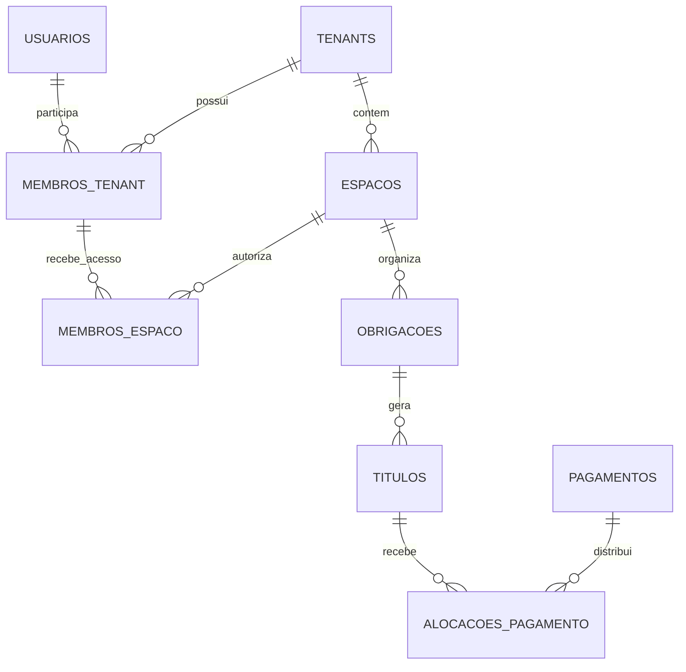

# Estruturação do SaaS Financeiro — Versão 3

**Data:** 09/11/2026.  
**Base:** [Arquitetura técnica — versão 2](Arquitetura_Sistema_Financeiro_NovaPlanilhaDividas2_v2.md).  
**Diretriz:** permitir preencher, manter e consultar pelo sistema todos os dados de negócio da planilha, começando com uma conta vazia. Upload e importação serão desenvolvidos posteriormente, em processo separado.

## 1. Decisão de escopo e precedência

Esta versão redefine a prioridade funcional da versão 2. O produto inicial é um **SaaS com operação manual completa**, incluindo dados atuais, históricos, previsões, parcelamentos, contas, cartões, despesas recorrentes, viagens e moedas. Nenhuma função financeira pode depender de arquivo Excel, staging de importação, parser ou identificação de célula.

Mantêm-se da versão 2 a separação Domain/Application/Infrastructure/Api, React/TypeScript, autenticação Identity, SQL Server ou PostgreSQL por implantação, Docker, migrations separadas e testes nos dois bancos. A matriz de versões permanece sujeita à homologação técnica descrita naquela versão; este documento não altera nem afirma novas versões de componentes.

**Mudanças sobre a versão 2:** viagem multimoeda passa a fazer parte do cadastro manual inicial; histórico pode ser informado manualmente sem registro de origem Excel; importação deixa de ser requisito de aceite, tela inicial ou etapa necessária para liberar o SaaS. As seções seguintes prevalecem sobre o planejamento e as dependências de importação da versão 2. Não é necessário reproduzir abas, backups, fórmulas e subtotais como entidades de negócio: seus dados financeiros e contexto devem ser representáveis e rastreáveis.

Esta entrega especifica o sistema; não implementa código, não executa Docker, não cria migrations executáveis e não envia dados a serviços externos.

## 2. Organização SaaS e isolamento de clientes

### 2.1. Cliente, usuário e espaço financeiro

Adotar **tenant** como conta cliente do SaaS. Um tenant pode possuir um ou mais espaços financeiros, por exemplo Família, Pessoal ou Viagem. O usuário é uma identidade global de autenticação e pode participar de tenants diferentes por convite; acesso a um não concede acesso aos demais.

O diagrama simplifica chaves compostas e perfis. A terminologia `membros` da versão 2 passa a `membros_espaco`, vinculada também ao membro do tenant. Para simplificar a primeira experiência, onboarding cria automaticamente um tenant e um espaço padrão, sem obrigar o usuário a entender essa estrutura.

### 2.2. Regras obrigatórias

- Todas as entidades financeiras e de configuração do cliente têm `tenant_id`; entidades financeiras também têm `espaco_id`. Cadastros financeiros como pessoas, contas, cartões e categorias pertencem a um espaço nesta primeira versão, evitando compartilhamento implícito entre espaços.
- Autorização verifica sessão, tenant ativo, associação ativa ao tenant, espaço pertencente ao tenant e associação/permissão no espaço. O servidor rejeita IDs estrangeiros mesmo em filhos de requisições válidas.
- FKs entre entidades de espaço usam `(tenant_id, espaco_id, id)` e respectivas chaves alternativas. Espaços referenciam seu tenant; membros de espaço referenciam membro do mesmo tenant. Usuários e catálogos técnicos são exceções globais explícitas.
- Filtro global EF é uma camada adicional; validação de escrita e FKs continuam obrigatórias. SQL nativo, consultas administrativas e jobs também precisam de escopo explícito. Não aceitar `tenant_id` do corpo como fonte de autorização.
- Cache, filas, arquivos exportados, storage e auditoria incluem o tenant no particionamento. Logout ou troca de contexto limpa o cache React; URL de outro tenant não pode mostrar dados em cache do anterior.
- Um deployment seleciona PostgreSQL ou SQL Server; cliente não escolhe banco na tela e não altera provider por requisição. Isolamento lógico em banco compartilhado é o padrão inicial; banco dedicado por cliente é evolução futura.
- Administração da plataforma gerencia estado operacional do tenant, sem acesso financeiro implícito. Acesso de suporte a dados, se futuramente criado, deverá ser temporário, autorizado e auditado.

### 2.3. Estruturas novas

| Entidade | Campos principais | Regras |
|---|---|---|
| `tenants` | id, nome, identificador público, situacao, criado_em, versao | Situações ATIVO/SUSPENSO/ENCERRADO; identificador único |
| `membros_tenant` | tenant_id, usuario_id, ativo, papel_administrativo, versao | PK composta; administração de tenant não implica leitura de todos os espaços |
| `espacos` | id, tenant_id, nome, fuso, moeda_padrao, ativo | Chave alternativa tenant/id; nome único ativo por tenant conforme normalização |
| `membros_espaco` | tenant_id, espaco_id, usuario_id, ativo, versao_acessos | FKs para espaço e membro do tenant |
| `preferencias_espaco` | tenant_id, espaco_id, horizonte_recorrencia, regra_dia_invalido | Configuração versionada; não reescreve dados históricos |

Provisionamento do tenant, espaço, membro administrador e perfis padrão é uma única operação idempotente. Não permitir espaço sem administrador. Proteger a remoção do último administrador tanto no tenant quanto no espaço, com controle de concorrência. Cobrança comercial, assinatura de plano e integração de pagamento do SaaS ficam fora do escopo inicial solicitado.

## 3. Cobertura dos dados da planilha no produto

A referência de colunas e coordenadas continua na versão 2. Esta matriz determina onde o usuário preenche cada dado sem upload.

| Dados originais | Tela/formulário | Persistência ou cálculo |
|---|---|---|
| Dívida/produto/descrição | Obrigações e itens de viagem | Descrição da obrigação/item |
| Grupos da coluna A e divisão fixa/variável | Categorias e obrigação | Categoria e natureza da despesa |
| Nomes na coluna Pagamento | Pessoas, responsável e pagamento | Responsável previsto separado de pagador efetivo |
| Ano e mês de cada bloco | Títulos e grade mensal | Competência de cada ocorrência; sem tabela por ano |
| Dia de vencimento | Obrigação, cartão e recorrência | Dia nominal do cadastro e vencimento efetivo do título |
| Valor Total mensal | Título/ocorrência | Valor original por mês, inclusive variações |
| Qto. Pagarei | Planejamento por responsável | Valor planejado; não liquida obrigação |
| Valor Pago e status de quitação | Pagamento ou baixa histórica | Pagamento efetivo ou liquidação histórica documentada |
| Valor Faltante e totais | Grade/dashboard | Cálculos, sem digitação redundante |
| Data Compra | Obrigação parcelada | Data completa opcional; dia isolado preservado como contexto, nunca data inventada |
| Quantidade e número da parcela | Parcelamento e editor de parcelas | Prazo confirmado e número original de cada parcela |
| Valor Quitação / Quitação Pago | Acordo de quitação | Proposta, desconto, pagamento/alocação e situação do acordo |
| Nome/código banco, tipo, agência, conta e dígito | Contas bancárias | Cadastro textual, preservando zeros e identificadores alfanuméricos |
| Saldo, poupança e saldo negativo | Posição bancária | Valores independentes com data conhecida ou explicitamente desconhecida |
| Limite de cheque e disponível | Conta/posição | Limite cadastrado e disponível calculado, não saldo próprio |
| Id legado dos cartões e serviços | Campo opcional de referência anterior | Identificador externo textual, separado da PK UUID |
| Credenciadora, cartão e administradora | Cartões | Instituição, nome, bandeira e rótulo anterior opcional |
| Limite e limites de saque/exterior/Pix/boletos | Cartões | Cinco valores separados, sem soma automática |
| Mensal/Trimestral/Anual | Recorrência | Periodicidade do ciclo, distinta do meio de pagamento |
| Dia e data de renovação | Recorrência | Dia nominal, âncora e próxima data calculada; data anterior pode ser registrada |
| Produto, valor, taxas e parcelas da viagem | Viagens e itens | Valor original, moeda, taxas e obrigação vinculada quando efetivada |
| Cotação peso, valor CLP, real, dólar | Moedas e cotações do item | Campos com unidade explícita; conversão rastreável ou valor informado a conferir |
| Já pago e falta pagar da viagem | Pagamento/histórico e detalhe do item | Liquidação da obrigação vinculada e saldo calculado |
| Comentários e informações antigas | Observações de cadastros/títulos | Texto informado pelo usuário com autoria e data |
| Abas anuais, controles e alternativas | Filtros por competência, histórico e cenários | Uma fonte operacional por ocorrência; cenários não duplicam dívida |
| BKP, subtotais e fórmulas | Histórico de alterações e indicadores | Não são registros financeiros a cadastrar |

O usuário deve conseguir representar um dado cujo significado ainda não conhece por rascunho e observação, sem forçar sua promoção a obrigação, pagamento ou cotação. Um rótulo ambíguo como “Dolar” exige escolher se representa valor USD ou taxa de câmbio antes de participar de cálculos.

## 4. Navegação e telas do SaaS

Menu principal: **Visão geral · Lançamentos · Pagamentos · Planejamento · Recorrências · Contas · Cartões · Viagens · Cadastros · Administração**. Tenant e espaço ativos ficam visíveis no cabeçalho. Não apresentar menu Upload/Importação nesta fase.

| Rota sugerida | Finalidade |
|---|---|
| `/login`, `/minha-conta` | Autenticação, recuperação, MFA e sessões conforme versão 2 |
| `/inicio/configuracao` | Criar conta cliente, espaço, moeda, fuso e configurações iniciais |
| `/dashboard` | Carteira, vencimentos, recorrências e pagamentos com período explícito |
| `/lancamentos` | Grade de títulos e cadastro de avulso/parcelamento/fatura |
| `/obrigacoes/:id` | Compromisso, histórico, ocorrências, parcelas, observações e acordos |
| `/planejamento` | Grade mensal de valores previstos e orçamento por responsável |
| `/pagamentos` | Registro, distribuição, confirmação, histórico e estorno |
| `/recorrencias` | Serviços e despesas de casa, periodicidade e geração de ocorrências |
| `/contas` e `/contas/:id/posicoes` | Cadastro e posições de saldos |
| `/cartoes` | Cadastro e todos os limites por modalidade |
| `/viagens` e `/viagens/:id` | Itens, orçamento, moedas, conversões e vínculo financeiro |
| `/cadastros/pessoas` e `/cadastros/categorias` | Responsáveis, pagadores, categorias e natureza fixa/variável |
| `/administracao/usuarios` e `/administracao/perfis` | Convites, acessos e permissões por espaço |
| `/administracao/espacos` | Espaços do tenant e respectivas associações |

Onboarding pode ser interrompido e retomado. O primeiro lançamento pode criar pessoa ou categoria em formulário lateral; concluir o cadastro auxiliar retorna ao formulário sem perder dados. Começar pelo dashboard vazio apresenta ações “Cadastrar obrigação”, “Cadastrar conta” e “Cadastrar recorrência”, com orientação curta.

## 5. Cadastro de obrigações e lançamentos

### 5.1. Dados comuns

Descrição, categoria, natureza fixa/variável herdada da categoria com regra explícita de classificação, responsável padrão, credor opcional, moeda, dia de vencimento opcional, observações e referência anterior. O tipo selecionado abre os campos de avulso, parcelamento, recorrência ou fatura.

**Salvar rascunho** permite dados incompletos, destacados e excluídos dos indicadores. **Confirmar** valida todos os requisitos do tipo e torna títulos operacionais. Histórico confirmado pode ter data de compra ou vencimento desconhecidos quando assim marcado, sem inventar datas.

### 5.2. Despesa avulsa

Informar competência, vencimento ou motivo da ausência histórica, valor e responsável. É possível informar ocorrência futura como PREVISAO. Confirmar uma previsão a transforma em compromisso EFETIVO sem criar segunda linha. Rascunho, cancelamento, previsão e efetivação são estados de registro, separados da situação de liquidação ABERTO/PARCIAL/PAGO.

### 5.3. Parcelamento

Formulário contém data da compra opcional, número total de parcelas quando conhecido, primeira competência, primeira parcela conhecida, primeiro vencimento, valor total ou valor por parcela e responsável. Se o prazo integral for desconhecido, permitir cadastrar somente as parcelas conhecidas; não inferir contrato de 12 meses a partir de uma agenda anual.

Antes de salvar, apresentar grade de prévia com número original, competência, vencimento, valor e responsável. Usuário pode corrigir parcelas desiguais, datas e valores. Se valor total foi informado, soma das parcelas deve fechar, com resíduo de centavos explícito. Gerar uma única vez por chave da ocorrência, usando idempotência.

Permitir adicionar parcelas históricas sem renumerar as futuras. Não sobrescrever parcelas pagas ao alterar contrato. Alterações futuras mostram a lista afetada e exigem confirmação concreta; excluir rascunhos é diferente de cancelar obrigação já efetiva.

### 5.4. Grade mensal para substituir a matriz Excel

Selecionar ano, mês inicial/final, responsável e categoria. Linhas representam obrigações; colunas mensais mostram valor devido, planejado, liquidado, saldo e situação. Para telas pequenas, apresentar mês individual com navegação.

A edição abre o título do mês ou permite entrada validada em lote de valores e vencimentos. Somente campos de entrada são editáveis; saldo e pago derivado não são sobrescritos. Não obrigar preencher doze meses para registrar uma despesa. “Copiar valores para meses seguintes” mostra prévia e ignora ocorrências com liquidação, salvo fluxo explícito de ajuste.

Cada lote tem validação completa antes de confirmar, IDs/versões dos registros e idempotência; falha de uma linha não deve deixar gravação parcial silenciosa. Para o escopo inicial, adotar confirmação atômica do lote com tamanho limitado. Totais devem responder aos mesmos filtros da grade.

## 6. Pagamento efetivo, histórico e planejamento

### 6.1. Pagamento efetivo

Selecionar títulos do espaço, data, conta, pagador, meio e valor. Distribuir entre títulos da mesma moeda e conferir diferença antes da confirmação. Permitir pagamento parcial. Ao confirmar, reduzir os saldos uma única vez; estorno auditado desfaz o efeito sem apagar histórico. Responsável pela dívida e pessoa que pagou são campos diferentes.

### 6.2. Preenchimento manual de histórico

Disponibilizar ação **Registrar liquidação histórica** no título. Informar valor, data efetiva se conhecida, pagador se conhecido, motivo e observação. Conta bancária não é obrigatória porque pode não haver evidência de movimentação. Toda baixa informa origem MANUAL_HISTORICA e usuário autor.

Sem data efetiva, a baixa reduz a carteira mas não entra em caixa mensal. Mesmo com data informada, baixa histórica não deve ser apresentada como movimento bancário comprovado; dashboards distinguem essas bases. Substituir por pagamento efetivo revoga a baixa e registra pagamento na mesma transação.

### 6.3. Planejamento e quitação

“Quanto pagarei” é planejamento por título/pessoa, distinto do valor pago. Permitir revisar previsão sem alterar saldo. Acordo de quitação contém títulos abrangidos, valor nominal, desconto ou acréscimos, valor proposto, validade, observação e situação. Simular não liquida. Confirmar com pagamento aplica desconto/alocações atomicamente, evitando duplicar parcelas e quitação.

Cenário de antecipação pode ser salvo com nome e alternativas; não entra em indicadores efetivos até confirmação. Nunca criar uma segunda carteira porque havia uma segunda aba na planilha.

## 7. Contas e cartões

### 7.1. Contas bancárias

Cadastrar instituição/nome/código, tipo, titular opcional, agência, número, dígito, moeda e limite de cheque. Campos de identificação são texto. Registrar posições separadamente: data conhecida ou desconhecida, saldo, poupança, cheque utilizado e observações. Campos não conhecidos são nulos e não zero.

Mostrar cheque disponível como limite menos utilizado, sem limitar artificialmente a zero: excesso deve aparecer como irregularidade. Não somar limite com dinheiro próprio. Para conta estrangeira, exigir moeda antes de consolidar. Uma posição desconhecida no tempo pode ser consultada no histórico, mas não substitui a última posição datada.

### 7.2. Cartões e faturas

Cadastrar nome, instituição emissora, bandeira, titular opcional, vencimento e cinco limites: principal, saque nacional, saque exterior, Pix no crédito e boletos. Preservar referências anteriores sem usá-las como chave primária. Fechamento é opcional e não pode ser inventado.

Para informar fatura manualmente, selecionar cartão, competência, vencimento e valor. Há duas modalidades por fatura: valor consolidado informado ou composição por itens. Compra/parcelas vinculadas à fatura são componentes analíticos; somente a fatura representa a obrigação agregada de pagar. A tela explica diferenças entre soma dos itens e valor informado. Não incluir a mesma compra como dívida independente e composição simultaneamente.

## 8. Recorrências, serviços e despesas de casa

Formulário único com categorias diferentes, evitando duplicidade entre “Serviços” e “Casa”. Campos: produto, valor por ciclo, moeda, periodicidade mensal/trimestral/anual, dia nominal, data âncora, próxima renovação proposta, responsável, categoria, início/fim, ativo e observações.

A data âncora é necessária para geração automática, mas cadastro incompleto pode ficar em rascunho. O usuário visualiza as próximas ocorrências e ajusta antes de confirmar. Mudança de preço cria vigência para ciclos futuros; não reescreve títulos anteriores. Encerrar assinatura cancela geração futura, mantendo histórico.

Geração é idempotente por recorrência/ocorrência. Para dia inexistente, aplicar último dia do mês preservando dia nominal. Mostrar custo mensal equivalente separado de contas efetivamente vencendo no mês. Conectar recorrência a ocorrência anual já cadastrada quando forem a mesma despesa, sem gerar segunda cobrança.

## 9. Viagens, moedas e informações ambíguas

Criar viagem com nome, período opcional, moeda de apresentação e observações. Cadastrar itens com descrição, categoria, responsável, moeda original, valor base, taxas na mesma moeda, quantidade de parcelas opcional e valores/conversões de referência.

Cada conversão deve informar moeda de origem/destino, taxa, data se conhecida e convenção “unidades de destino por uma unidade de origem”. Total original = base + taxas; convertido = total × taxa. Se o usuário possui apenas um valor já convertido, permitir armazená-lo como valor informado, distinguindo-o do calculado. Não exigir uma cotação fictícia para salvar histórico incompleto.

Representar CLP, BRL e USD como moedas explícitas. Um campo legado cujo significado seja desconhecido fica como informação de referência com rótulo, valor textual e observação, fora das somas. Diferenças entre informado e calculado aparecem para revisão; não somar cotação com valor monetário.

Item pode ser **ORCAMENTO** ou **COMPROMISSO**. Só o compromisso vinculado a obrigação/título participa da carteira financeira. Um item parcelado é ligado à obrigação correspondente, sem duplicar seus pagamentos. Já pago e falta pagar são derivados das liquidações desse vínculo; para histórico, usar a ação específica de baixa. Excedente pago é crédito/diferença a tratar, não dívida negativa silenciosamente apagada.

## 10. Ajustes no modelo de dados para independência do Excel

Além dos campos SaaS da seção 2, aplicar ao modelo da versão 2:

| Alteração | Motivo |
|---|---|
| `baixas_historicas.registro_origem_id` passa a opcional | Permitir quitação histórica informada manualmente |
| Acrescentar em baixas `origem`, `registrado_por`, `registrado_em`, `justificativa`, `pagador_id?` | Auditoria e distinção de liquidação manual/importada |
| Campos `origem_criacao` e `referencia_anterior?` nos agregados pertinentes | Distinguir MANUAL, RECORRENCIA e IMPORTACAO futura, sem depender de célula |
| `titulos.estado_registro` | RASCUNHO/PREVISAO/EFETIVO/CANCELADO, separado da situação de pagamento; substituir flags redundantes com migration consistente |
| Observações nos agregados e `anotacoes` com alvo tipado | Suportar contexto manual com autoria/data, independente de anotacoes_origem |
| `obrigacoes.data_compra_contexto?` | Preservar informação parcial como “dia 10” sem criar data incorreta |
| `recorrencia_vigencias` | Histórico de preço, moeda e periodicidade com início/fim, sem reescrever ocorrências |
| `faturas` e `fatura_itens` | Uma fatura vincula um título a pagar; itens referenciam composição analítica, não títulos pagáveis duplicados |
| `cenarios_quitacao` e itens | Guardar alternativas sem efeito financeiro; confirmação cria acordo operacional |
| `item_conversoes` | Valor informado/calculado, moeda destino, taxa/cotacao opcional, data/contexto e diferença |
| `referencias_informadas` | Rótulo, conteúdo textual e vínculo tipado para ambiguidades legadas; não é fonte de cálculos financeiros |

Vínculos de anotações/referências usam FKs tipadas por alvo suportado ou tabelas de associação específicas; evitar um UUID polimórfico sem integridade para dados essenciais. Dados de negócio continuam em tabelas relacionais. Origem futura não deve justificar JSON genérico para campos financeiros obrigatórios.

Se uma fatura agrupar compras, restringir item a uma única fatura/ocorrência e validar a exclusão dessas compras do agregado pagável. Itens de viagem e composição de faturas referenciam a mesma obrigação quando necessário; a fonte de saldo continua sendo título/alocação, não cópias de valor pago em telas distintas.

## 11. Contratos de aplicação e organização dos projetos

Criar casos de uso orientados à operação: `CriarTenant`, `ConfigurarEspaco`, `CadastrarObrigacao`, `GerarParcelas`, `ConfirmarLoteTitulos`, `RegistrarBaixaHistorica`, `RegistrarPagamento`, `SimularQuitacao`, `CadastrarRecorrencia`, `GerarOcorrencias`, `RegistrarPosicaoConta`, `CadastrarFatura` e `CadastrarItemViagem`.

Controllers recebem DTOs específicos, validam acesso e delegam. Backend é dono dos cálculos de saldo, calendário e alocação; frontend fornece prévia e exibe validações, sem ser a única barreira de consistência.

Complementos ao REST da versão 2:

| Endpoint | Uso |
|---|---|
| `POST /api/v1/tenants` | Provisionamento idempotente após autenticação; cria primeiro espaço e permissões |
| `GET /api/v1/tenants` | Listar apenas contas cliente acessíveis |
| `GET/POST /api/v1/espacos` | Espaços do tenant validado no contexto |
| `POST /api/v1/auth/contexto` | Trocar tenant/espaço após autorização; substituir seleção apenas de espaço |
| `POST /api/v1/obrigacoes/{id}/parcelas/previa` | Validar e apresentar calendário sem gravar |
| `POST /api/v1/obrigacoes/{id}/parcelas` | Confirmar calendário com idempotência |
| `POST /api/v1/titulos/lotes/previa` e `/confirmacao` | Edição mensal em lote com escopo/versões e atomicidade |
| `POST /api/v1/titulos/{id}/baixas-historicas` | Liquidação histórica manual autorizada |
| `POST /api/v1/baixas-historicas/{id}/revogacao` | Corrigir sem apagar evidência |
| `POST /api/v1/titulos/{id}/efetivacao` | Converter previsão em compromisso sem duplicar ocorrência |
| `GET/POST /api/v1/faturas` | Fatura consolidada/composição; detalhe e edição conforme estado |
| `GET/POST /api/v1/viagens/{id}/itens/{itemId}/conversoes` | Conversão/valor de referência explícito |

Ausência de permissão deve ser rejeitada mesmo em previews, exportação, lotes e IDs aninhados. Idempotência tem escopo de tenant, usuário/operação e chave, com validação de hash do payload; reutilizar chave com conteúdo diferente retorna conflito. Versão por registro detecta edição concorrente.

Interface futura de integração chama esses mesmos casos de uso mediante identidade autorizada e origem explícita. **Não implementar agora endpoints de upload, parser Excel, staging, mapeamento automático ou tela de reconciliação de importação.** Isso não impede auditoria e validação dos cadastros manuais.

## 12. Experiência de preenchimento e validação

Usar campos monetários pt-BR, datas locais e transporte decimal/ISO conforme versão 2. Explicar diferença entre devido, planejado e liquidado junto aos campos pertinentes. Mostrar contexto de tenant/espaço antes de confirmar dados.

Permitir salvar rascunho, duplicar cadastro como novo com prévia, cadastrar auxiliares sem perder formulário e navegar entre ocorrências. Duplicação não copia pagamento, baixa, número de conta ou status quitado por padrão. Avisar sobre saída com alterações não salvas; não gravar dados financeiros sensíveis em localStorage para autosave.

Validações incluem valores não negativos onde aplicável, moeda consistente, soma de parcelas/alocações, dia válido, datas desconhecidas explícitas, quantidade e número original de parcela e vínculos do mesmo tenant/espaço. Valores desconhecidos aparecem como “Não informado”, nunca como zero calculado. Criação de nomes semelhantes pode sugerir revisão, mas não bloquear dois cartões/pessoas legítimos apenas por nome.

Tela mensal, dashboard e exportação devem aplicar o mesmo escopo. Usuário escolhe se inclui previsões; rascunhos ficam fora dos KPIs. Não oferecer evolução retroativa exata sem eventos datados suficientes. Posições bancárias, carteira, despesas efetivas e orçamento têm blocos separados com definição da base temporal.

## 13. Permissões e auditoria do preenchimento

Manter perfis Administrador, Gestor financeiro, Operador e Leitor. Complementar catálogo com `historico.registrar`, `historico.revogar`, `viagens.editar`, `cotacoes.editar`, `faturas.editar` e `espacos.gerenciar`. Registro/revogação de histórico e confirmação de quitação ficam inicialmente com Administrador/Gestor; cadastro operacional com Operador quando permitido. Leitor não envia mutações por grid nem API.

Gestão de tenant tem políticas específicas como `tenant.gerenciar` e `tenant.membros.gerenciar`; não confundir com permissões financeiras do espaço. Atribuir acesso financeiro é operação explícita de perfil/membro. Toda ação crítica registra tenant/espaço, usuário, operação, data UTC, entidade e alteração, mascarando dados bancários e excluindo senhas/tokens.

## 14. Testes e critérios de aceite do SaaS manual

Reutilizar projetos da versão 2 com matriz PostgreSQL/SQL Server. Nesta fase, substituir dependências de teste de importação por cenários de preenchimento manual; reservar testes do upload para o futuro.

| Cenário de aceite | Resultado esperado |
|---|---|
| Conta cliente vazia | Usuário conclui onboarding e registra a primeira despesa sem arquivo |
| Múltiplos clientes | Mesmo usuário só vê tenants/espaços autorizados; IDs estrangeiros são rejeitados |
| Cobertura da planilha | Todo campo de negócio da matriz da seção 3 tem entrada, referência ou cálculo explícito |
| Histórico sem detalhes bancários | Baixa reduz saldo sem inventar data/conta ou pagamento efetivo |
| Parcelas desiguais e números continuados | Calendário preserva número original, valor e vencimento por parcela |
| Grade mensal | Edita somente entradas, valida lote atomicamente e impede sobrescrita concorrente |
| Planejamento versus pago | Previsão não liquida; pagamento e baixa não são contados duas vezes |
| Conta bancária e cartões | Identificadores textuais preservados; cinco limites e posições independentes |
| Serviços/casa | Renovação mensal/trimestral/anual gera uma ocorrência por ciclo com vigência correta |
| Fatura e compra | Obrigação agregada e composição não duplicam o total a pagar |
| Viagem multimoeda | CLP/BRL/USD são explícitos; cotação e valor informado têm tratamento diferente |
| Antecipação | Cenário não altera carteira; confirmação registra acordo, desconto e pagamento uma vez |
| Dado desconhecido | Pode permanecer rascunho/referência sem virar zero ou fato financeiro |
| Segurança | Cookies/CSRF, permissões, sessões e último administrador testados |
| Dois bancos | Migrations e consultas produzem resultados financeiros equivalentes |

Testar também isolamento em arquivos exportados, cache e jobs; precisão decimal; ano bissexto; dia 31; revogação de acesso durante sessão; alterações de preço e exportação com filtros. Não usar apenas ocultação de tela como evidência de segurança.

## 15. Plano de execução por entregas

1. **Fundação SaaS:** tenant/espaço, autenticação, perfis, migrations dos dois bancos, Docker e CI.
2. **Cadastro e operação:** pessoas/categorias, contas/posições, cartões, obrigações, títulos, parcelamentos e grade mensal.
3. **Liquidação e histórico:** pagamentos, alocações, baixas manuais, estornos, planejamento e quitação.
4. **Cobertura completa:** recorrências/vigências, faturas/composição e viagens/moedas/conversões.
5. **Visibilidade e homologação:** dashboards, exportação autorizada, acessibilidade e testes de cobertura da matriz da planilha.
6. **Projeto futuro independente:** upload/importação usando os contratos de domínio já estabilizados.

O aceite do produto manual abrange as entregas 1–5. A entrega 6 não é pré-requisito para uso e será definida posteriormente pelo usuário. Evolução comercial de planos/cobrança e livro-caixa completo de receitas/transferências continuam fora deste recorte, sem impedir o preenchimento dos dados efetivamente presentes na planilha.

## 16. Documentos e preservação

Este documento é o direcionamento funcional SaaS para implementar a arquitetura da versão 2. A versão 2 conserva o dicionário detalhado da planilha, exemplos Docker, organização das migrations e base técnica. Em conflitos de escopo, hierarquia de tenant/espaço, entrada manual, obrigatoriedade de origem e prioridade de viagens, prevalece esta versão 3.

A planilha original e as versões anteriores não foram alteradas. A única entrega nesta etapa é este novo arquivo Markdown, salvo na pasta `Guia`.
