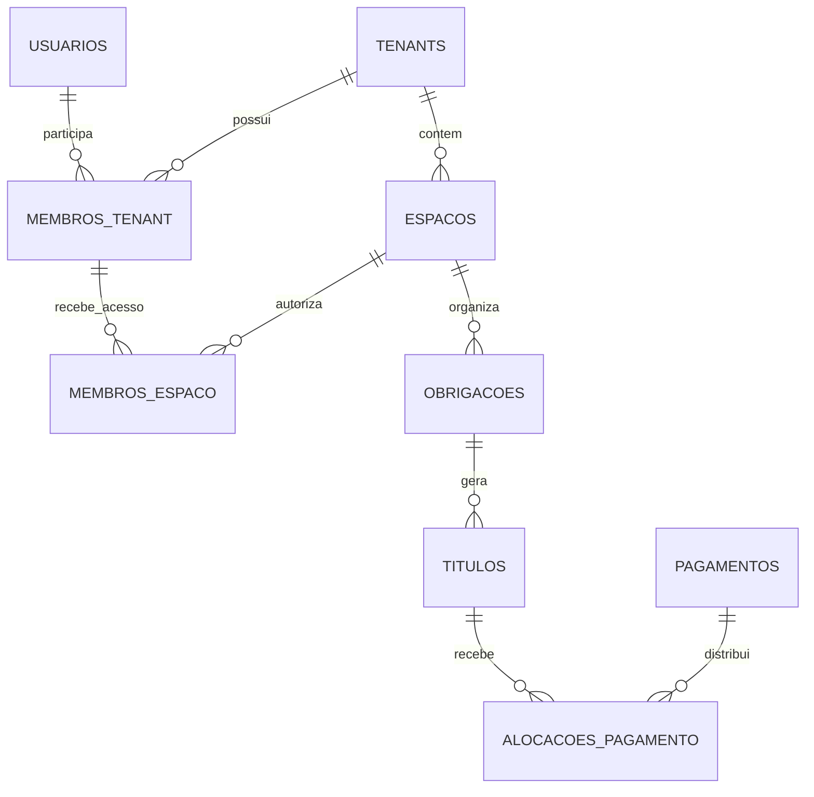
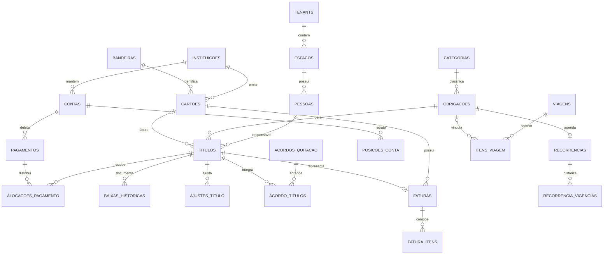
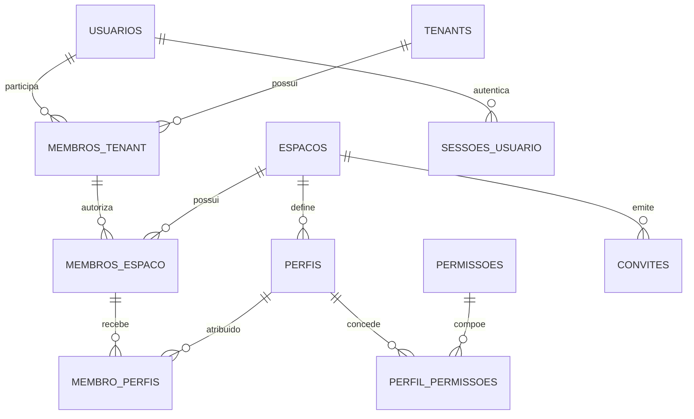

# Arquitetura Consolidada do SaaS Financeiro — Versão 4

**Data da consolidação:** 09/11/2026.  
**Finalidade:** referência única para o plano de desenvolvimento do SaaS com cadastro manual completo.

## Sumário

- [1. Objetivo, escopo e decisões consolidadas](#secao-1)
- [2. Organização SaaS e isolamento de clientes](#secao-2)
- [3. Inventário da planilha](#secao-3)
- [4. Estrutura e regras observadas](#secao-4)
- [5. Dicionário de mapeamento da origem](#secao-5)
- [6. Cobertura dos dados da planilha no produto](#secao-6)
- [7. Modelo conceitual e lógico normalizado](#secao-7)
- [8. Regras de negócio propostas](#secao-8)
- [9. Plataforma atualizada e suporte a dois bancos](#secao-9)
- [10. Arquitetura backend](#secao-10)
- [11. Projetos de migrations e fluxo de evolução](#secao-11)
- [12. Docker Compose e configuração dos bancos](#secao-12)
- [13. Identidade, usuários, perfis e permissões](#secao-13)
- [14. Tela de login e administração de acessos](#secao-14)
- [15. Arquitetura frontend React](#secao-15)
- [16. Cadastro de obrigações e lançamentos](#secao-16)
- [17. Pagamento efetivo, histórico e planejamento](#secao-17)
- [18. Contas e cartões](#secao-18)
- [19. Recorrências, serviços e despesas de casa](#secao-19)
- [20. Viagens, moedas e informações ambíguas](#secao-20)
- [21. Segurança, operação e escalabilidade](#secao-21)
- [22. Projetos de testes e pipeline](#secao-22)
- [23. Evolução futura: upload e integração de dados](#secao-23)
- [24. Plano de execução e conclusão do SaaS manual](#secao-24)
- [25. Referências, rastreabilidade e natureza da entrega](#secao-25)

<a id="secao-1"></a>

## 1. Objetivo, escopo e decisões consolidadas

Este documento reúne a arquitetura técnica e o dicionário de dados da versão 2 com a definição funcional SaaS da versão 3, resolvendo as diferenças em favor da versão 3. É a **referência única para gerar o plano de desenvolvimento**, sem necessidade de consultar as versões anteriores para requisitos.

O produto é um SaaS financeiro com **cadastro manual completo**, capaz de representar todos os dados de negócio da planilha `NovaPlanilhaDividas2.xlsx`, começando por uma conta vazia. Inclui obrigações, títulos, parcelamentos, planejamento, pagamentos, histórico, contas, cartões, recorrências, faturas, viagens e múltiplas moedas. Upload e importação ficam fora do aceite inicial e são descritos apenas como evolução futura na seção 23.

A arquitetura é um monólito modular com Clean Architecture, ASP.NET Core Web API, EF Core, OpenAPI/Swagger e React/TypeScript. Cada implantação seleciona SQL Server ou PostgreSQL; Docker, migrations por provider e projetos de testes fazem parte da solução. Identidade usa ASP.NET Core Identity e sessão por cookie seguro. O isolamento é por conta cliente (**tenant**) e espaço financeiro.

| Decisão | Definição vigente |
|---|---|
| Entrada de dados inicial | Formulários, edição mensal e operações manuais; nenhuma dependência de Excel/upload |
| Cobertura funcional | Todos os dados de negócio da planilha, incluindo históricos e viagens multimoeda |
| Dados desconhecidos | Nulo, contexto ou rascunho; nunca data/valor financeiro inventado |
| Autenticação | Identity local, cookie, CSRF, sessões revogáveis e MFA conforme política |
| Autorização | Associação a tenant/espaço e perfis/permissões por espaço |
| Persistência | Um provider por implantação; nenhuma gravação dupla ou escolha por cliente |
| Histórico de quitação | Baixa manual sem exigir arquivo, data ou conta fictícia |
| Fatura e compra | Uma fonte pagável, com composição analítica sem dupla contagem |
| Entrega futura | Upload/parser/staging/reconciliação de importação, sem bloquear o SaaS manual |
| Fora do recorte | Cobrança comercial do SaaS e livro-caixa completo de receitas/transferências |

A análise da planilha registrada nos documentos de origem foi somente leitura do OOXML: 14 abas, inclusive ocultas, cabeçalhos, fórmulas, resultados armazenados, formatos, mesclagens e amostras de comentários. Não houve recálculo no Excel. A consolidação não reexecutou a análise nem homologou componentes: as versões técnicas citadas conservam a referência de consulta de 09/11/2026 e precisam de verificação na implementação.

SHA-256 da planilha analisada: `7d386946d6753f4bd8ddc0b823800722e6f46f6db40e77ceeacf9b008b20d500`.

Este arquivo especifica o sistema; não cria aplicações, não executa Docker/migrations/testes e não importa dados.

<a id="secao-2"></a>

## 2. Organização SaaS e isolamento de clientes

### 2.1. Cliente, usuário e espaço financeiro

Adotar **tenant** como conta cliente do SaaS. Um tenant pode possuir um ou mais espaços financeiros, por exemplo Família, Pessoal ou Viagem. O usuário é uma identidade global de autenticação e pode participar de tenants diferentes por convite; acesso a um não concede acesso aos demais.



O diagrama simplifica chaves compostas e perfis. A associação financeira chama-se `membros_espaco` e é vinculada ao membro do tenant. Para simplificar a primeira experiência, onboarding cria automaticamente um tenant e um espaço padrão, sem obrigar o usuário a entender essa estrutura.

### 2.2. Regras obrigatórias

- Todas as entidades financeiras e de configuração do cliente têm `tenant_id`; entidades financeiras também têm `espaco_id`. Cadastros financeiros como pessoas, contas, cartões e categorias pertencem a um espaço nesta primeira versão, evitando compartilhamento implícito entre espaços.
- Autorização verifica sessão, tenant ativo, associação ativa ao tenant, espaço pertencente ao tenant e associação/permissão no espaço. O servidor rejeita IDs estrangeiros mesmo em filhos de requisições válidas.
- FKs entre entidades de espaço usam `(tenant_id, espaco_id, id)` e respectivas chaves alternativas. Espaços referenciam seu tenant; membros de espaço referenciam membro do mesmo tenant. Usuários e catálogos técnicos são exceções globais explícitas.
- Filtro global EF é uma camada adicional; validação de escrita e FKs continuam obrigatórias. SQL nativo, consultas administrativas e jobs também precisam de escopo explícito. Não aceitar `tenant_id` do corpo como fonte de autorização.
- Cache, filas, arquivos exportados, storage e auditoria incluem o tenant no particionamento. Logout ou troca de contexto limpa o cache React; URL de outro tenant não pode mostrar dados em cache do anterior.
- Um deployment seleciona PostgreSQL ou SQL Server; cliente não escolhe banco na tela e não altera provider por requisição. Isolamento lógico em banco compartilhado é o padrão inicial; banco dedicado por cliente é evolução futura.
- Administração da plataforma gerencia estado operacional do tenant, sem acesso financeiro implícito. Acesso de suporte a dados, se futuramente criado, deverá ser temporário, autorizado e auditado.

### 2.3. Estruturas novas

| Entidade | Campos principais | Regras |
|---|---|---|
| `tenants` | id, nome, identificador público, situacao, criado_em, versao | Situações ATIVO/SUSPENSO/ENCERRADO; identificador único |
| `membros_tenant` | tenant_id, usuario_id, ativo, papel_administrativo, versao | PK composta; administração de tenant não implica leitura de todos os espaços |
| `espacos` | id, tenant_id, nome, fuso, moeda_padrao, ativo | Chave alternativa tenant/id; nome único ativo por tenant conforme normalização |
| `membros_espaco` | tenant_id, espaco_id, usuario_id, ativo, versao_acessos | FKs para espaço e membro do tenant |
| `preferencias_espaco` | tenant_id, espaco_id, horizonte_recorrencia, regra_dia_invalido | Configuração versionada; não reescreve dados históricos |

Provisionamento do tenant, espaço, membro administrador e perfis padrão é uma única operação idempotente. Não permitir espaço sem administrador. Proteger a remoção do último administrador tanto no tenant quanto no espaço, com controle de concorrência. Cobrança comercial, assinatura de plano e integração de pagamento do SaaS ficam fora do escopo inicial solicitado.

<a id="secao-3"></a>

## 3. Inventário da planilha

| Aba exata | Visibilidade | Dimensão | Células com valor/fórmula | Fórmulas | Papel |
|---|---|---|---:|---:|---|
| 2024 | Oculta | A1:AY142 | 4.976 | 1.368 | Controle mensal histórico |
| 2025 | Oculta | A1:AY153 | 5.373 | 1.519 | Controle mensal histórico |
| 2026 | Visível | A1:AY161 | 5.672 | 1.632 | Controle mensal atual |
| 2027 | Visível | A1:AY160 | 5.530 | 1.620 | Controle mensal futuro; confirmar se é previsão ou cópia |
| Controle Pagamentos - 2026 | Visível | A1:CB36 | 1.652 | 691 | Detalhamento mensal de parcelas |
| CP - 2026 - Antecipação de Parc | Visível | A1:CD43 | 1.746 | 775 | Variante com quitação antecipada |
| CP - 2026 - BKP | Oculta | A1:CB52 | 2.322 | 987 | Backup; não somar ao controle principal |
| Controle Pagamentos - 2025 | Oculta | A1:CB48 | 2.025 | 795 | Parcelas históricas |
| Controle Pagamentos - 2024 | Oculta | A1:CB45 | 2.834 | 1.089 | Parcelas históricas |
| Contas Bancarias | Visível | A1:K25 | 213 | 25 | Cadastro e posição de saldos |
| Cartoes de Credito | Visível | A1:J33 | 307 | 5 | Cadastro e limites de cartões |
| Streaming e Serviços | Visível | A1:F48 | 225 | 36 | Despesas recorrentes |
| Dividas de Casa | Visível | A1:F36 | 82 | 33 | Despesas domésticas recorrentes |
| Passeio - Chile | Oculta | A1:K23 | 101 | 29 | Orçamento de viagem e valores em moedas diferentes |

Não foram encontrados objetos de tabela estruturada nem gráficos no pacote. As abas não possuem regras OOXML de validação de dados. Foram encontrados quatro arquivos de comentários, com 49, 39, 49 e 49 comentários, totalizando 186; amostras incluem anotações antigas sobre compras. Esses textos são contexto, não lançamentos financeiros automaticamente válidos. Não foram encontradas células de tipo erro armazenado; isso não comprova a correção das fórmulas.

<a id="secao-4"></a>

## 4. Estrutura e regras observadas

### 4.1. Abas anuais 2024–2027

A linha 3 informa meses, a linha 4 contém o cabeçalho inicial e há cabeçalhos repetidos entre seções. As colunas A–C são descrição da dívida, dia de vencimento e limite de crédito. D–AY repetem quatro campos por mês. Seções representam grupos como dívidas familiares, telefonia, financiamentos, contas pessoais, gastos domésticos, faturas de cartões e serviços. Os nomes de responsáveis aparecem na coluna chamada “Pagamento”. Linhas de subtotal por pessoa e totais finais não são dívidas.

**Divergência semântica:** `2026!E7 = IF(G7="P",0,D7)`. Apesar do título “Valor Pago”, E7 representa pendência nessa fórmula. Há seções intituladas “Qto. Pagarei”, que podem ter interpretação de planejamento. Não mapear o nome do cabeçalho isoladamente: classificar cada célula conforme fórmula, status e contexto. A interpretação de `P` como pago é fortemente sugerida pelo comportamento da fórmula, mas deve constar da validação de histórico. Status vazio não comprova atraso ou pagamento.

### 4.2. Controles de parcelas

A–D: descrição, “Data Compra”, quantidade de parcelas e vencimento. Depois há doze blocos mensais de seis campos: número da parcela, valor, faltante, pago, responsável e status. Em `Controle Pagamentos - 2026!G5`, `IF(J5="Pago",0,F5)` calcula faltante; H5 usa `IF(J5="Pago",F5,0)` para pago. Essa regra original é binária e não registra pagamentos parciais, juros, descontos ou data efetiva do pagamento.

“Data Compra” é heterogênea: B5 da aba de 2026 contém `10`, enquanto B30 da aba de antecipação contém serial de data com formato de data. Não converter todo número dessa coluna em data Excel: `10` não comprova uma compra em janeiro de 1900. Quantidade 12 em obrigações domésticas pode representar os meses exibidos, não o prazo integral de um financiamento.

Na aba de antecipação, abril tem oito campos: W–AD, incluindo **AA = Valor Quitação** e **AB = Quitação Pago**. Maio passa a AE–AJ; um leitor com deslocamento fixo de seis colunas falharia. Totais ficam em CB–CD. A existência dessa aba não comprova que as antecipações foram efetivadas; é uma fonte concorrente a reconciliar.

### 4.3. Limites, recorrência e viagem

Em contas, K calcula `J-I`, ou limite de cheque especial menos saldo negativo informado. Saldo, poupança e saldo negativo são campos independentes na planilha: não deduzir automaticamente o sinal de um a partir do outro. Limite de crédito não é caixa disponível próprio.

Serviços e casa compartilham cabeçalhos; “Tipo de Pagamento” contém Mensal, Anual ou Trimestral e representa **periodicidade**, não meio de pagamento. A fórmula de renovação `IF(E4 > 0, DATE(YEAR(TODAY()), MONTH(TODAY()), E4), "")` gera data do mês corrente. Não calcula corretamente, por si só, o próximo ciclo anual ou trimestral, nem garante uma data futura.

Viagem mistura BRL, peso chileno e dólar sem convenção explícita da cotação. Em `Passeio - Chile!G3`, a fórmula é `E3+F3`, apesar do título de conversão para pesos: soma não comprova conversão cambial válida. K5 tem saldo negativo armazenado de -6; tratar como divergência/crédito a investigar, sem apagar o excedente.

### 4.4. Inconsistências e decisões de tratamento

| Evidência | Consequência | Tratamento proposto |
|---|---|---|
| `Cartoes de Credito!E33:I33` somam linhas 3–29, mas existem cartões nas linhas 30–31 | Totais não abrangem todos os cadastros | Recalcular sobre cadastros aprovados; apresentar diferença de reconciliação |
| `Controle Pagamentos - 2026!BZ36:CB36` excluem explicitamente linhas 5–7 | Total tem escopo diferente do total de todas as obrigações | Tornar filtros de categoria explícitos; não reproduzir exclusão por posição |
| Linha 30 do controle de 2026 usa intervalos distintos nos subtotais F30 e H30 | Pago e previsto podem ter escopos diferentes | Recalcular por entidades e registrar divergências |
| Abas anual, parcelas, casa e serviços podem descrever a mesma obrigação | Risco de duplicação | Vincular cadastro, recorrência e título; não somar fontes sem reconciliação |
| Safra/Banco Safra e descrições semelhantes de cartões | Identidade ambígua | Sugerir unificação; exigir revisão antes de mesclar |
| Zeros, células vazias e “-” coexistem | Ausência não é zero | Preservar valor bruto e significado; pendências ficam em referências de origem futura |
| Comentários antigos reaparecem em abas recentes | Não comprovam transação do ano | Preservar anotação com origem e não gerar dívida automaticamente |

<a id="secao-5"></a>

## 5. Dicionário de mapeamento da origem

### 5.1. Abas anuais: todas as colunas

| Origem | Tipo observado/semântico | Destino |
|---|---|---|
| A — Dívida | Texto, também seção/cabeçalho | `obrigacoes.descricao`; seções → `categorias` |
| B — Data - Venc. | Número de dia, vazio | `obrigacoes.dia_vencimento`; materializar `titulos.vencimento` por mês/ano |
| C — Limite de Crédito | Monetário, zero ou “-” | `cartoes.limite` somente com vínculo confirmado; senão referência informada para revisão para revisão |
| Valor Total de cada mês | Número monetário | `titulos.valor_original`, competência obtida da aba e mês |
| Valor Pago / Qto. Pagarei | Número ou fórmula | Fórmula de pendente → valor calculado de conferência; valor planejado manual → `planejamentos.valor`; pagamento comprovado → pagamento ou baixa histórica conforme evidência |
| Pagamento | Nome de pessoa | `pessoas` e `titulos.responsavel_id`; não é data nem forma de pagamento |
| Status | Texto “P” ou vazio, entre outros a validar | `baixas_historicas.status_origem`; situação operacional derivada após aprovação |
| Subtotais, totais e Gasto Fixo/Variável | Fórmulas/textos de agrupamento | Relatórios e classificação `categorias.natureza`; não importar como obrigação |

| Mês | Total | Campo pago/planejado/pendente | Responsável | Status |
|---|---|---|---|---|
| Janeiro | D | E | F | G |
| Fevereiro | H | I | J | K |
| Março | L | M | N | O |
| Abril | P | Q | R | S |
| Maio | T | U | V | W |
| Junho | X | Y | Z | AA |
| Julho | AB | AC | AD | AE |
| Agosto | AF | AG | AH | AI |
| Setembro | AJ | AK | AL | AM |
| Outubro | AN | AO | AP | AQ |
| Novembro | AR | AS | AT | AU |
| Dezembro | AV | AW | AX | AY |

### 5.2. Parcelamentos: todas as colunas de negócio

| Campo | Tipo alvo | Destino/regra |
|---|---|---|
| A — Dívida | Texto | `obrigacoes.descricao`, credor/cartão apenas por vínculo revisado |
| B — Data Compra | `date` ou desconhecido | `obrigacoes.data_compra` quando data inequívoca; dia isolado fica no registro bruto |
| C — Qtde Parcelas | Inteiro | `obrigacoes.quantidade_parcelas` se prazo confirmado; não inferir saldo total do contrato |
| D — Data - Venc. | Inteiro 1–31 | `obrigacoes.dia_vencimento` |
| Parcela | Inteiro | `titulos.numero_parcela`; não renumerar a cada ano |
| Valor | `numeric(19,2)` | `titulos.valor_original` |
| Valor Faltante | Monetário calculado | Conferência com saldo derivado; não segunda dívida |
| Valor Pago | Monetário calculado/manual | Conferência ou `baixas_historicas.valor`, após homologação |
| Pagamento | Texto | `titulos.responsavel_id` |
| Status | Texto | Evidência de baixa; “Pago” sugere quitação integral |
| Valor Quitação | Monetário | `acordos_quitacao.valor_proposto` |
| Quitação Pago | Monetário/fórmula | Evidência histórica de pagamento do acordo; não somar com parcelas já baixadas |
| Totais Valor/Faltante/Pago | Fórmulas | Consultas agregadas e reconciliação |

Blocos das abas padrão: janeiro **E:J**, fevereiro **K:P**, março **Q:V**, abril **W:AB**, maio **AC:AH**, junho **AI:AN**, julho **AO:AT**, agosto **AU:AZ**, setembro **BA:BF**, outubro **BG:BL**, novembro **BM:BR**, dezembro **BS:BX**. Dentro de cada bloco, a ordem é a da tabela acima. BY é separação; BZ/CA/CB são os totais.

Na antecipação: janeiro **E:J**, fevereiro **K:P**, março **Q:V**, abril **W:AD** (W parcela, X valor, Y faltante, Z pago, AA quitação, AB quitação paga, AC responsável, AD status), maio **AE:AJ**, junho **AK:AP**, julho **AQ:AV**, agosto **AW:BB**, setembro **BC:BH**, outubro **BI:BN**, novembro **BO:BT**, dezembro **BU:BZ**. CA é separação; CB/CC/CD são totais. O parser deve reconhecer os cabeçalhos reais.

### 5.3. Contas bancárias

| Coluna / título | Tipo PostgreSQL / C# | Destino |
|---|---|---|
| A Nome Banco | `varchar(120)` / string | `instituicoes.nome` |
| B Banco | `varchar(20)` / string | `instituicoes.codigo`; preservar zeros e códigos ausentes |
| C Tipo Conta | `varchar(30)` / string | `contas.tipo` |
| D Agência | `varchar(30)` / string | `contas.agencia`; preservar hífen/dígito |
| E Conta | `varchar(60)` / string | `contas.numero`; aceita identificadores alfanuméricos |
| F Digito | `varchar(10)` / string | `contas.digito`, opcional |
| G Saldo | `numeric(19,2)` / decimal | `posicoes_conta.saldo` |
| H Saldo Poupança | `numeric(19,2)` / decimal | `posicoes_conta.saldo_poupanca`; separar em outra conta só após confirmação |
| I Saldo Negativo | `numeric(19,2)` / decimal | `posicoes_conta.cheque_utilizado` |
| J Limite Cheque Especial | `numeric(19,2)` / decimal | `contas.limite_cheque_especial` |
| K Limite Cheque Especial Disponível | Calculado | `limite_cheque_especial - cheque_utilizado`, sem persistência redundante |

Linhas 4–23 são candidatas a cadastro, incluindo registros incompletos; linha 25 é total. Saldos presentes na planilha não têm data de posição comprovada: registrar data informada pelo usuário ou manter posição histórica sem data efetiva conhecida, fora do saldo atual até revisão.

### 5.4. Cartões de crédito

| Coluna / título | Tipo alvo | Destino |
|---|---|---|
| A Id | Inteiro legado | `referencia_anterior`; PK nova é UUID |
| B Credenciadora | Texto | `instituicoes.nome`, usada como instituição emissora conforme revisão |
| C Nome do Cartão | Texto | `cartoes.nome` |
| D Administradora | Texto (Visa/MasterCard observados) | `bandeiras.nome`; preservar título original na origem |
| E Limite | Monetário | `cartoes.limite` |
| F Limite Saque | Monetário | `cartoes.limite_saque` |
| G Limite Saque Exterior | Monetário | `cartoes.limite_saque_exterior` |
| H Pix no Crédito | Monetário | `cartoes.limite_pix_credito`, não booleano |
| I Pagamento de Boletos | Monetário | `cartoes.limite_boletos`, não valor de uma despesa |
| J Vencimento | Inteiro 1–31 | `cartoes.dia_vencimento` |

29 cadastros candidatos nas linhas 3–31. Limites de modalidades podem ser compartilhados: não somá-los para obter crédito total. Titular, fechamento e últimos quatro dígitos não estão em colunas próprias; são campos opcionais novos. Não armazenar PAN completo nem CVV.

### 5.5. Serviços e dívidas de casa

| Coluna / título | Tipo alvo | Destino |
|---|---|---|
| A Id | Inteiro legado | `referencia_anterior` |
| B Produto | Texto | `obrigacoes.descricao` |
| C Valor | Monetário por ciclo | `recorrencias.valor_ciclo` |
| D Tipo de Pagamento | Enum textual | `recorrencias.periodicidade`: MENSAL, TRIMESTRAL, ANUAL |
| E Dia de Renovação | Inteiro 1–31 | `recorrencias.dia_renovacao` |
| F Data Renovação | Data serial/fórmula | Conferência; `recorrencias.data_ancora` somente quando data histórica confiável |
| Totais por periodicidade e total | Fórmulas | Agregados, nunca cadastros |

“Streaming e Serviços” usa área de dados até a linha 43 e resumos 44–47; “Dividas de Casa” tem área modelo até 32, com produtos preenchidos nas linhas 3–8, e resumos 33–35. Fórmula isolada em linha vazia não cria assinatura. Categorias iniciais propostas: SERVICOS e CASA; vínculos com títulos anuais exigem revisão.

### 5.6. Passeio - Chile

Os cabeçalhos se repetem nas linhas 2 e 10. Registros candidatos em 3–5 e 11–19; totais em 7 e 21, cuja abrangência precisa ser conferida.

| Coluna / título | Tipo alvo | Destino/regra |
|---|---|---|
| A Produto | Texto | `itens_viagem.descricao` |
| B Valor | Monetário | `itens_viagem.valor_base`, moeda a confirmar |
| C Parcelas | Inteiro ou texto “4X” | `obrigacoes.quantidade_parcelas`, com parsing explícito e revisão |
| D Taxas | Monetário | `itens_viagem.taxas`, moeda compatível com base |
| E Total | Calculado B+D | Total de conferência |
| F Cotação Peso Chileno | `numeric(20,8)` | `cotacoes.valor`, somente após definir par, data e direção |
| G Valor em Peso Chileno | Monetário | Valor original em CLP se confirmado; fórmula observada não é conversão confiável |
| H Valor em Real | Monetário | Valor BRL de conferência, com regra de conversão validada |
| I Valor Já Pago | Monetário acumulado | `baixas_historicas` após vincular obrigação; data pode ser desconhecida |
| J Dolar | Monetário sem unidade comprovada | Staging; promover a valor USD ou cotação apenas após confirmação |
| K Falta Pagar | Calculado | Conferir saldo; manter excedentes como crédito separado |

Comentários podem ser cadastrados como anotações com autoria/data e referência textual à origem. Futuro upload poderá preservar aba/célula/autor/texto; não extrair valores de texto como pagamentos automaticamente.

O mapeamento descreve significado de dados, não uma dependência de upload. Campos ambíguos são referências informadas ou rascunhos. Campos derivados aparecem calculados, e todo dado manual recebe autoria e origem MANUAL. Tabelas de integração mencionadas na seção 23 são exclusivamente futuras.

<a id="secao-6"></a>

## 6. Cobertura dos dados da planilha no produto

A referência de colunas e coordenadas está na seção 5. Esta matriz determina onde o usuário preenche cada dado sem upload.

| Dados originais | Tela/formulário | Persistência ou cálculo |
|---|---|---|
| Dívida/produto/descrição | Obrigações e itens de viagem | Descrição da obrigação/item |
| Grupos da coluna A e divisão fixa/variável | Categorias e obrigação | Categoria e natureza da despesa |
| Nomes na coluna Pagamento | Pessoas, responsável e pagamento | Responsável previsto separado de pagador efetivo |
| Ano e mês de cada bloco | Títulos e grade mensal | Competência de cada ocorrência; sem tabela por ano |
| Dia de vencimento | Obrigação, cartão e recorrência | Dia nominal do cadastro e vencimento efetivo do título |
| Valor Total mensal | Título/ocorrência | Valor original por mês, inclusive variações |
| Qto. Pagarei | Planejamento por responsável | Valor planejado; não liquida obrigação |
| Valor Pago e status de quitação | Pagamento ou baixa histórica | Pagamento efetivo ou liquidação histórica documentada |
| Valor Faltante e totais | Grade/dashboard | Cálculos, sem digitação redundante |
| Data Compra | Obrigação parcelada | Data completa opcional; dia isolado preservado como contexto, nunca data inventada |
| Quantidade e número da parcela | Parcelamento e editor de parcelas | Prazo confirmado e número original de cada parcela |
| Valor Quitação / Quitação Pago | Acordo de quitação | Proposta, desconto, pagamento/alocação e situação do acordo |
| Nome/código banco, tipo, agência, conta e dígito | Contas bancárias | Cadastro textual, preservando zeros e identificadores alfanuméricos |
| Saldo, poupança e saldo negativo | Posição bancária | Valores independentes com data conhecida ou explicitamente desconhecida |
| Limite de cheque e disponível | Conta/posição | Limite cadastrado e disponível calculado, não saldo próprio |
| Id legado dos cartões e serviços | Campo opcional de referência anterior | Identificador externo textual, separado da PK UUID |
| Credenciadora, cartão e administradora | Cartões | Instituição, nome, bandeira e rótulo anterior opcional |
| Limite e limites de saque/exterior/Pix/boletos | Cartões | Cinco valores separados, sem soma automática |
| Mensal/Trimestral/Anual | Recorrência | Periodicidade do ciclo, distinta do meio de pagamento |
| Dia e data de renovação | Recorrência | Dia nominal, âncora e próxima data calculada; data anterior pode ser registrada |
| Produto, valor, taxas e parcelas da viagem | Viagens e itens | Valor original, moeda, taxas e obrigação vinculada quando efetivada |
| Cotação peso, valor CLP, real, dólar | Moedas e cotações do item | Campos com unidade explícita; conversão rastreável ou valor informado a conferir |
| Já pago e falta pagar da viagem | Pagamento/histórico e detalhe do item | Liquidação da obrigação vinculada e saldo calculado |
| Comentários e informações antigas | Observações de cadastros/títulos | Texto informado pelo usuário com autoria e data |
| Abas anuais, controles e alternativas | Filtros por competência, histórico e cenários | Uma fonte operacional por ocorrência; cenários não duplicam dívida |
| BKP, subtotais e fórmulas | Histórico de alterações e indicadores | Não são registros financeiros a cadastrar |

O usuário deve conseguir representar um dado cujo significado ainda não conhece por rascunho e observação, sem forçar sua promoção a obrigação, pagamento ou cotação. Um rótulo ambíguo como “Dolar” exige escolher se representa valor USD ou taxa de câmbio antes de participar de cálculos.

<a id="secao-7"></a>

## 7. Modelo conceitual e lógico normalizado

### 7.1. Conceitos e relacionamentos

**Obrigação** representa o compromisso ou contrato; **título** representa uma parcela/fatura/ocorrência com competência e vencimento; **pagamento** representa saída efetiva de caixa; **alocação** aplica parte do pagamento a um título. Um pagamento pode liquidar vários títulos e um título pode receber vários pagamentos. **Baixa histórica** registra quitação conhecida sem inventar movimentação bancária ou data de caixa.



Toda entidade financeira pertence a um tenant e a um espaço financeiro. O diagrama omite algumas FKs de escopo para legibilidade. A aplicação e o banco devem impedir associações entre espaços diferentes.

### 7.2. Convenções de armazenamento

PK `id uuid`; escopo `tenant_id uuid` e `espaco_id uuid`; valores `numeric(19,2)` mapeados a `decimal`; cotações `numeric(20,8)`; datas civis `date`/`DateOnly`; instantes de auditoria `timestamptz`/`DateTimeOffset` UTC. Competência é primeiro dia do mês (`date`), independente da data do pagamento. BRL é pressuposto a homologar para abas domésticas; nenhuma soma mistura moedas sem conversão explícita. Identificadores de conta e banco são strings.

Salvo indicação contrária, campos são obrigatórios; `?` indica opcional. Agregados de entrada têm `origem_criacao` (MANUAL/RECORRENCIA/IMPORTACAO futura), `referencia_anterior text?` e observações. Entidades mutáveis têm `criado_em`, `atualizado_em`, `criado_por` e `versao bigint` para concorrência otimista. Exclusão lógica de cadastros por `ativo`; movimentos confirmados são preservados e estornados com motivo.

### 7.3. Dicionário das tabelas propostas

| Tabela | Colunas de negócio e chaves principais |
|---|---|
| `tenants`, `membros_tenant`, `membros_espaco`, `preferencias_espaco` | Estrutura SaaS e chaves da seção 2; acesso detalhado na seção 13 |
| `espacos` | `id`, `tenant_id FK`, `nome varchar(120)`, `fuso varchar(60)`, `moeda_padrao char(3)`, `ativo`; padrão America/Sao_Paulo |
| `usuarios` | Usuário ASP.NET Core Identity com UUID, email normalizado único, hash de senha e estado de segurança; modelo completo na seção 13. |
| `pessoas` | `id`, `tenant_id FK`, `espaco_id FK`, `nome varchar(120)`, `ativo bool`; responsável financeiro não precisa ser usuário autenticado |
| `categorias` | `id`, `tenant_id FK`, `espaco_id FK`, `nome varchar(100)`, `natureza varchar(15)` FIXA/VARIAVEL/NAO_CLASSIFICADA, `ativo` |
| `instituicoes` | `id`, `tenant_id FK`, `espaco_id FK`, `nome varchar(120)`, `codigo varchar(20)?`, `ativo`; não unificar apenas por código |
| `bandeiras` | `id`, `tenant_id FK`, `espaco_id FK`, `nome`, `ativo`, auditoria e versão; nome único por espaço. Decisão confirmada: editáveis por espaço. Na evolução do esquema inicial, armazenamento ativo em `bandeiras_espaco` e tabela global antiga preservada como legado. |
| `contas` | `id`, `tenant_id FK`, `espaco_id FK`, `instituicao_id FK`, `titular_id FK?`, `tipo varchar(30)?`, `agencia varchar(30)?`, `numero varchar(60)?`, `digito varchar(10)?`, `moeda char(3)`, `limite_cheque_especial numeric(19,2)`, `ativo` |
| `posicoes_conta` | `id`, `tenant_id FK`, `espaco_id FK`, `conta_id FK`, `data_posicao date?`, `saldo`, `saldo_poupanca`, `cheque_utilizado` monetários opcionais, `origem varchar(20)`; snapshot, não fluxo |
| `cartoes` | `id`, `tenant_id FK`, `espaco_id FK`, `instituicao_id FK`, `bandeira_id FK?`, `titular_id FK?`, `nome varchar(120)`, `dia_vencimento smallint?`, `dia_fechamento smallint?`, cinco limites monetários opcionais: `limite`, `limite_saque`, `limite_saque_exterior`, `limite_pix_credito`, `limite_boletos`; `ativo` |
| `obrigacoes` | `id`, `tenant_id FK`, `espaco_id FK`, `categoria_id FK`, `responsavel_padrao_id FK?`, `descricao varchar(300)`, `credor varchar(150)?`, `tipo varchar(20)` AVULSA/PARCELADA/RECORRENTE/FATURA, `data_compra date?`, `data_compra_contexto text?`, `dia_vencimento smallint?`, `quantidade_parcelas int?`, `moeda char(3)`, `ativo` |
| `recorrencias` | `id`, `tenant_id FK`, `espaco_id FK`, `obrigacao_id FK UNIQUE`, `periodicidade varchar(15)`, `valor_ciclo numeric(19,2)`, `dia_renovacao smallint?`, `data_ancora date?`, `fim date?`, `ativo`; sem âncora confiável, não gerar ciclos automaticamente |
| `titulos` | `id`, `tenant_id FK`, `espaco_id FK`, `obrigacao_id FK`, `responsavel_id FK?`, `cartao_id FK?`, `competencia date`, `vencimento date?`, `numero_parcela int?`, `chave_ocorrencia varchar(100)`, `valor_original numeric(19,2)`, `estado_registro varchar(15)` RASCUNHO/PREVISAO/EFETIVO/CANCELADO, `cancelado_em timestamptz?`; vencimento ausente somente para histórico incompleto |
| `planejamentos` | `id`, `tenant_id FK`, `espaco_id FK`, `titulo_id FK`, `pessoa_id FK`, `valor numeric(19,2)`; UNIQUE(titulo_id,pessoa_id), previsão não reduz saldo |
| `pagamentos` | `id`, `tenant_id FK`, `espaco_id FK`, `conta_id FK`, `pagador_id FK`, `data_pagamento date`, `valor numeric(19,2)`, `moeda char(3)`, `meio varchar(30)`, `situacao varchar(20)` RASCUNHO/CONFIRMADO/ESTORNADO, `chave_idempotencia varchar(100)`, `estornado_em timestamptz?`, `motivo_estorno text?`; UNIQUE(espaco_id,chave_idempotencia) |
| `alocacoes_pagamento` | `id`, `tenant_id FK`, `espaco_id FK`, `pagamento_id FK`, `titulo_id FK`, `valor numeric(19,2)`; UNIQUE(pagamento_id,titulo_id) |
| `baixas_historicas` | `id`, `tenant_id FK`, `espaco_id FK`, `titulo_id FK`, `origem varchar(30)` MANUAL_HISTORICA/IMPORTACAO futura, `referencia_anterior text?`, `registrado_por FK`, `registrado_em timestamptz`, `justificativa text`, `pagador_id FK?`, `valor numeric(19,2)`, `data_efetiva date?`, `status_origem varchar(50)?`, `aprovado_por FK`, `revogada_em timestamptz?`; sem conta bancária fictícia |
| `ajustes_titulo` | `id`, `tenant_id FK`, `espaco_id FK`, `titulo_id FK`, `tipo varchar(20)` JUROS/MULTA/DESCONTO/CREDITO, `valor numeric(19,2)` positivo, `motivo text`, `data date`, `acordo_id FK?`, `revogado_em timestamptz?` |
| `acordos_quitacao` | `id`, `tenant_id FK`, `espaco_id FK`, `obrigacao_id FK`, `data_proposta date?`, `validade date?`, `valor_proposto numeric(19,2)`, `situacao varchar(20)` RASCUNHO/CONFIRMADO/CANCELADO, `pagamento_id FK?` |
| `acordo_titulos` | `acordo_id FK`, `titulo_id FK`, `tenant_id FK`, `espaco_id FK`, `valor_nominal numeric(19,2)`, `desconto numeric(19,2)`; PK(acordo_id,titulo_id) |
| `viagens` | `id`, `tenant_id FK`, `espaco_id FK`, `nome varchar(150)`, `inicio date?`, `fim date?` |
| `itens_viagem` | `id`, `tenant_id FK`, `espaco_id FK`, `viagem_id FK`, `obrigacao_id FK?`, `estado varchar(15)` ORCAMENTO/COMPROMISSO, `categoria_id FK?`, `responsavel_id FK?`, `descricao varchar(300)`, `moeda char(3)?`, `valor_base numeric(19,2)?`, `taxas numeric(19,2)?`, conversões em `item_conversoes`; itens sem moeda definida não entram em consolidação |
| `cotacoes` | `id`, `tenant_id FK`, `espaco_id FK`, `moeda_origem char(3)`, `moeda_destino char(3)`, `data date?`, `data_contexto text?`, `valor numeric(20,8)`, `fonte varchar(200)`; convenção: destino por 1 unidade de origem |
| `auditoria` | `id`, `tenant_id FK`, `espaco_id FK`, `usuario_id FK?`, `acao`, `entidade`, `entidade_id`, `instante`, `correlacao_id`, `alteracoes jsonb`; excluir segredos e mascarar contas |

O núcleo transacional está em 3FN: meses são linhas, cadastros são referenciados e saldos derivados não são duplicados. JSONB/JSON fica restrito à auditoria e à integração futura. Limites atuais pertencem ao cadastro; caso seja necessário histórico de limites, acrescentar tabela de vigências em vez de reescrever posições antigas.


### 7.4. Entidades complementares do preenchimento manual

Todas as tabelas abaixo possuem `id`, `tenant_id`, `espaco_id`, auditoria e versão quando mutáveis, além das colunas listadas. Campos `?` são opcionais.

| Tabela | Colunas e integridade |
|---|---|
| `recorrencia_vigencias` | recorrencia_id FK, inicio date, fim date?, valor_ciclo decimal(19,2), moeda char(3), periodicidade; impedir vigências sobrepostas, preservar anteriores |
| `faturas` | cartao_id FK, titulo_id FK UNIQUE, competencia date, modo CONSOLIDADA/COMPOSICAO, valor_informado decimal(19,2)?, observacoes; UNIQUE por cartão/competência/ciclo quando aplicável |
| `fatura_itens` | fatura_id FK, descricao, valor decimal(19,2), obrigacao_compra_id FK?, numero_parcela? e chave_ocorrencia; uma ocorrência de compra só pode compor uma fatura |
| `cenarios_quitacao` | obrigacao_id FK, nome, data_simulacao, valor_proposto, observacoes; não liquida títulos |
| `cenario_quitacao_itens` | cenario_id FK, titulo_id FK, valor_nominal, desconto; UNIQUE(cenario_id,titulo_id), sem efeitos financeiros |
| `item_conversoes` | item_viagem_id FK, moeda_destino, modo INFORMADO/CALCULADO, valor_informado decimal(19,2)?, cotacao_id FK?, data_contexto text?; calculado exige taxa; diferença é derivada |
| `anotacoes` | autor_id FK, criado_em, texto e alvo por FK tipada; pelo menos e no máximo um alvo suportado ou associações específicas equivalentes |
| `referencias_informadas` | rotulo, conteudo_textual, observacao e alvo por FK tipada; contexto ambíguo excluído dos cálculos |

Valor e periodicidade atuais da recorrência são a projeção da vigência ativa; geração de ocorrências lê a vigência da data alvo e registra no título o valor aplicado. Não manter duas fontes editáveis concorrentes. Valores calculados de conversão, somas e diferenças são retornados em DTO; não precisam de coluna redundante.

Compras vinculadas à fatura constituem composição analítica, não títulos pagáveis concorrentes. Se uma compra já tiver título independente com liquidação, sua vinculação à fatura exige resolução explícita e não pode duplicar pagamento. Baixa histórica manual não possui FK obrigatória para integração Excel; apenas no projeto futuro de upload será criada associação opcional entre origem e entidade já existente.

Para rascunhos, a implementação pode usar estrutura específica de rascunho ou relaxar nulabilidade condicionada ao estado; escolher uma abordagem consistente. As obrigatoriedades do dicionário aplicam-se à confirmação, sem bloquear o salvamento de rascunhos incompletos.

### 7.5. Integridade, índices e EF Core

As tabelas financeiras listadas, inclusive associações de acordo/cenário e anotações, carregam tenant e espaço. Os exemplos abreviados de unicidade por IDs globais não dispensam as FKs compostas e a autorização. Usuários, sessões globais e catálogo de permissões são exceções explícitas de escopo; sessões autorizam contexto, sem dar acesso financeiro por si sós.

- FKs de entidades do mesmo espaço usam `(tenant_id, espaco_id, id)` como chave alternativa e referência composta; não basta filtrar a tela. `bandeiras` pertence ao espaço e cartões usam FK composta para a bandeira do mesmo espaço.
- `CHECK`: valores originais, limites e ajustes não negativos; pagamentos/alocações estritamente positivos; dia entre 1 e 31; parcelas positivas; competência no primeiro dia; moeda em catálogo ISO configurado. Zeros informados permanecem distintos de desconhecidos.
- `UNIQUE(obrigacao_id,chave_ocorrencia)` evita gerar duas vezes a mesma ocorrência. Para parcelamentos, índice único parcial `(obrigacao_id,numero_parcela)` onde número não nulo; não usar descrição como chave.
- Índices: `titulos(tenant_id,espaco_id,competencia)`, `(tenant_id,espaco_id,vencimento)` para não cancelados, `(tenant_id,espaco_id,responsavel_id,competencia)`, `pagamentos(tenant_id,espaco_id,data_pagamento)`, alocações por título e posições por conta/data. Indexar FKs consultadas e verificar planos com EXPLAIN.
- `ON DELETE RESTRICT` em obrigações com títulos e pagamentos com alocações. Exclusão física apenas de rascunhos sem dependências. Revogação de baixa histórica exige justificativa.
- EF Core: `IEntityTypeConfiguration<T>`, `HasPrecision(19,2)`, `DateOnly`, enum convertido a string com restrição, migrations versionadas. `versao` é concurrency token incrementado na alteração; conflito retorna 409. Projeções DTO com `AsNoTracking()` e paginação; proibir lazy loading e consultas N+1.
- `DbContext` scoped é unidade de trabalho. Repositórios especializados não expõem `IQueryable` para controllers. Consultas de dashboard têm interface de leitura própria; transações atravessando agregados usam o mesmo contexto.

Exemplo ilustrativo de configuração (a implementação deve completar FKs, escopo e checks):

```csharp
public void Configure(EntityTypeBuilder<Titulo> b)
{
    b.ToTable("titulos");
    b.HasKey(x => x.Id);
    b.Property(x => x.ValorOriginal).HasPrecision(19, 2);
    b.Property(x => x.Competencia).HasColumnType("date");
    b.Property(x => x.Versao).IsConcurrencyToken();
    b.HasAlternateKey(x => new { x.TenantId, x.EspacoId, x.Id });
    b.HasIndex(x => new { x.ObrigacaoId, x.ChaveOcorrencia }).IsUnique();
    b.HasIndex(x => new { x.TenantId, x.EspacoId, x.Vencimento });
}
```

Os tipos PostgreSQL deste dicionário têm equivalências SQL Server na seção 9. A presença de IDs globais UUID não substitui as FKs compostas de isolamento. As chaves de idempotência incluem tenant, espaço quando aplicável, usuário/operação e hash do payload conforme seção 10.

<a id="secao-8"></a>

## 8. Regras de negócio propostas

1. **Saldo de título:** original + juros + multas − descontos − créditos − alocações de pagamentos confirmados e não estornados − baixas históricas não revogadas. Cancelados, rascunhos e previsões (salvo visão explícita de planejamento) são excluídos dos indicadores de pendência. Evitar excedente por validação; excedente legado fica em conciliação/crédito, sem ocultação por simples truncamento.
2. **Situação:** estado de registro RASCUNHO/PREVISAO/EFETIVO/CANCELADO separado de liquidação; para títulos efetivos, PAGO quando saldo = 0; PARCIAL quando há baixa e saldo > 0; ABERTO quando sem baixa; `atrasado` é atributo adicional se vencimento < data de referência e saldo > 0. Vence hoje não está atrasado. Vencimento desconhecido resulta em atraso indeterminado.
3. **Pagamentos:** soma das alocações = valor do pagamento na confirmação; mesma moeda, tenant e espaço. Bloquear concorrência nos títulos em ordem estável dentro de transação; recalcular saldo antes de gravar. Idempotência evita duplicação por retry. Estorno integral reverte o efeito uma única vez e mantém histórico.
4. **Histórico incompleto:** baixa aprovada pode reduzir saldo, mesmo sem data efetiva; não entra em fluxo de caixa por período quando a data é desconhecida. Ao substituí-la por pagamento comprovado, revogar baixa e gravar pagamento atomicamente para não liquidar duas vezes.
5. **Antecipação:** simulação não altera títulos. Confirmar acordo aplica desconto explícito e distribui um pagamento entre os títulos selecionados em transação. Ex.: nominal 300, desconto 20 e pagamento 280 liquidam 300. Não manter simultaneamente a quitação e as parcelas como duas saídas.
6. **Recorrência:** usar data âncora e avanço de 1/3/12 meses conforme periodicidade. Para dia 31 em mês menor, proposta é último dia válido, preservando o dia nominal para o próximo ciclo. Geração idempotente por ocorrência, sem reproduzir a fórmula volátil da origem. Não reajustar valores históricos ao editar preço da assinatura.
7. **Cartões/faturas:** no MVP, título de fatura representa obrigação de pagar; compras detalhadas vinculadas à fatura são composição analítica, excluídas da soma de contas a pagar. Não somar compra e fatura. Sem fechamento/uso histórico, não prometer limite disponível calculado com precisão.
8. **Saldos bancários:** snapshots cadastrados não são receitas. Para evolução futura, saldo = posição inicial datada + movimentos posteriores; transferências entre contas têm duas pernas e não contam como despesa. Adicionar módulo de movimentos antes de oferecer fluxo de caixa completo. O MVP oferece saídas registradas e posições bancárias, sem inventar receitas.
9. **Moedas:** conversão = valor_origem × cotação_destino_por_origem; arredondar no resultado monetário com política explícita `MidpointRounding.AwayFromZero`. Distribuir resíduos de centavos na última alocação. Preservar taxa e data utilizadas.
10. **Previsão:** títulos futuros não equivalem a pagamentos. Dados copiados para 2027 devem ser classificados como previsão até revisão; um status copiado não deve criar baixa automática.

Baixa histórica, mesmo datada, não é movimento bancário comprovado. Valores planejados e cenários não reduzem saldo. Origem MANUAL é suficiente para registrar histórico; não exigir registro Excel. Previsão vira efetivo na mesma ocorrência, sem nova cobrança. O prazo do contrato pode ser desconhecido, com parcelas conhecidas cadastradas isoladamente.

<a id="secao-9"></a>

## 9. Plataforma atualizada e suporte a dois bancos

### 9.1. Decisão de arquitetura

A mesma aplicação deve funcionar com **SQL Server ou PostgreSQL**, escolhidos por `Database:Provider = SqlServer | PostgreSql`. Cada implantação utiliza um banco principal. Não haverá gravação simultânea nos dois bancos, replicação entre providers ou troca de banco por requisição. Trocar o provider não transporta dados: transferência exige exportação, transformação e reconciliação próprias.

Domain e Application permanecem independentes do provider. Infrastructure contém o contexto e os mapeamentos comuns; cada banco tem configurações e migrations específicas. No modelo consolidado, o contexto de infraestrutura `FinanceiroDbContext : IdentityDbContext<ApplicationUser, IdentityRole<Guid>, Guid>` reúne Identity e tabelas financeiras, permitindo transação única para adesão ao espaço e atribuição inicial de acessos. Isso não introduz Identity no projeto de domínio. Repositórios financeiros continuam usando interfaces de Application.

### 9.2. Componentes e política de versões

Referência consultada em **09/11/2026**, sujeita a atualização no início da implementação:

| Componente | Base proposta / evidência | Política |
|---|---|---|
| Runtime e Web API | .NET/ASP.NET Core 11, ainda RC na data consultada | Manter alvo `net11.0`; fixar SDK exato após homologar release; não declarar GA antecipadamente |
| Persistência comum | EF Core **10.0.14** e SqlServer **10.0.14** encontrados como estáveis | Linha inicial comum aos dois providers, mesmo com aplicação em .NET 11; não confundir versão do runtime com versão do ORM |
| PostgreSQL EF provider | `Npgsql.EntityFrameworkCore.PostgreSQL` **10.0.3** | Página informa EF Core >=10.0.4 e <11.0.0; não combinar com EF 11 |
| Identity EF | `Microsoft.AspNetCore.Identity.EntityFrameworkCore` da linha 10 compatível com EF 10 | Conferir grafo transitivo junto ao runtime 11; se futura versão 11 exigir EF 11, não atualizá-la isoladamente |
| SQL Server | SQL Server **2025**, imagem oficial Microsoft | Tag de desenvolvimento `2025-latest`; fixar CU/digest antes de homologação |
| PostgreSQL | Linha **18**, imagem oficial Docker | Base de exemplo `postgres:18`; não representa afirmação de última major disponível; fixar patch/digest após homologação |
| React | Linha **19**, anúncio oficial 19.3 encontrado | Páginas oficiais de versões/lançamento divergem; resolver versão estável do registry e fixar patch sem canary |
| UI e estado | MUI, React Hook Form, Zod, TanStack Query, Recharts | Selecionar releases estáveis compatíveis com React, sem ranges flutuantes no lockfile |
| Build frontend | TypeScript, Vite, Node LTS compatível | Fixar Node e package manager; conferir requisitos de engines do Vite selecionado |
| Testes backend | xUnit, Microsoft.NET.Test.Sdk, Microsoft.AspNetCore.Mvc.Testing, coverlet | Fixar versões estáveis compatíveis; pacote Mvc.Testing acompanha runtime da API |
| Integração | Testcontainers.PostgreSql e Testcontainers.MsSql | Mesma versão da família Testcontainers; imagens iguais às homologadas |
| Testes frontend | Vitest, Testing Library, Playwright | Lockfile e navegadores Playwright correspondentes à versão instalada |

As versões do provider e EF acima foram verificadas em [NuGet SQL Server](https://www.nuget.org/packages/Microsoft.EntityFrameworkCore.SqlServer/) e [NuGet Npgsql](https://www.nuget.org/packages/Npgsql.EntityFrameworkCore.PostgreSQL/). O provider Npgsql documenta limites transitivos; restore e testes ainda são necessários. [React 19.3](https://react.dev/blog/2026/09/09/react-19-3).

**Gate de compatibilidade:** executar restore com warnings de downgrade/conflito como erro, build e matriz de testes com ambos os bancos. Se o conjunto runtime 11 + Identity 10 + EF 10 não passar, não forçar dependências: manter uma linha 10 integral para homologação e registrar a adoção de .NET 11 como pendente até suporte comprovado. A meta .NET 11 é preservada; nenhuma compatibilidade binária foi executada nesta entrega. Quando Npgsql/Identity/EF 11 compatíveis estiverem disponíveis, migrar o conjunto e regenerar as duas cadeias de evolução a partir dos snapshots existentes, sem apagar migrations aplicadas.

Centralizar versões .NET em `Directory.Packages.props`; SDK em `global.json`; ferramenta `dotnet-ef` em `.config/dotnet-tools.json`, alinhada ao EF Core utilizado. Usar `packages.lock.json`/restore locked no CI e lockfile frontend com instalação reproduzível. Atualizações automatizadas devem abrir alterações revisáveis, executar a matriz de testes e registrar mudanças de schema. Os exemplos deste documento não substituem esses arquivos de lock.

### 9.3. Portabilidade física do modelo

O dicionário da seção 7 usa nomes físicos PostgreSQL como referência. Aplicar equivalências:

| Conceito .NET | PostgreSQL | SQL Server | Regra |
|---|---|---|---|
| Guid | uuid | uniqueidentifier | Gerar UUID na aplicação para identidade estável |
| decimal monetário | numeric(19,2) | decimal(19,2) | Mesma precisão/escala |
| DateOnly | date | date | Não converter competência em timestamp |
| Instante UTC | timestamp with time zone | datetimeoffset(7) | Normalizar para UTC; mapear Npgsql para instante com offset zero |
| bool | boolean | bit | Sem SQL literal compartilhado entre dialetos |
| Texto Unicode | varchar/text com UTF-8 | nvarchar(n)/nvarchar(max) | `IsUnicode(true)`; preservar acentos e comentários |
| JSON de origem | jsonb | nvarchar(max) com ISJSON | Baseline portátil; consultas JSON específicas encapsuladas |
| Versão de concorrência | bigint | bigint | Token explícito da aplicação; não depender de xmin/rowversion |
| Índice único opcional | Índice parcial | Índice filtrado | Predicate SQL diferente por provider |

Checks de competência usam `EXTRACT(DAY FROM competencia)=1` no PostgreSQL e `DAY(competencia)=1` no SQL Server. Filtros de índices e funções de data/texto não devem ser copiados literalmente entre migrations. Collations e ordenação diferem: email/username têm campos normalizados do Identity; não confiar na collation para unicidade lógica de acesso.

Evitar cascade múltiplo no SQL Server: referências financeiras e de autenticação com histórico usam Restrict/NoAction e exclusão orquestrada. SQL Server exige índices com largura controlada; não indexar texto `max`. PostgreSQL não exige extensões para UUID quando a aplicação gera a chave. JSONB não entra no domínio; filtros obrigatórios de negócio usam colunas relacionais indexáveis.

Para serializar pagamento concorrente, implementar lock específico: `SELECT ... FOR UPDATE` no PostgreSQL e leitura com `UPDLOCK,HOLDLOCK` no SQL Server, em transação, com ordem determinística de IDs. A interface comum é `ITituloLockService`; testar deadlock/retry sem repetir efeitos externos. Atualização otimista com `versao` continua necessária para edição de cadastros.

<a id="secao-10"></a>

## 10. Arquitetura backend

### 10.1. Camadas e dependências

Todos os caminhos desta seção são relativos a `Projetos/`, raiz de implementação definida na seção 11.1.

```text
Financeiro.slnx
src/
  Financeiro.Domain/          Entidades, invariantes, enums, serviços de domínio
  Financeiro.Application/     DTOs, validadores, casos de uso/services, interfaces
  Financeiro.Infrastructure/  EF Core, providers, repositories, identidade e contexto SaaS
  Financeiro.Api/             Controllers, composição DI, OpenAPI, middleware
tests/                       Proposta: testes de domínio, integração e contrato
```

Dependências: Application → Domain; Infrastructure → Application/Domain; Api → Application e Infrastructure na composição. Domain não referencia EF, HTTP ou React. Controllers fazem binding/autorização e delegam; Services coordenam regras/transações; Repositories persistem agregados. A integração futura não contamina o domínio com coordenadas Excel.

Módulos: Tenancy, Acessos, Cadastros, Obrigações, Liquidação, Recorrências, Faturas, Viagens e Consultas. Usar `CancellationToken`, validação de entrada, injeção por construtor, logs estruturados e `ProblemDetails`. Para o volume inicial, um banco relacional e a API são suficientes; fila, Redis e microserviços somente após necessidade medida.

### 10.2. Plataforma e compatibilidade

Alvo solicitado: **.NET 11 / ASP.NET Core 11** (`net11.0`). Na consulta de 09/11/2026, as fontes oficiais indicam estágio release candidate e disponibilidade geral prevista para novembro, com tabela de releases indicando 10/11/2026. Não tratar o SDK estável como já homologado. Fixar SDK em `global.json` quando implementado e selecionar versões compatíveis de EF Core e `Npgsql.EntityFrameworkCore.PostgreSQL`; a versão principal do provider precisa suportar a versão do EF. Não usar um provider antigo ignorando conflitos de dependência. Esta análise não executou restore/build nem comprovou compatibilidade binária do conjunto. [Estado do .NET 11](https://learn.microsoft.com/en-us/dotnet/core/whats-new/dotnet-11/overview), [releases oficiais](https://github.com/dotnet/core/blob/main/releases.md), [compatibilidade de providers EF](https://learn.microsoft.com/en-us/ef/core/providers/), [Npgsql](https://www.npgsql.org/efcore/).

### 10.3. OpenAPI e Swagger UI

Usar geração nativa `Microsoft.AspNetCore.OpenApi` com `AddOpenApi`/`MapOpenApi`, que suporta documentação de controllers, e pacote `Swashbuckle.AspNetCore.SwaggerUI` para interface visual. OpenAPI é o contrato; Swagger UI é o explorador. Fixar OpenAPI 3.0 no exemplo para reduzir dependência do suporte da UI ao padrão 3.2 citado na documentação de .NET 11. Confirmar versões efetivas no projeto. [Geração OpenAPI e integração de UI](https://learn.microsoft.com/en-us/aspnet/core/fundamentals/openapi/aspnetcore-openapi).

Exemplo de composição, não aplicação completa executada:

```csharp
using Microsoft.OpenApi;

var builder = WebApplication.CreateBuilder(args);
builder.Services.AddControllers();
builder.Services.AddProblemDetails();
builder.Services.AddOpenApi("v1", options =>
{
    options.OpenApiVersion = OpenApiSpecVersion.OpenApi3_0;
});
// Registrar Application, Infrastructure, provider selecionado, Identity,
// cookie, antiforgery e autorização por tenant/espaço.
// Este trecho demonstra apenas OpenAPI; a composição completa inclui segurança.

var app = builder.Build();
app.UseExceptionHandler();
app.UseHttpsRedirection();
// app.UseCors("Frontend");
// app.UseAuthentication();
// app.UseAuthorization();
app.MapControllers();
if (app.Environment.IsDevelopment())
{
    app.MapOpenApi();
    app.UseSwaggerUI(options =>
    {
        options.RoutePrefix = "swagger";
        options.SwaggerEndpoint("/openapi/v1.json", "Financeiro API v1");
    });
}
app.Run();
```

Documentar parâmetros, paginação, filtros, DTOs de request/response, exemplos sintéticos, tipos monetários, erros e códigos HTTP com metadados de controllers (`ProducesResponseType`, descrições e comentários XML conforme gerador). Na implementação autenticada, documentar cookie e header antiforgery via transformer OpenAPI; o Swagger UI deve obter/enviar token CSRF nas mutações. O botão Authorize sem política de backend não protege a API. Bearer/OIDC é integração futura opcional, não autenticação escolhida para a SPA. Em produção, habilitar documentação apenas sob política administrativa quando necessário. Validar o JSON gerado e a renderização da UI em teste de contrato.

### 10.4. Contrato REST

Prefixo `/api/v1`. Tenant e espaço autorizados extraídos do contexto autenticado e validada para cada recurso; não confiar em `espacoId` enviado no corpo.

| Recurso/ação | Métodos e rotas |
|---|---|
| Cadastros | `GET/POST /pessoas`, `/categorias`, `/instituicoes`, `/contas`, `/cartoes`, `/viagens` |
| Registro cadastral | `GET/PUT/DELETE /{recurso}/{id}` para os recursos acima; DELETE inativa quando referenciado |
| Obrigações | `GET/POST /obrigacoes`; `GET/PUT/DELETE /obrigacoes/{id}` |
| Recorrências | `GET/POST /recorrencias`; `GET/PUT/DELETE /recorrencias/{id}`; `POST /recorrencias/{id}/geracoes` com horizonte |
| Títulos | `GET/POST /titulos`; `GET/PUT/DELETE /titulos/{id}`; exclusão só em rascunho, cancelamento auditado para título efetivo |
| Planejamento | `GET/POST /titulos/{id}/planejamentos`; `PUT/DELETE /titulos/{id}/planejamentos/{planejamentoId}` |
| Pagamentos | `GET/POST /pagamentos`; `GET /pagamentos/{id}`; `PUT/DELETE /pagamentos/{id}` somente rascunhos; `POST /pagamentos/{id}/confirmacao` e `/estornos` |
| Posições | `GET/POST /contas/{id}/posicoes`; correção auditada de posição cadastrada, nunca sobrescrita silenciosa |
| Quitação | `POST /obrigacoes/{id}/simulacoes-quitacao`; `POST /acordos-quitacao`; `GET/PUT/DELETE /acordos-quitacao/{id}` em rascunho; `POST /acordos-quitacao/{id}/confirmacao` |
| Viagem | `GET/POST /viagens/{id}/itens`; `GET/PUT/DELETE /viagens/{id}/itens/{itemId}`; CRUD `/cotacoes` e `/cotacoes/{id}` |
| Dashboard | `GET /dashboard/resumo`, `/evolucao-mensal`, `/por-categoria`, `/por-responsavel`, `/vencimentos`, `/posicao-bancaria` |

Bandeiras são cadastros editáveis por espaço, com criação, consulta, edição, desativação e exclusão restrita quando referenciadas; baixas históricas são criadas por operação manual autorizada e corrigidas por revogação auditada, sem dependência de importação. O “CRUD completo” aplica-se aos cadastros e rascunhos; registros financeiros confirmados exigem cancelamento/estorno para integridade.

Listas: `page` ≥ 1, `pageSize` 1–100, filtros `competenciaInicio`, `competenciaFim`, `vencimentoInicio`, `vencimentoFim`, `categoriaId`, `responsavelId`, `cartaoId`, `situacao`, `atrasado`, ordenação por lista permitida. Retorno `{items,total,page,pageSize}`. O grid e os gráficos compartilham a mesma definição de filtros.

HTTP: 201 + Location em criação; 200 em leitura/edição; 204 em exclusão; 400 em entrada inválida; 401/403 em autenticação/autorização; 404 para recurso não acessível; 409 em concorrência, duplicação ou saldo incompatível; 422 para regra de negócio não satisfeita. Erros seguem ProblemDetails com `traceId` e erros por campo, sem detalhes internos.

Valores monetários são strings decimais no contrato (`"1250.30"`) para evitar arredondamento no JavaScript; schemas OpenAPI devem refletir string com padrão decimal, não number. Backend converte com cultura invariável. Datas ISO `YYYY-MM-DD`; interface formata pt-BR. `versao` no DTO ou ETag/If-Match, padronizado em todas as mutações.

### 10.5. Consultas e indicadores sem dupla contagem

| Indicador | Definição e período |
|---|---|
| Total de obrigações do período | Soma dos títulos EFETIVOS válidos por competência, com ajustes; excluir composição analítica de fatura |
| Total liquidado da carteira | Alocações válidas + baixas históricas aprovadas dos títulos filtrados; não é caixa do período |
| Saldo em aberto | Soma dos saldos individuais dos títulos filtrados na data de referência |
| Vencido | Saldo > 0 com vencimento anterior à data de referência |
| Saídas efetivas | Pagamentos confirmados pela data de pagamento, excluindo estornados; não inclui baixas históricas, mesmo datadas |
| Evolução mensal | Série distinta de competência (obrigações) e caixa (pagamentos), explicitamente rotuladas |
| Recorrência mensal equivalente | Mensal + trimestral/3 + anual/12; indicador de orçamento, distinto de vencimentos efetivos |
| Posição bancária | Última posição conhecida por conta até referência, exibindo data e saldos desconhecidos |
| Limites | Somar apenas limites principais quando independência estiver confirmada; não apresentar como patrimônio |

Agregações devem pré-agrupar alocações, ajustes e baixas por título antes dos JOINs; juntar relações 1:N diretamente multiplicaria valores. Resposta de dashboard inclui filtros efetivos, moeda, data de referência, horário de geração e quantidade de registros com informações desconhecidas. Views SQL são suficientes no início; materialização/cache exige invalidação após cadastros, confirmação, estorno e geração de ocorrências. Sem histórico datado dos eventos, não prometer saldo retroativo exato.

### 10.6. Casos de uso e contratos do SaaS manual

Criar casos de uso orientados à operação: `CriarTenant`, `ConfigurarEspaco`, `CadastrarObrigacao`, `GerarParcelas`, `ConfirmarLoteTitulos`, `RegistrarBaixaHistorica`, `RegistrarPagamento`, `SimularQuitacao`, `CadastrarRecorrencia`, `GerarOcorrencias`, `RegistrarPosicaoConta`, `CadastrarFatura` e `CadastrarItemViagem`.

Controllers recebem DTOs específicos, validam acesso e delegam. Backend é dono dos cálculos de saldo, calendário e alocação; frontend fornece prévia e exibe validações, sem ser a única barreira de consistência.

Contratos complementares de operação manual:

| Endpoint | Uso |
|---|---|
| `POST /api/v1/tenants` | Provisionamento idempotente após autenticação; cria primeiro espaço e permissões |
| `GET /api/v1/tenants` | Listar apenas contas cliente acessíveis |
| `GET/POST /api/v1/espacos` | Espaços do tenant validado no contexto |
| `POST /api/v1/auth/contexto` | Trocar tenant/espaço após autorização; substituir seleção apenas de espaço |
| `POST /api/v1/obrigacoes/{id}/parcelas/previa` | Validar e apresentar calendário sem gravar |
| `POST /api/v1/obrigacoes/{id}/parcelas` | Confirmar calendário com idempotência |
| `POST /api/v1/titulos/lotes/previa` e `/confirmacao` | Edição mensal em lote com escopo/versões e atomicidade |
| `POST /api/v1/titulos/{id}/baixas-historicas` | Liquidação histórica manual autorizada |
| `POST /api/v1/baixas-historicas/{id}/revogacao` | Corrigir sem apagar evidência |
| `POST /api/v1/titulos/{id}/efetivacao` | Converter previsão em compromisso sem duplicar ocorrência |
| `GET/POST /api/v1/faturas` | Fatura consolidada/composição; detalhe e edição conforme estado |
| `GET/POST /api/v1/viagens/{id}/itens/{itemId}/conversoes` | Conversão/valor de referência explícito |

Ausência de permissão deve ser rejeitada mesmo em previews, exportação, lotes e IDs aninhados. Idempotência tem escopo de tenant, usuário/operação e chave, com validação de hash do payload; reutilizar chave com conteúdo diferente retorna conflito. Versão por registro detecta edição concorrente.

Interface futura de integração chama esses mesmos casos de uso mediante identidade autorizada e origem explícita. **Não implementar agora endpoints de upload, parser Excel, staging, mapeamento automático ou tela de reconciliação de importação.** Isso não impede auditoria e validação dos cadastros manuais.

<a id="secao-11"></a>

## 11. Projetos de migrations e fluxo de evolução

### 11.1. Estrutura completa de solução

A raiz obrigatória de implementação é `/home/wilsons/Documentos/ProjetosEstudos/CodexIA002/DashBoardFinanceiro/Projetos`. Todos os projetos, código-fonte, scripts de automação, configurações de build, testes, infraestrutura e artefatos gerados devem ser criados dentro de `Projetos/`. O caminho absoluto identifica o workspace atual; scripts e configurações devem usar caminhos relativos ou resolver a raiz a partir da própria localização, permitindo clonar o projeto em outra máquina.

A raiz `DashBoardFinanceiro/` mantém `Guia/` e sua planilha de referência, `openspec/`, `prompts/` e configurações de ferramentas já existentes. Não duplicar nem mover esses materiais para `Projetos/`. A única exceção de localização para novas automações é o arquivo de entrada de CI em `.github/workflows/`, exigido pelo GitHub Actions; sua implementação reutilizável permanece em `Projetos/scripts/`.

A árvore a seguir é um contrato de organização a implementar; não indica arquivos já criados. Os caminhos internos são relativos a `Projetos/`:

```text
README.md                         Entrada: pré-requisitos, execução e comandos
.gitignore                        Exclusões locais de builds e segredos
.editorconfig                     Convenções compartilhadas
Financeiro.slnx
Directory.Build.props
Directory.Packages.props
global.json
.config/dotnet-tools.json
src/
  Financeiro.Domain/
  Financeiro.Application/
  Financeiro.Infrastructure/
    Persistence/FinanceiroDbContext.cs
    Persistence/Configurations/Common/
    Persistence/Configurations/SqlServer/
    Persistence/Configurations/PostgreSql/
    Identity/ApplicationUser.cs
    Identity/PermissionAuthorizationHandler.cs
  Financeiro.Migrations.SqlServer/
    Migrations/
    SqlServerDesignTimeDbContextFactory.cs
  Financeiro.Migrations.PostgreSql/
    Migrations/
    PostgreSqlDesignTimeDbContextFactory.cs
  Financeiro.Migrator/                 Console, execução one-shot
  Financeiro.Api/
frontend/
  package.json
  package-lock.json
  src/features/auth/
  src/features/acessos/
  tests/unit/
  tests/e2e/
tests/
  Financeiro.Domain.Tests/
  Financeiro.Application.Tests/
  Financeiro.Architecture.Tests/
  Financeiro.Infrastructure.IntegrationTests/
  Financeiro.Api.IntegrationTests/
  Financeiro.Migrations.Tests/
infra/
  compose.yaml
  .env.example
  docker/
  sqlserver/
scripts/
  common/                            Resolução de caminhos e funções compartilhadas
  dev/                               Preparação e execução local
  build/                             Restore, build e geração de contratos
  test/                              Testes e matriz de providers
  database/                          Bootstrap, migrations e geração de SQL
  ops/                               Backup, restauração e implantação
artifacts/                           Saídas geradas, não versionadas
  migrations/
  openapi/
  test-results/
  coverage/
  publish/
docs/
  adr/                               Decisões de implementação
  runbooks/                          Operação, backup e restauração
```

#### Responsabilidades e convenções de organização

- `src/` contém somente projetos backend de produção. Manter os módulos de negócio dentro das camadas do monólito; não criar um serviço ou solução independente por módulo sem decisão arquitetural registrada.
- `tests/` contém projetos .NET, incluídos em `Financeiro.slnx`, espelhando as responsabilidades das camadas. Testes de componentes e E2E do frontend ficam exclusivamente em `frontend/tests/`, usando as dependências e o lockfile de `frontend/`.
- `frontend/` é a raiz do aplicativo web e dos comandos npm. A árvore `src/` da seção 15 significa `Projetos/frontend/src/`. Tipos e cliente gerados do OpenAPI ficam em `frontend/src/shared/api/generated/`; não editar manualmente os arquivos gerados.
- `infra/` concentra Compose, Dockerfiles, configuração de proxy e bootstrap de banco. Os builds Docker usam `Projetos/` como contexto, com Dockerfiles em `infra/docker/` e `.dockerignore` na raiz `Projetos/`. Assim, backend e frontend permanecem acessíveis ao build sem incluir planilhas e materiais externos.
- `scripts/` contém automação reutilizável por desenvolvedores e CI; scripts SQL próprios do bootstrap ficam em `infra/sqlserver/`. Não distribuir scripts avulsos na raiz do workspace, em `src/` ou em `Guia/`.
- `docs/adr/` registra decisões e suas consequências; `docs/runbooks/` registra procedimentos executáveis. A arquitetura funcional permanece neste documento em `Guia/`, referenciado por caminho relativo, sem cópia divergente.
- `artifacts/` recebe SQL gerado, contratos exportados, relatórios, cobertura e pacotes. `bin/`, `obj/`, `node_modules/`, `frontend/dist/`, arquivos `.env` locais e resultados gerados devem ser ignorados pelo controle de versão. Versionar os lockfiles, exemplos sem segredos e migrations EF com seus snapshots.

#### Contrato dos scripts e execução

Os scripts devem resolver `Projetos/` a partir do diretório do próprio arquivo, validar pré-requisitos e entradas, interromper ao primeiro erro e devolver código de saída diferente de zero em falha. Não depender do diretório atual do terminal, de caminhos absolutos da máquina ou de instalações globais quando houver ferramenta local fixada. Documentar no `Projetos/README.md` o shell e os sistemas operacionais suportados; evitar implementações duplicadas sem necessidade.

Definir pontos de entrada em `scripts/dev/`, `scripts/build/`, `scripts/test/` e `scripts/database/`, com nomes explícitos como `setup`, `start`, `build`, `test` e `migrate`, usando a extensão do shell escolhido. O comando de migrations deve exigir provider e ambiente explícitos, sem assumir produção. Preparação local deve ser repetível; operações destrutivas como apagar volumes, recriar banco e restaurar backup exigem opção explícita, validação do destino e instrução operacional documentada. Segredos entram por variáveis de ambiente ou mecanismo seguro, nunca por valores literais versionados ou logs.

O CI deve definir `Projetos/` como diretório de trabalho dos comandos backend, `Projetos/frontend/` para npm e `Projetos/infra/` para Compose. Caminhos de upload de artefatos e filtros de alteração são relativos à raiz do repositório, portanto precisam do prefixo `Projetos/`. Os workflows devem observar também alterações nesta arquitetura e nos artefatos OpenSpec relevantes.

Migrations.SqlServer → Infrastructure + provider SqlServer + EF Design. Migrations.PostgreSql → Infrastructure + provider Npgsql + EF Design. Migrator → ambos os projetos de migrations + Infrastructure. Api → Application/Infrastructure; Api não precisa carregar assemblies de migrations se nunca aplicar migrations. Infrastructure nunca referencia projetos de migrations, evitando ciclo. EF Design é dependência privada de desenvolvimento (`PrivateAssets=all`).

Um contexto lógico, dois assemblies e dois snapshots. Factory de cada projeto cria contexto com provider e `MigrationsAssembly` fixos, lendo credenciais de ambiente. Não usar uma variável para a factory escolher o provider errado. Para EF Design no mesmo projeto class library, factory elimina dependência de executar a API; conferir descoberta no bootstrap inicial. Esse desenho segue as orientações de [migrations com múltiplos providers](https://learn.microsoft.com/en-us/ef/core/managing-schemas/migrations/providers) e [projeto separado](https://learn.microsoft.com/en-us/ef/core/managing-schemas/migrations/projects).

### 11.2. Seleção do provider

Exemplo ilustrativo da configuração compartilhada, não compilado nesta entrega:

```csharp
switch (configuration["Database:Provider"])
{
    case "SqlServer":
        options.UseSqlServer(connectionString, sql =>
            sql.MigrationsAssembly("Financeiro.Migrations.SqlServer"));
        break;
    case "PostgreSql":
        options.UseNpgsql(connectionString, pg =>
            pg.MigrationsAssembly("Financeiro.Migrations.PostgreSql"));
        break;
    default:
        throw new InvalidOperationException("Provider de banco inválido.");
}
```

`OnModelCreating` chama `base.OnModelCreating` para Identity, aplica configuração comum e depois específica, por `Database.ProviderName`. Não colocar `.HasColumnType("jsonb")` em configuração comum. Contexto tem provider fixo durante sua vida; cada host de testes utiliza um único provider. Se uma arquitetura futura variar provider em um mesmo service provider com opções dinâmicas, revisar cache do modelo (`IModelCacheKeyFactory`) e testes de isolamento.

### 11.3. Comandos de criação de migrations

Comandos previstos em `DashBoardFinanceiro/Projetos/`, raiz da solução, após os projetos existirem; **não foram executados**:

```bash
dotnet tool restore
# Gerar ambas para cada alteração do modelo:
dotnet ef migrations add InitialCreate --project src/Financeiro.Migrations.SqlServer --startup-project src/Financeiro.Migrations.SqlServer --context FinanceiroDbContext --output-dir Migrations

dotnet ef migrations add InitialCreate --project src/Financeiro.Migrations.PostgreSql --startup-project src/Financeiro.Migrations.PostgreSql --context FinanceiroDbContext --output-dir Migrations

# Inspecionar scripts de atualização:
dotnet ef migrations script --idempotent --project src/Financeiro.Migrations.SqlServer --startup-project src/Financeiro.Migrations.SqlServer --context FinanceiroDbContext --output artifacts/migrations/migrations-sqlserver.sql

dotnet ef migrations script --idempotent --project src/Financeiro.Migrations.PostgreSql --startup-project src/Financeiro.Migrations.PostgreSql --context FinanceiroDbContext --output artifacts/migrations/migrations-postgresql.sql
```

A pasta `Projetos/artifacts/migrations/` deve ser criada pelo fluxo de geração antes desses comandos. Factory obtém a connection string sem senha literal no comando. Não gerar migration apenas para um provider e copiar SQL para o outro. Sequência lógica proposta: `InitialTenancyIdentityAndAccess`, `InitialFinancialModel`, `RecurrencesInvoicesAndTravel`, `AuditAndDashboardIndexes`. Nomes são planejamento, não migrations já produzidas.

Migrator é executável que valida provider, abre conexão, obtém exclusividade de deployment e chama `MigrateAsync`. Flags propostas: `--provider`, `--check`, `--target`, `--seed-reference-data`; connection string somente por ambiente/secret. Sem flag de destruição automática. CLI retorna código não zero em falha e informa migration atual/alvo sem segredo. Primeiro provisionar banco/principals; depois migrator; depois API. Usar job único no CI/CD, nunca migrations automáticas ao subir cada réplica.

Seed estrutural idempotente cria catálogo de permissões e templates de perfis com IDs/chaves estáveis. Não criar senha de administrador em migration ou seed público. Bootstrap inicial usa comando administrativo one-shot que recebe segredo por canal seguro, exige troca de senha e cria o administrador da plataforma. Provisionamento de tenant/espaço cria os respectivos administradores no fluxo autenticado de onboarding. Dados de demonstração somente em ambiente de desenvolvimento.

Mudanças de schema usam expand/contract: adicionar coluna opcional → preencher → adaptar aplicação → validar → restringir/remover em implantação futura. Backup antes de operações destrutivas; preferir correção para frente. `Down()` não substitui restauração e não é plano universal de rollback. Registro de migrations aplicado não deve ser editado ou apagado.

As duas cadeias incluem tenancy, acesso por tenant/espaço, cadastro manual de histórico, vigências, composição de faturas, viagens e auditoria. Não criar schema de staging/upload como pré-requisito das migrations iniciais. Fixtures de testes devem aplicar exatamente as mesmas migrations da aplicação.

<a id="secao-12"></a>

## 12. Docker Compose e configuração dos bancos

### 12.1. Artefatos a implementar

Árvore relativa a `Projetos/`; o contexto de build das imagens é `Projetos/`.

```text
infra/
  compose.yaml
  .env.example                 Somente nomes e valores não secretos
  sqlserver/bootstrap.sql      Banco, login da aplicação e permissões
  docker/api.Dockerfile        Build multi-stage; usuário sem privilégio
  docker/migrator.Dockerfile   Mesmo conjunto SDK/runtime do backend
  docker/web.Dockerfile        Build frontend e proxy /api para API
```

O Compose abaixo é uma **especificação de desenvolvimento dos bancos**, a ser materializada na implementação. Não foi executado. API, web e migrator entram em arquivos/overrides posteriores com as imagens construídas a partir dos projetos da seção 11.

```yaml
name: financeiro-dev
services:
  postgres:
    image: postgres:18
    profiles: [postgres]
    environment:
      POSTGRES_DB: financeiro
      POSTGRES_USER: financeiro_dev
      POSTGRES_PASSWORD: ${POSTGRES_PASSWORD:?Defina POSTGRES_PASSWORD}
    ports:
      - "127.0.0.1:5432:5432"
    volumes:
      - postgres_data:/var/lib/postgresql
    healthcheck:
      test: ["CMD-SHELL", "pg_isready -U financeiro_dev -d financeiro"]
      interval: 10s
      timeout: 5s
      retries: 15
      start_period: 20s
    restart: unless-stopped

  sqlserver:
    image: mcr.microsoft.com/mssql/server:2025-latest
    profiles: [sqlserver]
    environment:
      ACCEPT_EULA: "Y"
      MSSQL_PID: Developer
      MSSQL_SA_PASSWORD: ${MSSQL_SA_PASSWORD:?Defina MSSQL_SA_PASSWORD}
    ports:
      - "127.0.0.1:1433:1433"
    volumes:
      - sqlserver_data:/var/opt/mssql
    healthcheck:
      test:
        - CMD-SHELL
        - >-
          SQLCMDPASSWORD="$${MSSQL_SA_PASSWORD}"
          /opt/mssql-tools18/bin/sqlcmd
          -S localhost -U sa -C -Q 'SELECT 1' -b -o /dev/null
      interval: 10s
      timeout: 5s
      retries: 20
      start_period: 40s
    restart: unless-stopped

volumes:
  postgres_data:
  sqlserver_data:
```

No PostgreSQL 18+, o volume é montado em `/var/lib/postgresql`, conforme a [documentação da imagem](https://hub.docker.com/_/postgres). O usuário criado por POSTGRES_USER no exemplo é bootstrap de desenvolvimento, não credencial de produção. Para SQL Server, conferir presença de `sqlcmd` no digest escolhido; a [imagem Microsoft](https://learn.microsoft.com/en-us/sql/linux/quickstart-install-connect-docker?pivots=cs1-bash&tabs=cli) usa ferramentas ODBC 18 nas versões atuais. `-C` no health check aceita certificado do ambiente local; produção deve validar certificado confiável.

Usar senha forte do ambiente local, sem valor real versionado em `.env.example`. O Compose exige as duas variáveis durante a interpolação, inclusive ao selecionar um profile: fornecer ambas no arquivo local não versionado. SQL Server Developer destina-se a desenvolvimento/testes; produção precisa de edição/licenciamento apropriados. A imagem SQL Server deve rodar em host Linux x86-64 suportado; não presumir suporte ARM por emulação. Planejar memória suficiente e validar requisitos da imagem escolhida.

### 12.2. Fluxo de execução planejado

```bash
# Executar em DashBoardFinanceiro/Projetos/infra/, após preparar .env local.
docker compose --profile postgres up -d --wait postgres
# Alternativa SQL Server:
docker compose --profile sqlserver up -d --wait sqlserver
# Ambos são permitidos para a matriz de desenvolvimento:
docker compose --profile postgres --profile sqlserver up -d --wait
```

SQL Server não cria `Financeiro` somente com variáveis do contêiner: um bootstrap controlado deve criar o banco e os principals. O bootstrap roda com credencial administrativa, antes do migrator, e é idempotente. Migrações usam credencial com DDL apenas no banco alvo; a API usa usuário separado com DML mínimo. PostgreSQL também separa owner/migrator e aplicação fora do protótipo local.

Volumes persistem ao recriar contêineres; não usar `down -v` como rotina. Alterar major da imagem não atualiza o formato dos dados automaticamente: usar procedimento de upgrade e backup/restore. Health check comprova conexão do servidor, não schema atualizado. API só fica pronta quando a versão de schema necessária estiver aplicada.

### 12.3. Configuração da aplicação

| Chave | PostgreSQL | SQL Server |
|---|---|---|
| `Database__Provider` | `PostgreSql` | `SqlServer` |
| Host visto pela API em Docker | `postgres` | `sqlserver` |
| Host visto por dotnet no host | `localhost` | `localhost,1433` |
| Banco | `financeiro` | `Financeiro` |
| `ConnectionStrings__Financeiro` | Connection string Npgsql via segredo/ambiente | Connection string SqlClient via segredo/ambiente |

Exemplos sem senha real: `Host=postgres;Port=5432;Database=financeiro;Username=financeiro_app;Password=<segredo>` e `Server=sqlserver,1433;Database=Financeiro;User Id=financeiro_app;Password=<segredo>;Encrypt=True;TrustServerCertificate=True`. O último parâmetro é exclusivo do ambiente local; produção usa TLS com validação. API em contêiner não usa localhost para acessar outro serviço.

Configuração de provider deve falhar ao iniciar se desconhecida. Não manter fallback silencioso para outro banco. Não imprimir connection strings. `/health/live` verifica processo; `/health/ready` verifica banco e compatibilidade de schema, sem expor credenciais ou detalhes internos.

<a id="secao-13"></a>

## 13. Identidade, usuários, perfis e permissões

### 13.1. Autenticação escolhida

Login local com ASP.NET Core Identity, store EF no banco selecionado e endpoints próprios por controllers. Identity fornece hash/validação de senha, bloqueio, tokens de recuperação e security stamp; não desenvolver criptografia de senha própria. [Recursos do ASP.NET Core Identity](https://learn.microsoft.com/en-us/aspnet/core/security/authentication/identity).

React e API são publicados sob a mesma origem; proxy encaminha `/api`. Sessão em cookie `__Host-Financeiro`, Secure, HttpOnly, Path=/, sem Domain e SameSite=Lax. Dados de autenticação não ficam em localStorage. Requisições mutáveis, inclusive login/logout, requerem token antiforgery em header. React obtém token de requisição em endpoint próprio, mantendo-o em memória; cookie antiforgery é gerido pelo framework. Swagger deve enviar cookie e header CSRF para operações interativas, ou utilizar autenticação externa separada quando implementada.

Proposta inicial: sessão ociosa de 30 minutos, renovação deslizante, limite absoluto de 8 horas por ticket, “manter conectado” desabilitado inicialmente. `sessoes_usuario` armazena sessão revogável; cookie contém apenas identificador e claims mínimas, protegidos pelo Data Protection. Verificar sessão, tenant ativo e membros de tenant/espaço ativos e versão de permissões em cada chamada autenticada, com otimização somente se invalidação for garantida. Sair revoga a sessão no servidor e apaga o cookie; desativar usuário ou trocar senha revoga todas as sessões. Chaves Data Protection persistidas e compartilhadas entre réplicas, protegidas e separadas por ambiente.

Senha: mínimo proposto de 12 caracteres, permitir gerenciadores/paste, limitar tamanho de entrada, hash pelo PasswordHasher Identity e parâmetros revisados na implementação. Bloquear temporariamente após 5 falhas por 15 minutos, complementado por rate limit por origem/conta; mensagem de login genérica. MFA TOTP previsto para administradores e configurável para os demais, com códigos de recuperação mostrados uma vez. Recuperação responde genericamente, usa token curto, de uso único e entrega por serviço de email configurado; nunca registra token/senha nos logs. Esses valores são decisões do produto, não defaults atribuídos ao framework.

Não habilitar cadastro público sem decisão de produto. Administrador convida usuários para seu espaço; a aceitação valida token, validade e identidade destinatária. O administrador da plataforma nasce pelo bootstrap controlado; o proprietário do tenant e o administrador do primeiro espaço são atribuídos pelo provisionamento autenticado, em operação idempotente. O frontend não pode escolher o próprio perfil no cadastro. Endpoints Identity genéricos não devem ser expostos indiscriminadamente via `MapIdentityApi` se contornarem convite, confirmação e regras de acesso. Tokens bearer nativos do Identity não devem ser apresentados como JWT/OIDC; a escolha atual é cookie. [Identity para SPAs](https://learn.microsoft.com/en-us/aspnet/core/security/authentication/identity-api-authorization).

### 13.2. Modelo de acesso

| Tabela | Campos e integridade |
|---|---|
| `usuarios` | Mapeamento de `IdentityUser<Guid>`: id, username/email e normalizados, PasswordHash, SecurityStamp, ConcurrencyStamp, EmailConfirmed, PhoneNumber opcional, TwoFactorEnabled, LockoutEnd, AccessFailedCount; adicionais nome_exibicao, ativo, criado_em, ultimo_login_em, deve_alterar_senha. Email normalizado único por índice configurado explicitamente |
| Tabelas Identity auxiliares | UserClaims, UserLogins, UserTokens, Roles, UserRoles e RoleClaims conforme Identity; claims técnicas não substituem autorização por espaço |
| `membros_tenant`, `membros_espaco` | Chaves e restrições da seção 2. Pessoa financeira não é usuário automaticamente; acesso a um espaço não concede acesso aos demais |
| `perfis` | id, tenant_id, espaco_id, nome, nome_normalizado, descricao, protegido, ativo; UNIQUE(tenant_id,espaco_id,nome_normalizado), chave alternativa(tenant_id,espaco_id,id) |
| `permissoes` | id, chave varchar(100) UNIQUE, descricao, modulo; catálogo global definido por código |
| `perfil_permissoes` | PK(tenant_id,espaco_id,perfil_id,permissao_id); FK composta para perfil; FK para permissão |
| `membro_perfis` | PK(tenant_id,espaco_id,usuario_id,perfil_id); FK composta para membro e perfil, impedindo cruzar espaços |
| `sessoes_usuario` | id UUID aleatório, usuario_id, criado_em, ultimo_acesso_em, expira_em, limite_absoluto_em, revogado_em?, versao_seguranca; identificador do cookie não é senha/token em claro |
| `convites` | id, tenant_id, espaco_id, email_normalizado, token_hash, criado_por, expira_em, aceito_em?, revogado_em?; token bruto só no link entregue |
| `convite_perfis` | PK(convite_id,perfil_id), tenant_id, espaco_id; associa perfis revisados sem duplicar nomes dentro do convite |
| `eventos_acesso` | id, usuario_id?, tenant_id?, espaco_id?, tipo, instante_utc, correlacao_id, resultado, metadados mínimos; sem senha, cookie ou token |

Perfis financeiros são **por espaço**, não roles globais do Identity. Roles do Identity, se utilizadas, reservam-se a funções técnicas da plataforma; não dão acesso automático às finanças. Administrador da plataforma não recebe implicitamente leitura de dados familiares. Nomes, descrição, FKs e índices seguem os dois providers.



### 13.3. Matriz inicial de acessos

| Permissão | Administrador | Gestor financeiro | Operador | Leitor |
|---|:---:|:---:|:---:|:---:|
| `dashboard.visualizar` | ✓ | ✓ | ✓ | ✓ |
| `cadastros.visualizar` | ✓ | ✓ | ✓ | ✓ |
| `cadastros.editar` | ✓ | ✓ | ✓ | — |
| `obrigacoes.visualizar` | ✓ | ✓ | ✓ | ✓ |
| `obrigacoes.editar` | ✓ | ✓ | ✓ | — |
| `pagamentos.registrar` | ✓ | ✓ | ✓ | — |
| `pagamentos.estornar` | ✓ | ✓ | — | — |
| `quitacoes.confirmar` | ✓ | ✓ | — | — |
| `relatorios.exportar` | ✓ | ✓ | — | — |
| `usuarios.gerenciar` | ✓ | — | — | — |
| `perfis.gerenciar` | ✓ | — | — | — |
| `auditoria.visualizar` | ✓ | — | — | — |

Permissão efetiva = união das permissões dos perfis ativos do membro ativo no espaço autorizado. Default deny para chave inexistente. Não há deny explícito ou hierarquia implícita na versão inicial. Administrador tem permissões explicitamente semeadas; novas permissões exigem atualização controlada, sem wildcard acidental. Todo novo endpoint deve declarar política de acesso.

`PermissionAuthorizationHandler` verifica usuário, sessão, associações ao tenant e ao espaço e permissão; regras de recurso verificam que a entidade pertence ao mesmo espaço. O espaço vem da seleção autenticada validada no servidor, nunca de um ID livre aceito sem associação. Não confiar só em claims antigas de cookie para acessos que podem ter sido revogados.

Proibir autoelevação: operador não edita perfis; quem gerencia acessos só pode conceder permissões dentro de sua capacidade delegável. Perfil Administrador é protegido; bloquear remoção/desativação do último administrador ativo do espaço em transação com lock para impedir corrida entre duas revogações. Alterar perfil, bloquear membro ou revogar sessão incrementa versão de acesso e gera auditoria.

### 13.4. Permissões de cadastro manual e administração SaaS

| Permissão | Administrador do espaço | Gestor financeiro | Operador | Leitor |
|---|:---:|:---:|:---:|:---:|
| `historico.registrar` | ✓ | ✓ | — | — |
| `historico.revogar` | ✓ | ✓ | — | — |
| `viagens.editar` | ✓ | ✓ | ✓ | — |
| `cotacoes.editar` | ✓ | ✓ | ✓ | — |
| `faturas.editar` | ✓ | ✓ | ✓ | — |

`espacos.gerenciar`, `tenant.gerenciar` e `tenant.membros.gerenciar` pertencem à administração do tenant, não são concedidas automaticamente a qualquer administrador de espaço. O proprietário inicial recebe permissões de administração de tenant e perfil de administrador do primeiro espaço explicitamente. As operações existentes de leitura/exportação e edição continuam valendo para esses módulos. Cada endpoint declara a combinação necessária de permissão e escopo.

Bloquear a remoção concorrente do último administrador do tenant e de cada espaço. Desativar membro de espaço afeta apenas esse espaço; desativar membro de tenant afeta todos os espaços daquele tenant; desativar usuário globalmente é operação da plataforma. Sessão pode sobreviver a uma troca de espaço, mas toda nova requisição revalida associações e contexto. Não aceitar acesso financeiro por papel administrativo global.

<a id="secao-14"></a>

## 14. Tela de login e administração de acessos

### 14.1. Login `/login`

Wireframe funcional para implementação em React:

```text
┌─────────────────────────────────────────────┐
│ Controle Financeiro                         │
│ Acesse seu espaço financeiro                │
│                                             │
│ Email                                       │
│ [nome@exemplo.com                          ] │
│ Senha                                       │
│ [••••••••••••••                   Mostrar] │
│                                             │
│ [                 Entrar                  ] │
│ Esqueci minha senha                         │
│                                             │
│ Área de mensagem e validação acessível       │
└─────────────────────────────────────────────┘
```

Campos com labels persistentes, `autocomplete=username/current-password`, validação de formato e obrigatoriedade; mostrar/ocultar senha com nome acessível. Enter submete; enquanto envia, bloquear envio duplicado e anunciar estado por `aria-live`. Erro de credencial não identifica se o email existe. Respeitar foco, contraste, teclado, zoom e viewport móvel. Não exibir dados financeiros antes de concluir sessão e seleção de espaço.

Fluxo: obter CSRF → enviar credenciais → MFA quando exigido → obter `/auth/me` → selecionar tenant/espaço autorizado se houver mais de um → dashboard. Retorno a rota anterior só aceita caminho relativo interno permitido, prevenindo redirecionamento aberto. Sessão expirada leva ao login com mensagem e preserva apenas navegação, sem dados sensíveis em query string.

Componentes: `LoginPage`, `LoginForm`, `PasswordField`, `MfaChallengePage`, `ForgotPasswordPage`, `ResetPasswordPage`, `AcceptInvitationPage`, `TenantSpaceSelector`, `AuthProvider`, `RequireSession` e `RequirePermission`. Guards ajudam a UX; a API aplica segurança. React Query só inicia consultas financeiras após autenticação/tenant/espaço; logout limpa cache e cancela requisições pendentes.

### 14.2. Telas de acesso

| Rota | Conteúdo e ações |
|---|---|
| `/esqueci-senha` | Solicitação com resposta genérica, sem indicar existência da conta |
| `/redefinir-senha` | Token de recuperação, nova senha e confirmação; token não aparece em analytics/logs |
| `/mfa` | Código TOTP ou recuperação; código de sessão parcial não autoriza finanças |
| `/aceitar-convite` | Validar convite, confirmar email/senha quando necessário e vincular ao espaço |
| `/selecionar-espaco` | Listar somente associações ativas retornadas pelo servidor |
| `/minha-conta` | Nome, email, alteração de senha, MFA e sessões ativas com revogação |
| `/administracao/usuarios` | Usuários/membros, busca, status e perfis; convidar, bloquear, revogar sessões e atribuir perfil |
| `/administracao/perfis` | Lista, criar/editar, matriz de permissões por módulo; avisar impacto e proteger administrador |
| `/administracao/auditoria` | Eventos de alteração de acesso e financeiro filtrados, sem segredos |

Administrador não deve ler senha nem definir senha conhecida para outro usuário pelo grid; usa convite/reset. Bloqueio de membro segue o escopo tenant ou espaço definido na seção 13; bloqueio global de usuário é operação separada da plataforma. “Excluir usuário” normalmente desativa/revoga acesso, preservando autoria histórica dos movimentos.

### 14.3. Endpoints de autenticação e acessos

Prefixo `/api/v1`:

| Endpoint | Comportamento |
|---|---|
| `GET /auth/csrf` | Gera token de requisição antiforgery; `Cache-Control: no-store` |
| `POST /auth/login` | Email/senha, CSRF e rate limit; cookie ou desafio MFA, nunca dados financeiros no desafio |
| `POST /auth/mfa/verify` | Conclui autenticação com estado parcial protegido e expirável |
| `POST /auth/logout` | Revoga sessão e cookie; idempotente |
| `GET /auth/me` | Usuário público, tenants/espaços autorizados e contexto atual; sem hashes/stamps/tokens |
| `POST /auth/contexto` | Seleciona tenant/espaço após validar associações e renova contexto |
| `POST /auth/forgot-password` | Resposta genérica 202 |
| `POST /auth/reset-password` | Valida token e senha, revoga sessões existentes |
| `POST /auth/change-password` | Reautenticação/senha atual e CSRF |
| `GET /auth/sessions` | Sessões do próprio usuário, dados mínimos |
| `DELETE /auth/sessions/{id}` | Revoga sessão própria; política distinta para administrador |
| `GET /usuarios` | Membros do espaço; exige `usuarios.gerenciar` |
| `POST /convites` | Convite com email e perfis; entrega por serviço de email |
| `POST /convites/aceitacao` | Token e dados necessários; valida destinatário e consumo único |
| `PUT /usuarios/{id}/perfis` | Substitui atribuições no espaço, com versão para concorrência |
| `PATCH /usuarios/{id}/status` | Ativa/desativa membro do espaço; protege último admin |
| `GET/POST /perfis`, `GET/PUT/DELETE /perfis/{id}` | CRUD por espaço; DELETE inativa, com proteção de vínculos |
| `GET /permissoes` | Catálogo para montagem de perfis, acesso administrativo |
| `GET /auditoria` | Consulta paginada com política específica |

Completar MFA com endpoints autenticados de setup, confirmação, desativação e regeneração de códigos de recuperação, sempre com reautenticação; não habilitar MFA só porque o segredo foi mostrado. Após mudança de email, confirmar o novo endereço antes de tratá-lo como confirmado. Login inválido retorna erro genérico 401; autenticação ausente 401; falta de permissão 403; bloqueios de negócio/conflitos 409. Configurar cookies para APIs retornarem 401/403 sem redirect HTML. Documentação OpenAPI descreve autenticação por cookie e header CSRF, sem tratar credenciais de login como parâmetros de URL.

Onboarding e gestão de tenants/espaços seguem as seções 2, 10 e 15. O produto não depende de cadastro público: inicialmente, usuário provisionado/convidado e autenticado cria seu tenant quando autorizado. Se houver futura abertura de registro público, exigir confirmação de email e controles contra abuso, sem permitir escolher perfis privilegiados no formulário.

<a id="secao-15"></a>

## 15. Arquitetura frontend React

### 15.1. Organização e estado

Proposta: React + TypeScript + Vite, React Router, MUI para componentes e grid paginado, React Hook Form + Zod para formulários, TanStack Query para dados de servidor e Recharts para gráficos. São escolhas de arquitetura a validar no início da implementação; fixar versões compatíveis em lockfile. O escopo não depende de funcionalidade paga de grid: exportação e filtros podem ser atendidos pelo backend.

```text
frontend/src/
  app/            providers, router, autenticação, tema
  features/
    cadastros/    pessoas, categorias, contas, cartões
    obrigacoes/   formulários, títulos, parcelas, recorrências
    pagamentos/  alocações, confirmação e estorno
    dashboard/   filtros, indicadores, gráficos e grid
    tenancy/     onboarding e seleção de tenant/espaço
    auth/        login, MFA e sessões
    acessos/     usuários, perfis e permissões
    faturas/     consolidação e composição
    viagens/     itens, moedas e cotações
  shared/         componentes, cliente HTTP, tipos e formatação
```

TanStack Query mantém cache e estado assíncrono; filtros compartilháveis ficam na URL; estado temporário fica no componente; contexto de autenticação/tenant/espaço é global. Evitar copiar respostas do servidor para outro store. Chaves de cache incluem tenant, espaço e filtros; ao trocar tenant/espaço, limpar dados anteriores. Após alteração financeira, invalidar título, listas, pagamentos e dashboard pertinentes.

Gerar cliente/tipos a partir do OpenAPI no CI para prevenir divergência entre C# e TypeScript. Guardar valores monetários como strings, usar biblioteca decimal para cálculos de interface e converter a number somente para apresentação gráfica, sem persistir esse valor aproximado.

### 15.2. Navegação e onboarding

Menu principal: **Visão geral · Lançamentos · Pagamentos · Planejamento · Recorrências · Contas · Cartões · Viagens · Cadastros · Administração**. Tenant e espaço ativos ficam visíveis no cabeçalho. Não apresentar menu Upload/Importação nesta fase.

| Rota sugerida | Finalidade |
|---|---|
| `/login`, `/minha-conta` | Autenticação, recuperação, MFA e sessões conforme seção 14 |
| `/inicio/configuracao` | Criar conta cliente, espaço, moeda, fuso e configurações iniciais |
| `/dashboard` | Carteira, vencimentos, recorrências e pagamentos com período explícito |
| `/lancamentos` | Grade de títulos e cadastro de avulso/parcelamento/fatura |
| `/obrigacoes/:id` | Compromisso, histórico, ocorrências, parcelas, observações e acordos |
| `/planejamento` | Grade mensal de valores previstos e orçamento por responsável |
| `/pagamentos` | Registro, distribuição, confirmação, histórico e estorno |
| `/recorrencias` | Serviços e despesas de casa, periodicidade e geração de ocorrências |
| `/contas` e `/contas/:id/posicoes` | Cadastro e posições de saldos |
| `/cartoes` | Cadastro e todos os limites por modalidade |
| `/viagens` e `/viagens/:id` | Itens, orçamento, moedas, conversões e vínculo financeiro |
| `/cadastros/pessoas` e `/cadastros/categorias` | Responsáveis, pagadores, categorias e natureza fixa/variável |
| `/administracao/usuarios` e `/administracao/perfis` | Convites, acessos e permissões por espaço |
| `/administracao/espacos` | Espaços do tenant e respectivas associações |

Onboarding pode ser interrompido e retomado. O primeiro lançamento pode criar pessoa ou categoria em formulário lateral; concluir o cadastro auxiliar retorna ao formulário sem perder dados. Começar pelo dashboard vazio apresenta ações “Cadastrar obrigação”, “Cadastrar conta” e “Cadastrar recorrência”, com orientação curta.

### 15.3. Dashboard e gráficos

Rota `/dashboard`. Cabeçalho com período/competência, data de referência, responsável, categoria, cartão, situação e moeda. Alternar visão de carteira e saídas por data de pagamento, com rótulos claros.

1. Cards: obrigações do período, liquidado da carteira, saldo pendente, vencido e saídas efetivas.
2. Gráfico de barras/linhas: obrigações por competência e pagamentos por mês de caixa; tooltip explica bases temporais.
3. Gráfico por categoria e responsável: valores absolutos e percentuais com denominador visível; clique aplica filtro ao grid.
4. Agenda de vencimentos: próximos 7/30 dias e atrasados, com alerta de vencimentos desconhecidos.
5. Grid: descrição, categoria, responsável, competência, vencimento, parcela, valor, ajustes, liquidado, saldo, situação, atraso e origem. Paginação/ordenação/filtros no servidor; painel lateral apresenta histórico.
6. Posição bancária separada: saldos e poupança com data de posição; cheque especial em indicador de crédito separado.
7. Recorrências: valor por ciclo, custo mensal equivalente e próximo vencimento; não misturar projeção com dívida efetivada.

Gráficos têm alternativa tabular, cores acessíveis e valores visíveis. Interface responsiva, navegação por teclado, labels e foco adequados. Prever loading, erro com retry, ausência de dados e dados parcialmente desconhecidos. Exportação deve respeitar filtros/permissões e neutralizar injeção de fórmula em CSV.

### 15.4. Preenchimento, validação e acessibilidade

Usar campos monetários pt-BR, datas locais e transporte decimal/ISO conforme seção 10. Explicar diferença entre devido, planejado e liquidado junto aos campos pertinentes. Mostrar contexto de tenant/espaço antes de confirmar dados.

Permitir salvar rascunho, duplicar cadastro como novo com prévia, cadastrar auxiliares sem perder formulário e navegar entre ocorrências. Duplicação não copia pagamento, baixa, número de conta ou status quitado por padrão. Avisar sobre saída com alterações não salvas; não gravar dados financeiros sensíveis em localStorage para autosave.

Validações incluem valores não negativos onde aplicável, moeda consistente, soma de parcelas/alocações, dia válido, datas desconhecidas explícitas, quantidade e número original de parcela e vínculos do mesmo tenant/espaço. Valores desconhecidos aparecem como “Não informado”, nunca como zero calculado. Criação de nomes semelhantes pode sugerir revisão, mas não bloquear dois cartões/pessoas legítimos apenas por nome.

Tela mensal, dashboard e exportação devem aplicar o mesmo escopo. Usuário escolhe se inclui previsões; rascunhos ficam fora dos KPIs. Não oferecer evolução retroativa exata sem eventos datados suficientes. Posições bancárias, carteira, despesas efetivas e orçamento têm blocos separados com definição da base temporal.

<a id="secao-16"></a>

## 16. Cadastro de obrigações e lançamentos

### 16.1. Dados comuns

Descrição, categoria, natureza fixa/variável herdada da categoria com regra explícita de classificação, responsável padrão, credor opcional, moeda, dia de vencimento opcional, observações e referência anterior. O tipo selecionado abre os campos de avulso, parcelamento, recorrência ou fatura.

**Salvar rascunho** permite dados incompletos, destacados e excluídos dos indicadores. **Confirmar** valida todos os requisitos do tipo e torna títulos operacionais. Histórico confirmado pode ter data de compra ou vencimento desconhecidos quando assim marcado, sem inventar datas.

### 16.2. Despesa avulsa

Informar competência, vencimento ou motivo da ausência histórica, valor e responsável. É possível informar ocorrência futura como PREVISAO. Confirmar uma previsão a transforma em compromisso EFETIVO sem criar segunda linha. Rascunho, cancelamento, previsão e efetivação são estados de registro, separados da situação de liquidação ABERTO/PARCIAL/PAGO.

### 16.3. Parcelamento

Formulário contém data da compra opcional, número total de parcelas quando conhecido, primeira competência, primeira parcela conhecida, primeiro vencimento, valor total ou valor por parcela e responsável. Se o prazo integral for desconhecido, permitir cadastrar somente as parcelas conhecidas; não inferir contrato de 12 meses a partir de uma agenda anual.

Antes de salvar, apresentar grade de prévia com número original, competência, vencimento, valor e responsável. Usuário pode corrigir parcelas desiguais, datas e valores. Se valor total foi informado, soma das parcelas deve fechar, com resíduo de centavos explícito. Gerar uma única vez por chave da ocorrência, usando idempotência.

Permitir adicionar parcelas históricas sem renumerar as futuras. Não sobrescrever parcelas pagas ao alterar contrato. Alterações futuras mostram a lista afetada e exigem confirmação concreta; excluir rascunhos é diferente de cancelar obrigação já efetiva.

### 16.4. Grade mensal para substituir a matriz Excel

Selecionar ano, mês inicial/final, responsável e categoria. Linhas representam obrigações; colunas mensais mostram valor devido, planejado, liquidado, saldo e situação. Para telas pequenas, apresentar mês individual com navegação.

A edição abre o título do mês ou permite entrada validada em lote de valores e vencimentos. Somente campos de entrada são editáveis; saldo e pago derivado não são sobrescritos. Não obrigar preencher doze meses para registrar uma despesa. “Copiar valores para meses seguintes” mostra prévia e ignora ocorrências com liquidação, salvo fluxo explícito de ajuste.

Cada lote tem validação completa antes de confirmar, IDs/versões dos registros e idempotência; falha de uma linha não deve deixar gravação parcial silenciosa. Para o escopo inicial, adotar confirmação atômica do lote com tamanho limitado. Totais devem responder aos mesmos filtros da grade.

<a id="secao-17"></a>

## 17. Pagamento efetivo, histórico e planejamento

### 17.1. Pagamento efetivo

Selecionar títulos do espaço, data, conta, pagador, meio e valor. Distribuir entre títulos da mesma moeda e conferir diferença antes da confirmação. Permitir pagamento parcial. Ao confirmar, reduzir os saldos uma única vez; estorno auditado desfaz o efeito sem apagar histórico. Responsável pela dívida e pessoa que pagou são campos diferentes.

### 17.2. Preenchimento manual de histórico

Disponibilizar ação **Registrar liquidação histórica** no título. Informar valor, data efetiva se conhecida, pagador se conhecido, motivo e observação. Conta bancária não é obrigatória porque pode não haver evidência de movimentação. Toda baixa informa origem MANUAL_HISTORICA e usuário autor.

Sem data efetiva, a baixa reduz a carteira mas não entra em caixa mensal. Mesmo com data informada, baixa histórica não deve ser apresentada como movimento bancário comprovado; dashboards distinguem essas bases. Substituir por pagamento efetivo revoga a baixa e registra pagamento na mesma transação.

### 17.3. Planejamento e quitação

“Quanto pagarei” é planejamento por título/pessoa, distinto do valor pago. Permitir revisar previsão sem alterar saldo. Acordo de quitação contém títulos abrangidos, valor nominal, desconto ou acréscimos, valor proposto, validade, observação e situação. Simular não liquida. Confirmar com pagamento aplica desconto/alocações atomicamente, evitando duplicar parcelas e quitação.

Cenário de antecipação pode ser salvo com nome e alternativas; não entra em indicadores efetivos até confirmação. Nunca criar uma segunda carteira porque havia uma segunda aba na planilha.

<a id="secao-18"></a>

## 18. Contas e cartões

### 18.1. Contas bancárias

Cadastrar instituição/nome/código, tipo, titular opcional, agência, número, dígito, moeda e limite de cheque. Campos de identificação são texto. Registrar posições separadamente: data conhecida ou desconhecida, saldo, poupança, cheque utilizado e observações. Campos não conhecidos são nulos e não zero.

Mostrar cheque disponível como limite menos utilizado, sem limitar artificialmente a zero: excesso deve aparecer como irregularidade. Não somar limite com dinheiro próprio. Para conta estrangeira, exigir moeda antes de consolidar. Uma posição desconhecida no tempo pode ser consultada no histórico, mas não substitui a última posição datada.

### 18.2. Cartões e faturas

Cadastrar nome, instituição emissora, bandeira, titular opcional, vencimento e cinco limites: principal, saque nacional, saque exterior, Pix no crédito e boletos. Preservar referências anteriores sem usá-las como chave primária. Fechamento é opcional e não pode ser inventado.

Para informar fatura manualmente, selecionar cartão, competência, vencimento e valor. Há duas modalidades por fatura: valor consolidado informado ou composição por itens. Compra/parcelas vinculadas à fatura são componentes analíticos; somente a fatura representa a obrigação agregada de pagar. A tela explica diferenças entre soma dos itens e valor informado. Não incluir a mesma compra como dívida independente e composição simultaneamente.

<a id="secao-19"></a>

## 19. Recorrências, serviços e despesas de casa

Formulário único com categorias diferentes, evitando duplicidade entre “Serviços” e “Casa”. Campos: produto, valor por ciclo, moeda, periodicidade mensal/trimestral/anual, dia nominal, data âncora, próxima renovação proposta, responsável, categoria, início/fim, ativo e observações.

A data âncora é necessária para geração automática, mas cadastro incompleto pode ficar em rascunho. O usuário visualiza as próximas ocorrências e ajusta antes de confirmar. Mudança de preço cria vigência para ciclos futuros; não reescreve títulos anteriores. Encerrar assinatura cancela geração futura, mantendo histórico.

Geração é idempotente por recorrência/ocorrência. Para dia inexistente, aplicar último dia do mês preservando dia nominal. Mostrar custo mensal equivalente separado de contas efetivamente vencendo no mês. Conectar recorrência a ocorrência anual já cadastrada quando forem a mesma despesa, sem gerar segunda cobrança.

<a id="secao-20"></a>

## 20. Viagens, moedas e informações ambíguas

Criar viagem com nome, período opcional, moeda de apresentação e observações. Cadastrar itens com descrição, categoria, responsável, moeda original, valor base, taxas na mesma moeda, quantidade de parcelas opcional e valores/conversões de referência.

Cada conversão deve informar moeda de origem/destino, taxa, data se conhecida e convenção “unidades de destino por uma unidade de origem”. Total original = base + taxas; convertido = total × taxa. Se o usuário possui apenas um valor já convertido, permitir armazená-lo como valor informado, distinguindo-o do calculado. Não exigir uma cotação fictícia para salvar histórico incompleto.

Representar CLP, BRL e USD como moedas explícitas. Um campo legado cujo significado seja desconhecido fica como informação de referência com rótulo, valor textual e observação, fora das somas. Diferenças entre informado e calculado aparecem para revisão; não somar cotação com valor monetário.

Item pode ser **ORCAMENTO** ou **COMPROMISSO**. Só o compromisso vinculado a obrigação/título participa da carteira financeira. Um item parcelado é ligado à obrigação correspondente, sem duplicar seus pagamentos. Já pago e falta pagar são derivados das liquidações desse vínculo; para histórico, usar a ação específica de baixa. Excedente pago é crédito/diferença a tratar, não dívida negativa silenciosamente apagada.

<a id="secao-21"></a>

## 21. Segurança, operação e escalabilidade

Autenticação local com ASP.NET Core Identity e cookie HttpOnly/Secure, com React e API sob a mesma origem e proteção CSRF, conforme seção 13. OIDC/OAuth2 fica como integração futura opcional; não é requisito para a tela de login desta revisão. O fluxo do navegador usa cookie e header CSRF conforme seção 13. Autorizar leitura/escrita/administração por tenant e espaço em cada caso de uso; nunca depender só de controles do React. CORS por origem explícita, HTTPS e rate limiting em endpoints sensíveis; limites de upload serão definidos no projeto futuro.

Segredos por ambiente/secret store, sem connection strings no repositório. Redigir logs sem números completos de conta, tokens ou texto integral de comentários. Criptografia em trânsito e backup protegido, política de retenção e trilha de alterações; exportações autorizadas e auditadas.

Deploy proposto: frontend e API sob mesma origem, API em contêiner e banco selecionado entre PostgreSQL e SQL Server, com ambientes separados. Docker Compose para desenvolvimento é detalhado na seção 12; produção poderá utilizar banco gerenciado. Migrations como etapa única controlada do deploy, não em cada réplica. Testar restauração, monitorar falhas, latência, consultas lentas e jobs de recorrência. Logs estruturados e traces por correlação; health checks de vida/prontidão sem expor credenciais. API sem estado permite réplicas; workers de recorrência usam idempotência e bloqueio distribuído no banco. Cache ou particionamento só após medir gargalos.

Jobs de recorrência e consultas de relatório devem sempre estabelecer tenant/espaço explicitamente. Cache particionado não pode reutilizar resultados financeiros de outro cliente. Exportação é autorizada por escopo/permissão e tem expiração de arquivo quando armazenada. Suspensão de tenant bloqueia operações financeiras de seus membros sem retirar acesso global a outros tenants. Chaves de Data Protection são persistidas, compartilhadas entre réplicas e protegidas; cookies não devem perder validade acidentalmente a cada reinício de contêiner.

<a id="secao-22"></a>

## 22. Projetos de testes e pipeline

### 22.1. Responsabilidade por projeto

| Projeto | Ferramentas propostas | Casos essenciais |
|---|---|---|
| Domain.Tests | xUnit | Saldo, parcial, quitação, arredondamento, estorno e recorrência |
| Application.Tests | xUnit + doubles apenas em fronteiras | Validação, escopo de tenant/espaço, permissão, orquestração e idempotência |
| Architecture.Tests | Regras de referências/assemblies | Domain sem EF/Identity/HTTP; Application sem Infrastructure; migrações sem ciclo |
| Infrastructure.IntegrationTests | xUnit + Testcontainers PostgreSql/MsSql | Mapeamento, precisão, FKs compostas, índices, locks e consultas agregadas |
| Api.IntegrationTests | WebApplicationFactory + bancos reais | HTTP, cookie, CSRF, sessão, MFA, autorização e ProblemDetails |
| Migrations.Tests | Contêiner por provider | Banco vazio → última migration; versão anterior → atual; preservação de dados e seeds idempotentes |
| Frontend unit/componentes | Vitest + Testing Library | Formulário login, erro genérico, foco, guards, grid e permissões visuais |
| Frontend E2E | Playwright | Login → espaço → cadastro → pagamento → dashboard; logout e revogação de acesso |

[PostgreSQL com Testcontainers](https://dotnet.testcontainers.org/modules/postgres/) e [módulos disponíveis](https://dotnet.testcontainers.org/modules/) documentam os builders usados. Contêineres de teste usam portas aleatórias e credenciais descartáveis, nunca os volumes de desenvolvimento. Não substituir os dois bancos reais por EF InMemory/SQLite para comprovar portabilidade.

### 22.2. Matriz e cenários de regressão

Executar integração API/infra/migrations em **PostgreSql e SqlServer** no CI Linux x86-64 com Docker disponível e memória adequada. Nenhum provider pode ser silenciosamente ignorado quando o Docker falha. Testes unitários não precisam de Docker. Paralelismo é limitado pelo peso do SQL Server; bancos isolados por fixture e limpeza determinística evitam interferência. E2E principal em ambos os providers; testes visuais/componentes são independentes de banco.

Casos de segurança obrigatórios: login inválido não revela usuário; 401 sem cookie; 403 sem permissão; POST sem CSRF é rejeitado; sessão revogada falha; usuário do espaço A não acessa ID do B; operador não concede perfil; duas tentativas concorrentes de remover últimos administradores não deixam espaço sem admin; reset de senha invalida sessões; perfil revogado tem efeito na próxima requisição; convite expirado/reutilizado falha. Não registrar tokens em evidências de teste.

Casos de persistência: Unicode, datas civis e UTC; precisão de centavos; GUID/FKs; JSON válido; unicidade com normalização; alteração concorrente; alocação excedente; duas confirmações do mesmo pagamento; deadlock/retry; meses de recorrência e títulos duplicados; agregados com múltiplos ajustes e alocações.

Testes de migration devem usar `MigrateAsync`, não `EnsureCreated`, e verificar schema/índices de ambos os providers. Criar dataset sintético na versão anterior, aplicar próxima migration e conferir preservação de valor, autoria, acesso e relacionamento. Comparar ausência de alterações pendentes de modelo por provider. Não exigir IDs SQL idênticos, mas os mesmos resultados de negócio.

### 22.3. Pipeline proposto

1. Restore locked, validação de dependências vulneráveis e formatação/analyzers.
2. Build backend/frontend; tipos OpenAPI gerados sem divergência.
3. Domain/Application/Architecture e componentes React.
4. Jobs PostgreSql/SqlServer: subir Testcontainers, aplicar migrations, testes infra/API e evolução de schema.
5. Publicar scripts SQL de ambos os providers e relatório de migrations para revisão.
6. E2E em ambientes efêmeros, inclusive autenticação e permissões.
7. Publicar imagens com versão/digest e relatórios de testes/cobertura, sem secrets.
8. No deploy: backup quando aplicável → bootstrap de banco autorizado → migrator único → API/web → smoke test.

Comandos de referência quando a solução existir, com .NET executado em `Projetos/` e npm/Playwright em `Projetos/frontend/`: `dotnet restore --locked-mode`, `dotnet build --no-restore`, `dotnet test`, `npm ci`, `npm run test`, `npx playwright test`. Ajustar scripts aos projetos reais e runner escolhido. Falhas da matriz bloqueiam liberação; cobertura é indicador, não substitui teste das invariantes e isolamento. Não houve execução desses comandos nesta entrega documental.

### 22.4. Critérios funcionais de aceite

A matriz PostgreSQL/SQL Server cobre todo o preenchimento manual; testes de upload pertencem apenas ao projeto futuro.

| Cenário de aceite | Resultado esperado |
|---|---|
| Conta cliente vazia | Usuário conclui onboarding e registra a primeira despesa sem arquivo |
| Múltiplos clientes | Mesmo usuário só vê tenants/espaços autorizados; IDs estrangeiros são rejeitados |
| Cobertura da planilha | Todo campo de negócio da matriz da seção 6 tem entrada, referência ou cálculo explícito |
| Histórico sem detalhes bancários | Baixa reduz saldo sem inventar data/conta ou pagamento efetivo |
| Parcelas desiguais e números continuados | Calendário preserva número original, valor e vencimento por parcela |
| Grade mensal | Edita somente entradas, valida lote atomicamente e impede sobrescrita concorrente |
| Planejamento versus pago | Previsão não liquida; pagamento e baixa não são contados duas vezes |
| Conta bancária e cartões | Identificadores textuais preservados; cinco limites e posições independentes |
| Serviços/casa | Renovação mensal/trimestral/anual gera uma ocorrência por ciclo com vigência correta |
| Fatura e compra | Obrigação agregada e composição não duplicam o total a pagar |
| Viagem multimoeda | CLP/BRL/USD são explícitos; cotação e valor informado têm tratamento diferente |
| Antecipação | Cenário não altera carteira; confirmação registra acordo, desconto e pagamento uma vez |
| Dado desconhecido | Pode permanecer rascunho/referência sem virar zero ou fato financeiro |
| Segurança | Cookies/CSRF, permissões, sessões e último administrador testados |
| Dois bancos | Migrations e consultas produzem resultados financeiros equivalentes |

Testar também isolamento em arquivos exportados, cache e jobs; precisão decimal; ano bissexto; dia 31; revogação de acesso durante sessão; alterações de preço e exportação com filtros. Não usar apenas ocultação de tela como evidência de segurança.

Meta inicial de desempenho a validar: dashboard até 1 segundo no percentil 95 com 100 mil títulos por espaço, sob infraestrutura e carga documentadas; não é uma medição desta entrega. Medir também consultas agregadas, geração de parcelas e edição mensal em lote antes de adotar cache ou filas.

A aceitação inicial não exige parser, staging ou importação. Exige isolamento entre tenants e espaços nos dois bancos, histórico manual sem origem Excel, viagens/conversões, vigências, grade mensal atômica, cenários e faturas sem dupla contagem.

<a id="secao-23"></a>

## 23. Evolução futura: upload e integração de dados

**Fora do desenvolvimento e do aceite inicial.** Esta seção preserva o desenho de migração da arquitetura técnica como referência futura. Nenhuma rota, tela, tabela de staging ou permissão de upload é exigida para o SaaS manual. Quando o usuário iniciar esse projeto, o processamento deve chamar os mesmos casos de uso de negócio e respeitar tenant/espaço, sem escrever diretamente nas tabelas financeiras.

1. Receber cópia para leitura, calcular hash e criar lote. Limitar tamanho, expansão ZIP e contagem de células; nunca executar macros/fórmulas fornecidas.
2. Ler todas as abas, inclusive ocultas, com parser de OOXML ou biblioteca homologada. Preservar posição, tipo, formato, fórmula, cache, nome da aba e comentários. Sistema de datas observado é 1900 (`date1904=false`); tratar serial segundo a convenção Excel e somente quando contexto/formato comprovar data.
3. Classificar linhas: cabeçalho, seção, registro, subtotal, total, linha modelo vazia. A presença de fórmula não basta para cadastrar. Não transformar ano em tabela distinta no banco.
4. Despivotar blocos mensais pelas etiquetas reais. Associar competência ao nome da aba/mês, preservar número original da parcela e identificar duplicatas candidatas entre anos sem usar apenas descrição.
5. Manter BKP fora da carga financeira inicial. Comparar controle de 2026 e antecipação campo a campo; diferenças precisam de decisão por obrigação/ocorrência. Não eleger a aba mais visível ou mais extensa como verdade automaticamente.
6. Resolver identidades e sobreposições: anual versus parcelas; casa versus serviços; fatura versus compra. Registrar decisão de origem prevalente por título. Dados não resolvidos permanecem em pendência e não entram nos KPIs.
7. Homologar semântica de P/Pago, valores planejados e datas desconhecidas. Criar baixas históricas separadas do caixa para quitações confirmadas sem detalhes bancários.
8. Reconciliar quantidades e somas por aba/ano/mês/responsável, excluindo resumos; comparar com totais originais como diagnóstico, sem exigir reproduzir totais sabidamente incompletos. Registrar diferenças esperadas e não explicadas.
9. Exibir prévia e relatório de decisões. Confirmação aplica registros aprovados em transação e vincula IDs de origem. Lote confirmado é imutável; correções geram eventos auditados, não nova importação cega.
10. Reenvio do mesmo hash/versão não duplica registros. Nova versão do parser exige comparação e reutilização dos vínculos existentes. Backup e restauração do banco devem ser testados antes da migração definitiva futura.

O fluxo de revisão pertence exclusivamente à futura integração. Nenhuma importação foi executada nesta tarefa.

### 23.1. Estruturas reservadas para o projeto futuro

| Estrutura | Responsabilidade futura |
|---|---|
| `importacoes` | Lote com tenant/espaço, nome, hash, versão de parser, estado e aprovação |
| `registros_origem` | Valores brutos, fórmulas/cache, aba/célula e pendências de interpretação |
| `vinculos_origem` | Associação de dados de origem a entidades existentes/novas, sem substituir chaves do domínio |
| `anotacoes_origem` | Comentários originais com localização e autoria preservadas |

A ligação com baixa histórica é opcional e nasce nessa evolução; dados manuais preexistentes continuam válidos sem essa referência. Backups e cenários concorrentes são tratados como fontes a reconciliar, não somados à carteira. O projeto futuro define upload, tamanho máximo, armazenamento, retenção, revisão e permissões próprias. Não adicionar menu de importação ao produto inicial.

<a id="secao-24"></a>

## 24. Plano de execução e conclusão do SaaS manual

1. **Fundação SaaS:** estruturar `Projetos/` conforme a seção 11.1, documentar os pontos de entrada de automação e configurar os diretórios de trabalho do CI; tenant/espaço, autenticação, perfis, migrations dos dois bancos, Docker e CI.
2. **Cadastro e operação:** pessoas/categorias, contas/posições, cartões, obrigações, títulos, parcelamentos e grade mensal.
3. **Liquidação e histórico:** pagamentos, alocações, baixas manuais, estornos, planejamento e quitação.
4. **Cobertura completa:** recorrências/vigências, faturas/composição e viagens/moedas/conversões.
5. **Visibilidade e homologação:** dashboards, exportação autorizada, acessibilidade e testes de cobertura da matriz da planilha.
6. **Projeto futuro independente:** upload/importação usando os contratos de domínio já estabilizados.

O aceite do produto manual abrange as entregas 1–5. A entrega 6 não é pré-requisito para uso e será definida posteriormente pelo usuário. Evolução comercial de planos/cobrança e livro-caixa completo de receitas/transferências continuam fora deste recorte, sem impedir o preenchimento dos dados efetivamente presentes na planilha.

### 24.1. Entregáveis técnicos e critério de conclusão

- Estrutura de código, scripts, infraestrutura e artefatos integralmente sob `Projetos/`, conforme seção 11.1, com README de execução e CI apontando para os diretórios corretos.
- Solução com projetos Domain/Application/Infrastructure/Api, Migrator e migrations independentes de SQL Server/PostgreSQL.
- Docker de desenvolvimento com health checks, volumes, segredos externos e bootstrap de banco; imagens e dependências fixadas após homologação.
- Identidade, tenant/espaço, perfis/permissões, sessão segura, recuperação e MFA com fluxos funcionais.
- Todos os cadastros e operações da matriz da seção 6 preenchíveis manualmente sem Excel.
- Modelo relacional com isolamento por FKs compostas, auditoria, concorrência e idempotência.
- API documentada por OpenAPI/Swagger, frontend React responsivo e dashboards com métricas conciliadas.
- Testes de domínio, aplicação, arquitetura, integração, migrations, componentes e E2E nos dois providers conforme seção 22.
- Restore/build/testes da matriz de componentes comprovados, sem forçar dependências incompatíveis para declarar .NET 11 homologado.
- Documentação de execução, configuração, backup/restauração e implantação reproduzível.

### 24.2. Como gerar o plano de desenvolvimento

Usar **somente esta versão 4 como referência principal**. Toda tarefa que cria projeto, script ou configuração deve declarar o caminho de destino sob `Projetos/`, respeitando a exceção dos workflows descrita na seção 11.1. Para cada entrega, detalhar tarefas backend, frontend, banco/migrations, segurança, testes, dependências e critérios de aceite. Começar pela homologação de componentes e pela fundação SaaS; não tratar exemplos de código deste documento como componentes já implementados. Distribuir viagens, histórico, faturas e grade mensal entre entregas sem removê-los do aceite final do cadastro manual. Excluir upload/importação do cronograma inicial e manter apenas uma frente futura independente.

Questões a resolver na implementação: quais dados históricos têm data conhecida; convenção das cotações; campos ambíguos; limites compartilhados; duplicidades de cartões e faturas; definição das previsões antigas e política de ajustes futuros. Essas dúvidas não podem obrigar preenchimento fictício nem bloquear o uso do sistema com cadastros novos.

<a id="secao-25"></a>

## 25. Referências, rastreabilidade e natureza da entrega

A versão 4 consolida o conteúdo funcional da versão 3 e o conteúdo técnico da versão 2. Os arquivos anteriores são mantidos como histórico; não são necessários para completar os requisitos aqui descritos. O inventário da planilha, suas coordenadas e o hash da seção 1 preservam a rastreabilidade da análise original.

As referências técnicas e as versões citadas foram herdadas da consulta de 09/11/2026 dos documentos anteriores. Esta consolidação não realizou nova consulta online, restore, build ou teste de compatibilidade. Versões de SDK, runtime, EF, Identity, providers e frontend precisam ser fixadas e homologadas em conjunto antes de implementação/liberação.

- [Microsoft — novidades do .NET 11](https://learn.microsoft.com/en-us/dotnet/core/whats-new/dotnet-11/overview).
- [Microsoft — releases do .NET](https://github.com/dotnet/core/blob/main/releases.md).
- [Microsoft — geração OpenAPI e UI](https://learn.microsoft.com/en-us/aspnet/core/fundamentals/openapi/aspnetcore-openapi).
- [Microsoft — providers EF Core e compatibilidade](https://learn.microsoft.com/en-us/ef/core/providers/).
- [Npgsql — provider EF Core](https://www.npgsql.org/efcore/).
- [NuGet — SQL Server EF](https://www.nuget.org/packages/Microsoft.EntityFrameworkCore.SqlServer/).
- [NuGet — PostgreSQL EF](https://www.nuget.org/packages/Npgsql.EntityFrameworkCore.PostgreSQL/).
- [Microsoft — migrations com vários providers](https://learn.microsoft.com/en-us/ef/core/managing-schemas/migrations/providers).
- [Microsoft — projeto de migrations separado](https://learn.microsoft.com/en-us/ef/core/managing-schemas/migrations/projects).
- [Microsoft — SQL Server em Docker](https://learn.microsoft.com/en-us/sql/linux/quickstart-install-connect-docker?pivots=cs1-bash&tabs=cli).
- [Docker — imagem oficial PostgreSQL](https://hub.docker.com/_/postgres).
- [Microsoft — ASP.NET Core Identity](https://learn.microsoft.com/en-us/aspnet/core/security/authentication/identity).
- [Microsoft — Identity para SPAs](https://learn.microsoft.com/en-us/aspnet/core/security/authentication/identity-api-authorization).
- [Testcontainers — PostgreSQL](https://dotnet.testcontainers.org/modules/postgres/) e [módulos](https://dotnet.testcontainers.org/modules/).
- [React — anúncio 19.3 citado no documento técnico](https://react.dev/blog/2026/09/09/react-19-3).

A entrega desta tarefa é exclusivamente este novo Markdown. Planilha e documentos anteriores foram preservados. Os trechos Compose, C#, CLI e wireframes são especificações a implementar; não equivalem a sistema funcional nem a infraestrutura/testes executados.

### Atualização de implementação — importação revisável

A evolução `add-spreadsheet-debt-import` implementa a entrega futura de importação como fluxo separado e revisável. O endpoint aceita `.xlsx` até 10 MB, limitado a 20 abas, 5.000 linhas por aba, 200 colunas, 500.000 células e 200 issues. ClosedXML permanece restrito à infraestrutura; o arquivo original não é retido depois da análise.

O staging preserva abas ocultas, fórmulas/cache, comentários, valores brutos, referências de célula e decisões. A confirmação aplica apenas registros aprovados em transação atômica, com hash/chaves de ocorrência, vínculos de origem e auditoria segura. Parcelas têm precedência para valor e número; fontes anuais complementam responsável e planejamento; `2027`, `BKP` e antecipação são previsão/cenário; `P`/`Pago` não cria pagamento bancário. Acesso requer permissões separadas de visualização/execução e CSRF, com comportamento equivalente em PostgreSQL e SQL Server.
